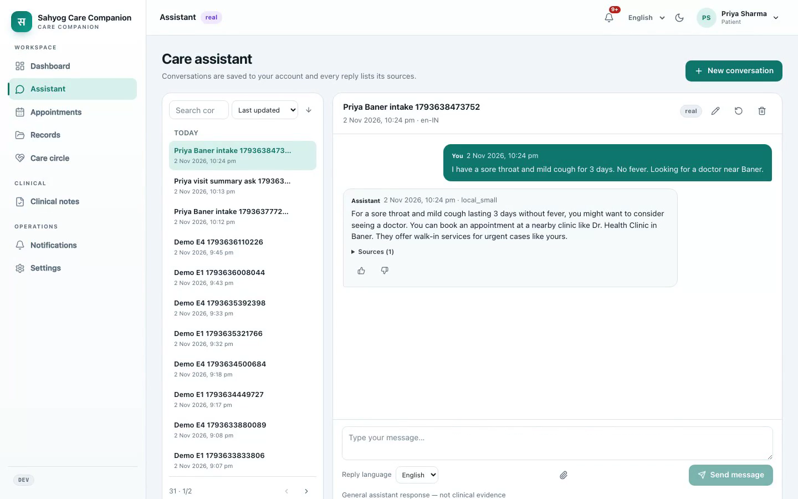
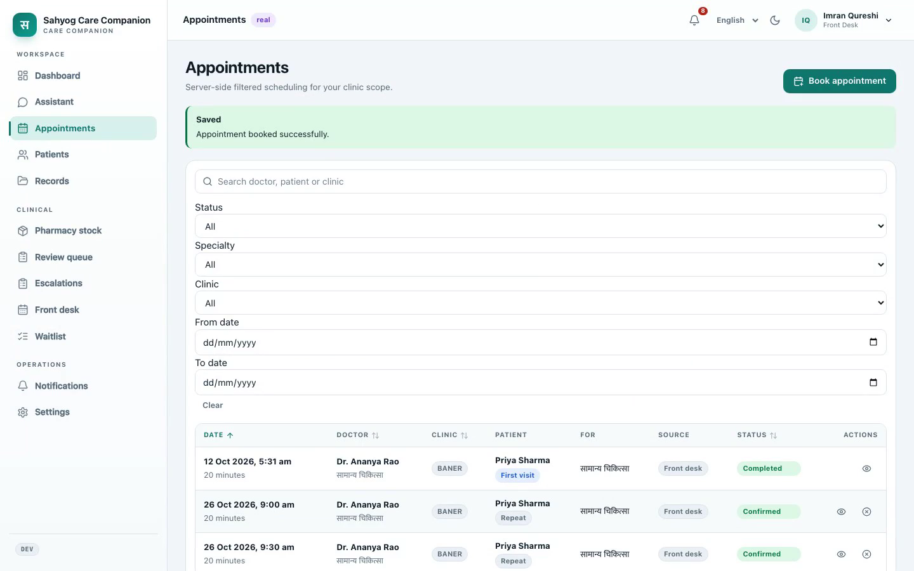
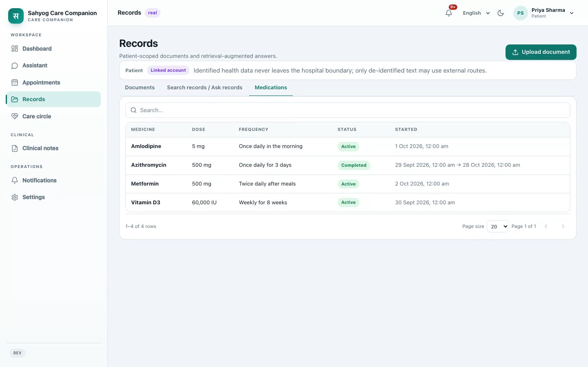
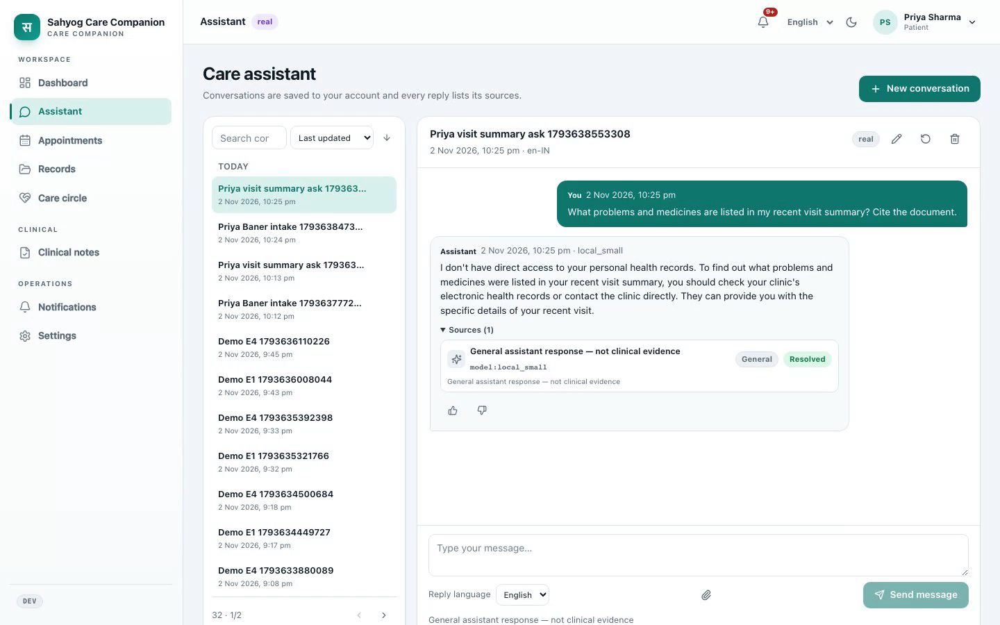
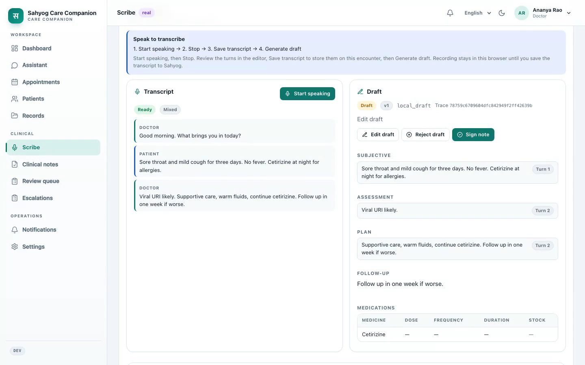
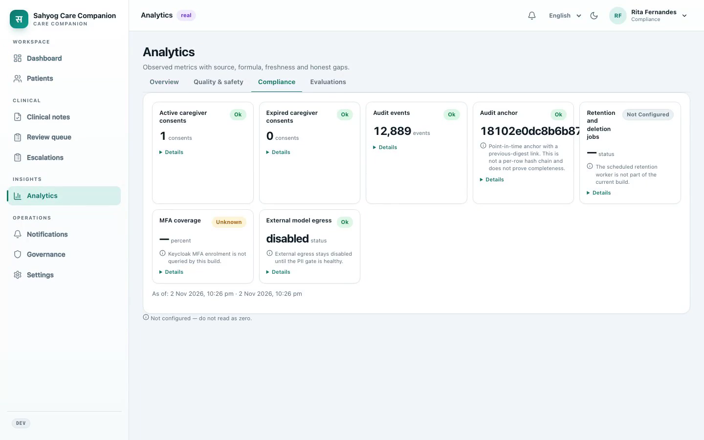
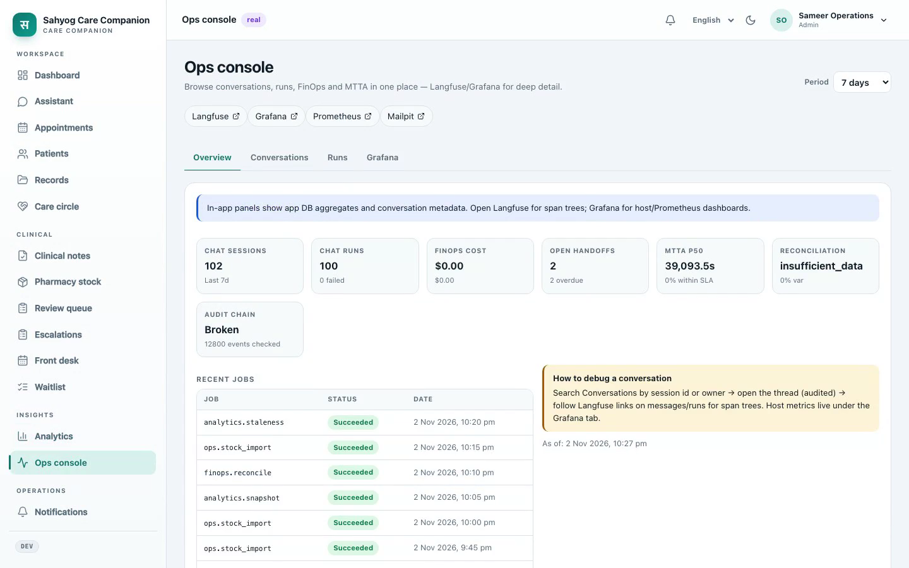
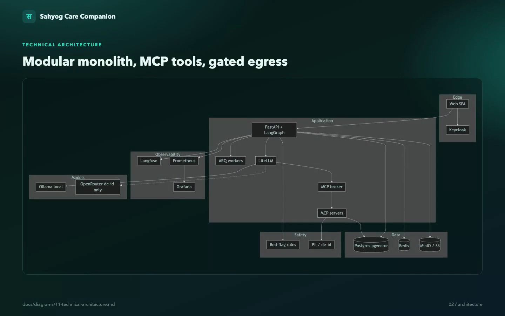
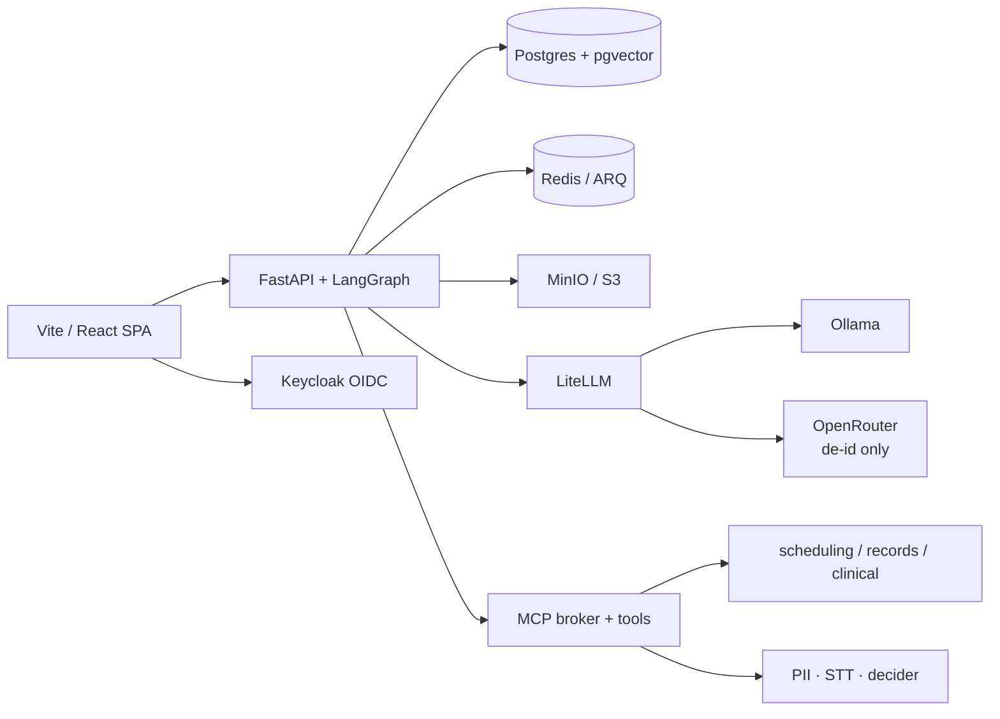

<div align="center">

# Sahyog Care Companion

A demonstration care companion for triage, booking, cited medical records, consultation notes, notifications, analytics and FinOps.

[](https://www.python.org/)
[](https://fastapi.tiangolo.com/)
[](https://react.dev/)
[](https://github.com/pgvector/pgvector)
[](https://www.keycloak.org/)
[](https://langchain-ai.github.io/langgraph/)
[](https://modelcontextprotocol.io/)

<br/>

<a href="https://youtu.be/JolTY535foc">
  
</a>

### [▶ Watch the ~7 minute demo](https://youtu.be/JolTY535foc)

Repo copy: [`docs/evidence/demo-recording/sahyog-demo-6min.mp4`](docs/evidence/demo-recording/sahyog-demo-6min.mp4) · Shot list: [`docs/demo.md`](docs/demo.md)

</div>

> **Safety.** Synthetic and public data only. Not a validated medical device. Do not load real patient data or production credentials. Identified health data stays inside the deployment boundary. Only de-identified text may reach an external model provider.

---

## Background

Sahyog Health Network is a multi-site outpatient network with high phone booking load, PDF report volume, and doctor time spent typing notes. The product is a **demonstration care companion** that shows how agent workflows, real adapters, and platform controls can support that network without claiming medical-device clearance.

| Outcome | What the product proves |
|---|---|
| Find and book | A patient describes symptoms, clears a red-flag check, and books a real slot |
| Ask my record | Answers are cited and scoped to the caller's own data |
| Scribe and sign | A doctor reviews a stock-aware draft; nothing clinical is written before signature |
| Traceable AI | Every model call and tool path is auditable; humans remain in the loop |
| Operable platform | Analytics, FinOps, notifications, flags and load evidence ship with the app |

Personas in the demo: patient **Priya**, doctor **Dr. Rao**, front desk **Imran**, caregiver **Meena**, compliance **Rita**, admin **ops**.

---

## Key features

| Feature | What you get |
|---|---|
| Role-scoped assistant | Chat for patients, staff and compliance, with server-derived identity |
| Red-flag triage | Deterministic rules before the model; fail closed to emergency guidance |
| Booking and waitlist | Public-API booking through Keycloak; front-desk override and grids |
| Records and RAG | Upload, malware scan, chunk, embed, ask with citations |
| Consultation scribe | Transcript → SOAP-style draft → edit / reject / **sign** |
| Notifications | In-app truth; email and Slack staff delivery proven; SMS optional |
| Safety boundary | Composite PII gate, egress off by default, no PHI in logs or traces |
| Analytics and FinOps | Versioned metrics, showback, budgets, advisory insights |
| Ops console | Sessions, runs, MTTA, Langfuse / Grafana / Prometheus links |
| Real adapters only | Missing credentials show `unconfigured`, never a silent mock |

---

## Product screenshots

Stills from the live demo reel. Full gallery: [`docs/assets/readme/`](docs/assets/readme/).

### Care assistant — triage and booking intake



<p align="center"><em>Patient chat with saved sessions, reply language, and a source panel on every answer.</em></p>

### Front-desk appointments



<p align="center"><em>Server-side search, sort, filter and pagination across clinic, specialty and status.</em></p>

### Patient records — medications



<p align="center"><em>Patient-scoped documents and medications. Identified data stays inside the boundary.</em></p>

### Ask my record



<p align="center"><em>Record questions must cite sources. Scope leaks are treated as defects.</em></p>

### Doctor scribe



<p align="center"><em>Transcript and draft side by side. Sign / reject are explicit human actions.</em></p>

### Analytics — compliance



<p align="center"><em>Observed metrics with freshness and honest gaps. Egress stays disabled until the PII gate is healthy.</em></p>

### Ops console



<p align="center"><em>Chat sessions, runs, FinOps, MTTA and deep links into Langfuse, Grafana and Prometheus.</em></p>

---

## Architecture



<p align="center"><em>Modular monolith + MCP tool boundary + LiteLLM model gateway. Full diagrams: <a href="docs/diagrams/">docs/diagrams/</a>.</em></p>



| Layer | Choice |
|---|---|
| UI | Vite + React + TypeScript |
| API | FastAPI modular monolith, SSE chat, LangGraph in-process |
| Identity | Keycloak OIDC in every environment |
| Data | Postgres + pgvector only · MinIO/S3 for documents and audio |
| Models | LiteLLM aliases by purpose · local Ollama default for identified paths |
| Tools | MCP servers behind a signed-context broker |
| Workers | ARQ on Redis for ingest, notify, analytics, retention |
| Observability | OTLP · Langfuse · Prometheus · Grafana |

---

## Quick start

Docker runs dependencies. The app can run in Compose or on the host.

```bash
cp .env.example .env
# Fill every required credential and change every default password.
uv sync --all-packages
npm --prefix apps/web install
./scripts/start.sh --profile minimal
./scripts/seed-users.sh
./scripts/load-data.sh --sample
./scripts/smoke.sh
```

| Surface | URL |
|---|---|
| Web | http://localhost:5705 |
| API | http://localhost:5706 |
| Keycloak | http://localhost:5707 |
| Mailpit | http://localhost:5718 |

Host reload with infra in Docker:

```bash
./scripts/start.sh --profile minimal --local
```

Host UI: http://localhost:5729 · Full guide: [`docs/setup.md`](docs/setup.md)

---

## Reference map

Pointers to the files and data that matter when you open the repo.

### Product and documentation

| What | Where |
|---|---|
| Requirements and acceptance | [`docs/spec.md`](docs/spec.md) |
| UX and agent behaviour | [`docs/design.md`](docs/design.md) |
| Runtime architecture | [`docs/architecture.md`](docs/architecture.md) |
| Delivery plan and gates | [`docs/plan.md`](docs/plan.md) · [`docs/gates/`](docs/gates/) |
| Demo script E1–E6 | [`docs/demo.md`](docs/demo.md) |
| Setup and operations | [`docs/setup.md`](docs/setup.md) |
| Known gaps | [`docs/gaps.md`](docs/gaps.md) · [`docs/evidence/ship-caveats.md`](docs/evidence/ship-caveats.md) |
| ADRs | [`docs/adr/`](docs/adr/) |
| Mermaid diagrams | [`docs/diagrams/`](docs/diagrams/) |
| Runbooks | [`docs/runbooks/`](docs/runbooks/) |
| Release notes | [`RELEASE.md`](RELEASE.md) |
| AI collaboration log | [`AI-COLLABORATION.md`](AI-COLLABORATION.md) |

### Application code

| What | Where |
|---|---|
| Web SPA | [`apps/web/`](apps/web/) |
| API and workers | [`apps/api/`](apps/api/) |
| Domain modules | [`apps/api/app/modules/`](apps/api/app/modules/) |
| LangGraph workflows | [`apps/api/app/agents/`](apps/api/app/agents/) |
| Shared Python package | [`packages/py-common/`](packages/py-common/) |
| Generated contracts | [`packages/contracts/`](packages/contracts/) |
| MCP services | [`services/mcp-*/`](services/) |
| Kubernetes overlays | [`deploy/k8s/`](deploy/k8s/) |

### Configuration and data

| What | Where |
|---|---|
| Env template | [`.env.example`](.env.example) |
| Feature flags | [`config/features.yaml`](config/features.yaml) |
| Model aliases | [`config/models.yaml`](config/models.yaml) · [`config/litellm.yaml`](config/litellm.yaml) |
| Red-flag rules | [`config/red_flags.yaml`](config/red_flags.yaml) |
| Specialties | [`config/specialties.yaml`](config/specialties.yaml) |
| Pharmacy stock CSV | [`config/stock.csv`](config/stock.csv) |
| Notifications | [`config/notifications.yaml`](config/notifications.yaml) |
| Metrics / FinOps | [`config/metrics.yaml`](config/metrics.yaml) · [`config/finops_model.yaml`](config/finops_model.yaml) · [`config/prices.yaml`](config/prices.yaml) |
| Public source inventory | [`config/data_sources.yaml`](config/data_sources.yaml) |
| Data contracts | [`docs/data-contracts/`](docs/data-contracts/) |
| Keycloak realm | [`docker/keycloak/realm-sahyog.json`](docker/keycloak/realm-sahyog.json) |

### Scripts

| What | Where |
|---|---|
| Start / stop stack | [`scripts/start.sh`](scripts/start.sh) · [`scripts/stop.sh`](scripts/stop.sh) |
| Seed users | [`scripts/seed-users.sh`](scripts/seed-users.sh) |
| Load sample / public data | [`scripts/load-data.sh`](scripts/load-data.sh) · [`scripts/load_public_sources.py`](scripts/load_public_sources.py) |
| Smoke check | [`scripts/smoke.sh`](scripts/smoke.sh) |
| Load test | [`scripts/load-test.sh`](scripts/load-test.sh) |
| Eval report | [`scripts/eval_report.py`](scripts/eval_report.py) · [`evals/`](evals/) |
| Demo recording | [`scripts/record-demo.sh`](scripts/record-demo.sh) · [`scripts/assemble-demo-reel.sh`](scripts/assemble-demo-reel.sh) |
| Test-data reset | [`scripts/reset-test-data.sh`](scripts/reset-test-data.sh) |

### Evidence and reports

| What | Where |
|---|---|
| Demo video | [YouTube](https://youtu.be/JolTY535foc) · [`docs/evidence/demo-recording/sahyog-demo-6min.mp4`](docs/evidence/demo-recording/sahyog-demo-6min.mp4) |
| README screenshots | [`docs/assets/readme/`](docs/assets/readme/) |
| Load test rollup | [`docs/evidence/load_test_report.md`](docs/evidence/load_test_report.md) |
| Matched R1 / R3 JSON | [`docs/evidence/load_test_r1_matched_20261102T004206Z.json`](docs/evidence/load_test_r1_matched_20261102T004206Z.json) · [`docs/evidence/load_test_r3_matched_20261102T004206Z.json`](docs/evidence/load_test_r3_matched_20261102T004206Z.json) |
| Chat / grid latency | [`docs/evidence/load_test_chat_latency_20261102T004206Z.json`](docs/evidence/load_test_chat_latency_20261102T004206Z.json) · [`docs/evidence/load_test_grid_latency_20261102T004206Z.json`](docs/evidence/load_test_grid_latency_20261102T004206Z.json) |
| NFR matrix | [`docs/evidence/test_report.md`](docs/evidence/test_report.md) |
| Eval report | [`evals/report.md`](evals/report.md) |
| Cost sheet | [`docs/cost-sheet.md`](docs/cost-sheet.md) |
| Deliverables register | [`docs/deliverables.md`](docs/deliverables.md) |

---

## Repository layout

```text
apps/web/            Vite + React + TypeScript SPA
apps/api/            FastAPI modular monolith and worker entrypoints
services/mcp-*/      MCP tool services behind the broker
packages/py-common/  Shared config, logging, auth, errors, telemetry, provenance
packages/contracts/  Generated API/SSE contracts
config/              Versioned non-secret configuration
evals/               RAGAS and DeepEval harnesses
deploy/k8s/          Kubernetes-ready Kustomize base and overlays
scripts/             Start, stop, seed, load, eval, backup, reset
docs/                Spec, architecture, plan, gates, evidence, assets
```

---

## Status

Pilot-shipable slices are in the repo. [`docs/gaps.md`](docs/gaps.md) v1.16 is authoritative. Short form: [`docs/evidence/ship-caveats.md`](docs/evidence/ship-caveats.md). Email and Slack staff delivery are proven. Vault and file secret backends ship. OPA is not required for this release.

<details>
<summary>Residuals still open</summary>

| Area | Gap | Residual |
|---|---|---|
| Dual-replica interrupt soak | G-46 | Same-base soak passed. Re-run with `API_A` ≠ `API_B` before an HA claim |
| Production MTTA | G-25 | Channels and a 2-minute SLA ship. MTTA needs an ops rota |
| SMS | G-06 | Optional and off by default |
| Clinical Hindi/Marathi sign-off | G-01, G-02 | Needs a named clinical reviewer |
| Hindi/Marathi speech and OCR scores | G-05 | English LibriSpeech WER only |
| Patient Slack coverage | G-07 | Needs a real opted-in population |
| ABDM certification | G-09 | Programme credentials |
| RLS / column encryption / break-glass | G-10 | Post-pilot |
| Multi-region restore | G-11 | Encrypted backup ≠ full restore drill |
| Medical-device clearance | G-12 | Attestation gate only |
| Clinician-graded nursing summary | G-13 | Live draft exists; 20 attested grades do not |
| Partner MCP | G-14 | Needs a named consumer |
| FinOps chargeback | G-15 | Needs operating history |
| Human judge agreement | G-16 | Needs an attested grade file |
| M/L capacity | G-17 | P-host runs keep `capacity_accepted=false` |
| Signed DPDP and egress | G-19 | Legal sign-off before egress on |
| Blocking supply-chain CI | G-27 | Advisory until a green blocking flip |
| Signed WCAG 2.2 AA | G-36 | Needs QA + screen reader |
| API leftovers | G-38 | Product must mark leftovers out of scope |

</details>

## Engineering rules

- Postgres with pgvector only.
- Keycloak OIDC in every environment.
- Model calls through LiteLLM aliases. Agent tools through MCP.
- Real integration adapters only. Missing credentials show `unconfigured`.
- No patient-identifying data in logs, traces, analytics or cost records.
- Server-side search, sort, filter and pagination on every grid.
- Feature flags are typed, owned, expiring and audited. Safety flags stay locked.
- No clinical effect without a named human action. Notes never auto-sign.
