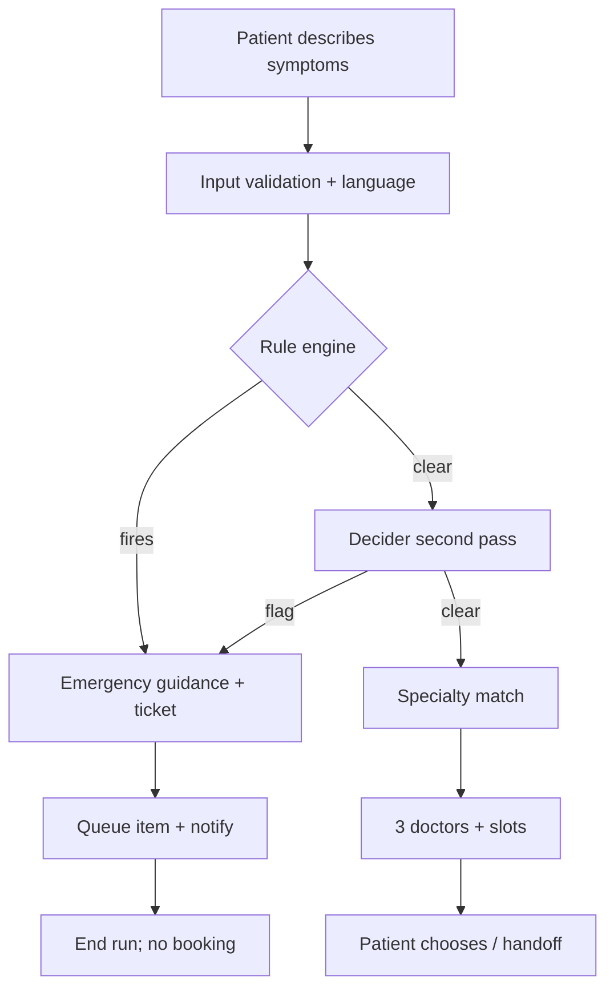
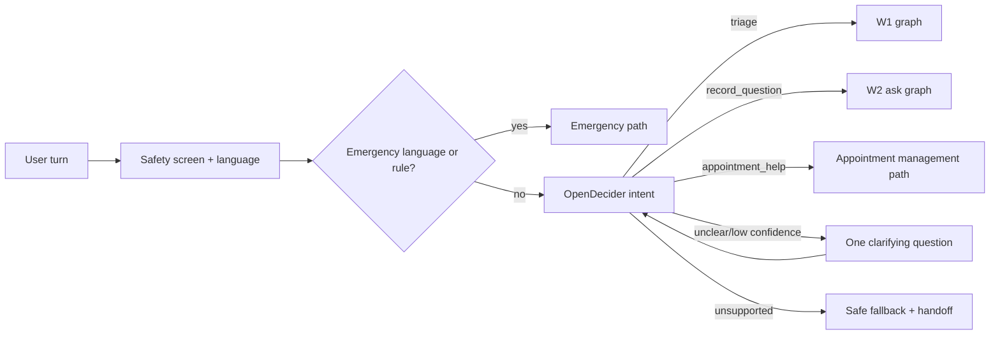
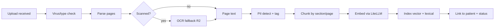
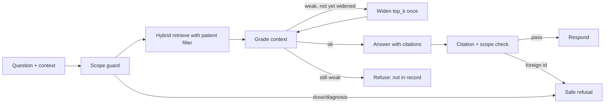
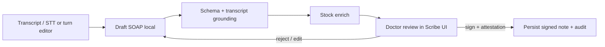

# Care Companion — Design Specification

| Field | Value |
|---|---|
| Document | `docs/design.md` — product, interaction, visual and agent-behaviour design |
| Version | 1.0 — implementation baseline |
| Date | 2026-10-25 |
| Status | Approved for implementation, aligned to [spec.md](./spec.md) 0.2 and [plan.md](./plan.md) 1.0. All personas, releases and the bounded X-01 slice are in scope. |
| Related | [spec.md](./spec.md) (requirements and acceptance) · [architecture.md](./architecture.md) (runtime and infrastructure) · [plan.md](./plan.md) · [setup.md](./setup.md) · [gaps.md](./gaps.md) |
| Review focus | Navigation and mobile behaviour, chat/session UX, doctor sign-off safety, grid behaviour, agent state machines and safety copy |

This document turns the requirements in [spec.md](./spec.md) into an interface and agent-behaviour design. It does not restate every requirement; requirement IDs are cited where a design choice satisfies or constrains one. Wireframes are structural, not pixel specifications. Final visual assets and the brand mark are placeholders until the client provides them.

**Build status.** This is the approved design target, not a description of the current binary. The delivered build covers the main R1–R3 flows; [gaps.md](./gaps.md) is authoritative for undelivered behaviour — notably the read-only FHIR adapter (G-08), X-01 (G-13), external MCP (G-14), mem0 preference memory (G-24), alert-to-runbook automation and recorded drills (G-25), human judge calibration (G-16), composite PII/de-identification (G-28), OpenDecider/Whisper models (G-29), row-level security/field encryption/break-glass (G-10), reviewed hi/mr clinical copy (G-01/G-02), the public-source data estate (G-35), WCAG/cross-browser conformance (G-36), the remaining CI/release stages (G-37) and the remaining catalogued API families (G-38). Langfuse export with agent spans (G-23), browser E2E/axe (G-26), model-generated insights with audit (G-30), LiteLLM reconciliation (G-31), upload malware scanning (G-32), the consent/care-circle lifecycle (G-33) and patient export/deletion with document download (G-34) are implemented. Where this document specifies other behaviour, read it as the design target.

## 1. Design intent

### 1.1 Principles

1. **Safety is visible, not implied.** Emergency routing, draft status, scope and consent are shown in the interface, not buried in a tooltip or a prompt. A user should be able to tell whether they are booking, asking or signing.
2. **The human owns the consequential step.** The patient chooses a slot; the doctor signs; the pharmacist decides on a substitute; the front desk can override. The system prepares evidence and options.
3. **Evidence over assurance.** Every answer has a source panel; every citation exposes document and page; every tool fact exposes its source and `as_of`; memory is labelled as a preference; every metric exposes its definition; the doctor sees exactly what changed.
4. **Deterministic first, model second.** Known rules (red flags, slot uniqueness, stock quantity, consent) are code and are shown as rules; the model handles language and structure.
5. **Calm, competent, human.** The visual language is warm and quiet, not alarmist or "AI futuristic". Clinical urgency is communicated by one clear, accessible alert, not a wall of red.
6. **One obvious next action.** Every screen has a primary action; every empty/error state has a route forward.
7. **Works on the phone in one hand.** Priya books at night; Dr. Rao may review between patients; Meena may walk the floor. Desktop density is not forced onto mobile.
8. **Accessible by construction.** Keyboard, focus, contrast, labels, live regions and reduced motion are part of the component contract, not a late audit.
9. **Private by default.** Chat content is the owner's; staff do not browse it; traces and analytics show metadata, not clinical text.
10. **No dead ends.** If the model, gateway, store or policy blocks a path, the UI offers a human hand-off or a clear explanation.
11. **FinOps is a product surface, not a PDF.** Cost per booking, answer and consultation is visible with its formula, source and date, so an operator can act before the bill arrives.

### 1.2 Experience tension and resolution

| Tension | Resolution |
|---|---|
| Speed of booking vs safety of triage | Emergency rules run before any model; the routine path stays short and the shortlist is three doctors, not a catalogue. |
| Doctor convenience vs accountability | Drafts are fast and structured, but nothing is stored as a note before the doctor signs; edits are visible and signed notes are immutable. |
| Rich admin control vs least privilege | Admins configure the system but never browse clinical content; compliance sees audit metadata. |
| Provider flexibility vs data residency | The UI shows the active model/egress context on the admin model page; clinical users see only the workflow, not vendor details. |
| Mobile vs data density | Grids become stacked cards with the same server query; desktop retains a dense table. |

## 2. Information architecture

### 2.1 Role-based app map

```mermaid
flowchart TD
  Shell[Care Companion shell]
  Shell --> Patient[Patient / caregiver]
  Shell --> Doctor[Doctor console]
  Shell --> Desk[Front desk]
  Shell --> Pharmacy[Pharmacy]
  Shell --> Compliance[Compliance]
  Shell --> Admin[Administration]

  Patient --> PHome[Home]
  Patient --> PChat[Chat + sessions]
  Patient --> PAppt[Appointments]
  Patient --> PRec[Records + citations]
  Patient --> PCare[Care circle + consent]

  Doctor --> DToday[Today]
  Doctor --> DConsult[Consultation / scribe]
  Doctor --> DNotes[Notes]
  Doctor --> DQueue[Review queue]
  Doctor --> DChat[Assistant chat]

  Desk --> DBook[Appointments + override]
  Desk --> DEsc[Escalation queue]
  Desk --> DPat[Patient lookup]
  Desk --> FChat[Assistant chat]

  Pharmacy --> Stock[Stock]
  Pharmacy --> Rx[Prescriptions from signed notes]
  Pharmacy --> PhChat[Assistant chat]

  Compliance --> Audit[Audit explorer]
  Compliance --> Consent[Consents]
  Compliance --> Incidents[Incidents]
  Compliance --> Retention[Retention evidence]
  Compliance --> CPosture[Analytics: compliance posture]
  Compliance --> CChat[Assistant chat]

  Admin --> Overview[Overview]
  Admin --> Users[Users and roles]
  Admin --> Models[Models and routing]
  Admin --> Prompts[Prompts and evals]
  Admin --> Catalogue[Data catalogue]
  Admin --> Analytics[Analytics: overview, quality, evals, FinOps, insights]
  Admin --> Telemetry[Telemetry and cost]
  Admin --> Health[System health]
  Admin --> Settings[Settings]
  Admin --> AChat[Assistant chat]
```



No route is shared silently across roles. A doctor cannot reach the admin model page; an admin cannot reach a patient's chat. If a user holds multiple roles, the navigation shows the union and the UI clearly labels the active workspace ("Clinical", "Administration").

### 2.2 Navigation

- **Desktop ≥ 1280 px:** a fixed left sidebar (248 px) with icon + label, a 64 px top bar, content area with a maximum width per screen. The sidebar can collapse to 72 px; collapsed items show tooltips and retain active-state colour and an icon.
- **Tablet 768–1279 px:** sidebar defaults collapsed; the chat session pane becomes a drawer; the citation pane can overlay.
- **Mobile < 768 px:** a top app bar with menu, title and at most two actions; sidebar becomes a modal drawer; chat sessions and citations become bottom sheets; grids become cards. The chat composer is sticky above the safe-area inset.
- **Persistent bottom items:** theme toggle, help/safety, profile. The theme control exposes Light / Dark / System in a menu, not a cycling button with no label.
- **Active state:** primary-soft background + 3 px leading indicator + bold label; never colour alone.
- **Skip link:** "Skip to main content" is the first focusable element.

| Role | Primary nav | Secondary/utility |
|---|---|---|
| Patient/caregiver | Home, Chat, Appointments, Records, Care circle | Notifications, Profile, Theme |
| Doctor | Today, Chat, Consultations, Notes, Review queue | Patient search, Profile, Theme |
| Front desk | Chat, Appointments, Escalation queue, Patients | Profile, Theme |
| Pharmacist | Chat, Stock, Prescriptions | Profile, Theme |
| Compliance | Chat, Audit, Consents, Incidents, Retention, Analytics | Profile, Theme |
| Admin | Chat, Overview, Users & roles, Models & routing, Prompts & evals, Data catalogue, Analytics & FinOps, Telemetry & cost, System health | Audit, Settings, Profile, Theme |

### 2.3 Route map

**Build status (G-33/G-34/G-38).** The delivered React app routes to `/`, `/chat`, `/appointments`, `/patients`, `/records`, `/care-circle`, `/scribe`, `/notes`, `/review-queue`, `/analytics`, `/notifications`, `/governance` and `/settings`. `/care-circle` is real: a patient grants and revokes consent, exports metadata and requests deletion; a caregiver switches context. Routes below such as `/compliance/consents`, `/compliance/audit`, `/front-desk`, `/escalations`, `/pharmacy/*` and `/admin/*` are target design: this build has no page for them and the navigation does not link to them.

| Route | Screen | Roles | Notes |
|---|---|---|---|
| `/` | Role-aware home/redirect | All | Patient home, doctor today, front-desk appointments, etc. |
| `/chat` | New or most recent chat | All authenticated | Role-scoped tools and data; creating a session is explicit; no implicit orphan sessions. |
| `/chat/:sessionId` | Chat session | Owner; caregiver with consent | 404 for non-owner; staff chats are owner-only and never expose patient chat. |
| `/appointments` | Appointments | Patient, front desk | Role-scoped columns/actions. |
| `/records` | Records list | Patient/caregiver | Server-side grid cards on mobile. |
| `/records/:documentId` | Document viewer | Authorized reader | Sandboxed preview + citation anchors. |
| `/care-circle` | Caregivers and consents | Patient, caregiver, admin | Patient grants/revokes; caregiver switches context; export and deletion request. |
| `/today` | Doctor's day | Doctor | Queue and pre-consult brief. |
| `/consult/:encounterId` | Scribe workspace | Treating doctor | Interrupt/review/sign. |
| `/notes` | Notes | Doctor | Signed/draft/review status. |
| `/review-queue` | Reviewer queue | Doctor/front desk | Role-filtered item types. |
| `/front-desk` | Appointments + override | Front desk | |
| `/escalations` | Escalation queue | Front desk | Red flags, low confidence, no slots, hand-offs. |
| `/pharmacy/stock` | Stock | Pharmacist | Stale flags. |
| `/pharmacy/prescriptions` | Prescription lines | Pharmacist | Signed notes only. |
| `/compliance/audit` | Audit explorer | Compliance | Server-side filters/export. |
| `/compliance/consents` | Consents | Compliance | |
| `/analytics` | Analytics overview | Admin, compliance | Tabs: Overview, Quality & safety, Compliance posture, Evaluations, FinOps, AI insights. |
| `/analytics/:tab` | Analytics tab | Admin, compliance | Role-filtered; compliance sees posture/quality only, admin sees operational/FinOps. |
| `/analytics/finops/export` | Showback export | Admin | Server-generated; audited; no PHI. |
| `/admin/*` | Admin pages | Admin | Each grid follows §12. |
| `/settings` | Profile/preferences | All | Theme, language, notifications per channel. |
| `/sign-in`, `/auth/callback`, `/auth/error` | Auth | Public | Keycloak redirect handling. |

## 3. Visual design system

### 3.1 Direction

The product should feel like a trustworthy clinical companion: teal/blue-green as the primary (care, calm), warm amber as a restrained accent for attention and "human review", and clear semantic colours for status. Avoid pink/magenta as a primary brand colour. Architecture diagrams may use it; the product does not. Avoid stock "robot" imagery. Typography is humanist and highly legible; data uses tabular numerals.

### 3.2 Design tokens

Tokens are CSS custom properties consumed by Tailwind and components. Values below are starting points; they must pass automated contrast checks before release.

| Token | Light | Dark | Use |
|---|---|---|---|
| `--bg` | `#F6FAF9` | `#0A1211` | App background |
| `--surface` | `#FFFFFF` | `#10201E` | Cards, panels |
| `--surface-2` | `#EDF5F2` | `#172B28` | Secondary fills, table headers |
| `--surface-3` | `#E2EEEA` | `#1F3A35` | Hover/selected soft fill |
| `--text` | `#12211F` | `#E7F1EE` | Primary text |
| `--text-muted` | `#536A65` | `#A9BDB8` | Secondary text |
| `--border` | `#D5E3DF` | `#29433E` | Borders/dividers |
| `--primary` | `#0F766E` | `#2DD4BF` | Primary actions, links |
| `--primary-hover` | `#0B5F59` | `#5EEAD4` | Hover |
| `--primary-contrast` | `#FFFFFF` | `#042F2E` | Text on primary |
| `--accent` | `#B45309` | `#FBBF24` | Human-review/attention accent |
| `--danger` | `#B91C1C` | `#FCA5A5` | Emergency/destructive |
| `--danger-soft` | `#FEF2F2` | `#3B1212` | Alert background |
| `--warning` | `#92400E` | `#FCD34D` | Caution/stale |
| `--success` | `#15803D` | `#86EFAC` | Confirmed/available |
| `--info` | `#1D4ED8` | `#93C5FD` | Informational |
| `--focus` | `#0F766E` | `#5EEAD4` | Focus ring |
| `--shadow-sm` | `0 1px 2px rgb(15 23 42 / .06)` | same with alpha | Cards |
| `--radius-sm/md/lg` | `8px / 12px / 16px` | same | Controls/cards/modals |

**Typography**

- Latin: Inter variable; Devanagari fallback: Noto Sans Devanagari. Bundle locally (no third-party font call) to avoid leaks and layout shift.
- Scale: 12 (caption), 13 (table), 14 (body small), 16 (body), 18 (section), 22 (page title), 28 (hero), 36 (marketing only). Line height 1.45–1.6.
- Numbers in grids and costs use `font-variant-numeric: tabular-nums`.
- Minimum body size 14 px on desktop, 16 px on mobile for patient-facing text.
- Never use all-caps for long labels; use sentence case, except status chips.

**Spacing, shape and motion**

- 4 px base spacing; 8/12/16/24/32/48 rhythm.
- Controls 40 px desktop, 44 px mobile; icon buttons 40×40/44×44; table row 44–48 px.
- Radius 8 px controls, 12 px cards, 16 px modals/bottom sheets.
- Motion 150–200 ms ease-out; respect `prefers-reduced-motion`; no parallax or attention-seeking loops.
- Focus ring 2 px `--focus` + 2 px offset, visible on all interactive elements.

### 3.3 Component inventory

| Component | Variants/states | Notes |
|---|---|---|
| Button | primary, secondary, ghost, danger, link; loading, disabled | Icon+label by default; icon-only only with tooltip + aria-label. |
| Icon button | default, danger, active | 40/44 px; tooltip on hover/focus; `aria-label` mandatory. |
| Input / textarea | default, error, disabled, read-only | Label above, helper below, error text with icon; no placeholder-only labels. |
| Select / combobox | single, searchable, multi | Keyboard navigation; selected chips; server-side options where large. |
| Date/time picker | date, date range, slot picker | Asia/Kolkata; disabled past dates; slot states available/held/booked. |
| DataGrid | full, compact, card-on-mobile | See §12. |
| Filter bar | chips, popover, clear-all | URL-synced; results count announced. |
| Status chip | neutral, info, success, warning, danger, muted | Text + icon/dot; never colour-only. |
| Card | default, selectable, doctor, doc, metric | Hover only when clickable; focus ring. |
| Dialog / bottom sheet | confirm, form, safety | Focus trap; Escape; labelled title; destructive confirm. |
| Toast | success, error, info; action | `aria-live`; auto-dismiss for non-critical; errors persist. |
| Banner | info, warning, danger, degraded | No auto-dismiss for safety. |
| Tooltip | label, shortcut | Hover/focus; Escape; not for essential information; 300 ms delay. |
| Tabs | underline, segmented | Arrow keys; panels labelled. |
| Timeline | messages, audit, versions | Semantic ordered list; timestamps. |
| Citation pill | inline, list, missing | Resolves to chunk; missing is an error state. |
| Source panel | inline summary, side pane, mobile sheet, empty | Lists every source type used; keyboard reachable; no source is an error state, not a blank. |
| Source badge | document, memory, tool, conversation, rule, general | Icon + text label; never colour-only; "general" is neutral, "memory" is visibly non-clinical. |
| Metric tile | value, trend, stale, unknown, suppressed | Definition, formula, source, `as_of` and freshness in an info popover; no hard-coded number. |
| Insight card | new, accepted, rejected, deferred, expired | Evidence links, impact/confidence/effort, owner, status; advisory banner; no "Apply" action. |
| Budget bar | healthy, warning 80%, stopped 100%, unknown | Remaining/period text; status icon; threshold announced. |
| Channel status | in-app, SMS, email; sent, delivered, failed, unknown | Per-channel row with attempts and retry action; no clinical content in preview. |
| SOAP editor | section, dirty, saved-to-draft | Autosave only to the run draft, never the clinical record. |
| Timer | review timer, SLA | Monospace-ish tabular; pauses on sign. |
| Empty state | action, illustration | Plain text + primary action. |
| Skeleton | row, card, chat | Matches final layout to avoid shift. |
| Avatar / identity chip | user, caregiver context | Consent expiry visible. |
| Metric tile | value, target, source, trend | Source link mandatory; no hard-coded target. |

### 3.4 Iconography

- Lucide React, 20 px default, 24 px in nav.
- Icons always paired with a label in primary nav; icon-only accepted in toolbars and row actions with tooltip + accessible name.
- Never use colour alone to indicate status: pair with a text label and, where useful, an icon.
- Custom clinical icons (stethoscope, pill, file-text, shield, activity) only if they remain legible at 20 px.

## 4. Layout and responsive behaviour

### 4.1 Desktop shell

```
┌───────────────┬────────────────────────────────────────────────────────────┐
│ Brand         │ Top bar: page title · search/context · notifications · user│
│ ───────────── │                                                            │
│ Home          │  Main content                                              │
│ Chat          │                                                            │
│ Appointments  │                                                            │
│ Records       │                                                            │
│ Care circle   │                                                            │
│               │                                                            │
│ Theme / Help  │                                                            │
└───────────────┴────────────────────────────────────────────────────────────┘
```

- Sidebar 248 px expanded, 72 px collapsed; a collapse control is at the bottom and its state is persisted per user.
- Top bar 64 px: page title + breadcrumb, context chip (patient/caregiver or clinic), quick search (admin/staff only), notification bell, theme menu, profile menu.
- Content padding 24–32 px; grids use full available width up to 1440 px; reading answers use a max width of 760 px with a citation pane beside.
- On routes with a secondary panel (chat sessions, citations), the content uses a 3-pane grid: 280 px sessions | flexible conversation | 360 px context/citations. The citation pane collapses to a drawer below 1280 px.

### 4.2 Mobile shell

```
┌──────────────────────────────┐
│ ☰  Chat            ＋   ⋯   │  App bar
├──────────────────────────────┤
│ Session title / context chip │
│                              │
│ Messages                     │
│                              │
│ [card / alert / citation]    │
│                              │
├──────────────────────────────┤
│ Ask anything…          [➤]   │  Sticky composer
└──────────────────────────────┘
```

- Drawer navigation from the menu button; focus trapped; close on route change and Escape.
- Sessions button opens a full-height bottom sheet/drawer with search, new chat and list; selecting one closes it.
- Citation opens a bottom sheet with source snippet and "Open record"; the sheet can be dismissed without losing the chat.
- Grids become `<article>` cards with the primary fields and an overflow menu; filters open in a sheet; pagination uses "Load more" + result count but still calls the server.
- The composer is sticky; safe-area padding; keyboard does not cover the send button. Send is disabled while empty; stop appears while streaming.
- Tables that must remain dense (admin) can scroll horizontally inside a labelled container with a sticky first column, but patient-facing screens must not require horizontal scrolling.

### 4.3 Breakpoints

| Name | Width | Behaviour |
|---|---|---|
| `sm` | < 640 | Single column, cards, drawer, bottom sheets |
| `md` | 640–1023 | Two columns where useful; session pane as overlay |
| `lg` | 1024–1279 | Collapsed nav, chat two-pane + citation overlay |
| `xl` | 1280–1535 | Full nav, chat three-pane |
| `2xl` | ≥ 1536 | Max-width content, wider grids |

### 4.4 Theming

- `next-themes` with `attribute="class"`, `defaultTheme="system"`, `enableSystem`, no flash via an inline pre-hydration script that reads the persisted preference.
- Tokens are CSS variables on `:root` and `.dark`; components never use raw hex values.
- The theme menu has three labelled options with icons and a check mark; the trigger has an accessible name ("Theme: system").
- Print (optional R2): signed note and citation pages use a light, print-safe stylesheet.
- User preference is stored in local storage; no PHI is stored alongside it.

## 5. Entry, authentication and first-run

### 5.1 Sign-in screen

- A quiet, single-column screen: wordmark, one sentence ("Care that stays with you."), primary button "Continue with Sahyog ID", secondary "Need help signing in?".
- No patient data, no email enumeration, no model claims, no emergency instructions here; emergency guidance belongs in the chat/triage flow.
- On redirect: a full-page skeleton and polite "Signing you in…" announcement.
- Errors: "We could not sign you in. Check your connection or contact the front desk." with a retry and a reference code. Never show raw Keycloak errors.
- After sign-in, if the patient record is not linked: a dedicated state explaining that the care team must link the account, with a support reference; no empty record views.

### 5.2 First-run consent and disclosure

On the first patient sign-in, show a concise, scrollable notice before chat:

- What the assistant can do (route to a specialty, book, answer from your records, prepare a draft for your doctor).
- What it cannot do (diagnose, prescribe, replace a doctor, handle emergencies alone).
- How data is used (model calls are de-identified for external providers; local processing for identified paths; traces exclude clinical content).
- Consent to AI processing and record Q&A, with a link to the full notice and a "Not now" exit that leaves the account usable but disables AI features.
- This is a product flow, not a legal substitute; the compliance owner approves the final notice (Q-15).

### 5.3 Account and preferences

- Profile: display name, role, clinics (read-only), language preference, theme.
- Notifications: per-event in-app/SMS/email preferences, masked verified phone/email with add/verify, quiet hours for optional channels; essential in-app safety and booking notifications are always on.
- Memory: a plain-language explanation of what the assistant remembers (preferences only), with "Forget this" on individual items and "Forget everything"; clinical facts are never stored as memory. The list shows scope and last used.
- "Sign out" clears tokens, query cache, local UI state and any in-memory chat; it returns to sign-in.
- No "switch user" shortcut that leaves another user's data on screen; in a shared front-desk device, an inactivity lock (configurable) masks content.

## 6. Patient experience

### 6.1 Home

Purpose: one place to start, resume and see what is next.

- Greeting with the patient's preferred name and time-of-day.
- Primary card: "What do you need today?" with actions: "Book a doctor", "Ask about a report", "Upload a report".
- Upcoming appointment card (date/time, doctor, clinic, source, cancel/reschedule).
- Recent records (last three) with status; "View all".
- Care circle summary if consents exist.
- A persistent, quiet emergency note: "For a medical emergency, call 112 or go to the nearest emergency department." It is not a chat answer and never blocks the page.
- If the LLM gateway is degraded, a banner: "The assistant is temporarily unavailable. You can still view appointments and records; the front desk can help." Do not hide booking/manage actions.

### 6.2 Chat

#### 6.2.1 Structure

```
┌─────────────┬───────────────────────────────────────────┬───────────────┐
│ Sessions    │ Chat header: title · context · actions    │ Sources · 4   │
│ [Search]    │                                           │               │
│ [+ New chat]│ User message                              │ Records 2     │
│ Today       │ Assistant message with citations [1][2]   │  Report · p4  │
│  · Knee…    │ ┌ Tool activity: checked availability ┐   │ Clinic tool 1 │
│  · Report…  │ └ 3 doctors available               ┘   │  Slots · 10:42│
│ Earlier     │ Slot picker / booking card / red alert    │ Memory 1      │
│  · …        │                                           │  Prefers …    │
│             │ Composer                                  │ General 1     │
└─────────────┴───────────────────────────────────────────┴───────────────┘
```

- **Session pane:** search, "New chat", grouped by Today / Previous 7 days / Earlier, each item showing title, last activity and workflow icon. A paginated "Load more" uses the server. A three-dot menu has Rename and Delete. No message preview by default (privacy on shared screens); an optional preview is a setting.
- **Header:** title (editable inline via Rename), context chip ("For you" or "Viewing for Asha — consent until 12 Nov"), workflow indicator if routed, and a menu (rename, delete, export? — export is R2).
- **Context chip is mandatory for caregivers**: tapping it opens the consent sheet with scope and expiry. Switching patient context in the same session is discouraged; the UI asks whether to start a new session to avoid mixing memory.
- **Composer:** auto-growing textarea (max ~6 rows), attach button opens the upload flow, send icon; no "voice" button until STT is productized. A short non-diagnostic line sits below: "This assistant can help you find care and understand your records. It cannot diagnose or prescribe." It is visible, not a link-only disclaimer.
- **Streaming:** assistant message shows a subtle typing indicator and a Stop button; text streams with a live region announcing chunks politely; on completion, focus stays in the composer and a "Answer complete" announcement occurs once.
- **Citations:** inline superscript pills after claims; clicking opens the Sources pane at that chunk. If a citation is missing or unresolved, the answer is blocked and replaced with the safe fallback (see §11.4). The Sources pane is assembled from the run's `sources.resolved` event, not from the model's prose.
- **Source status is mandatory:** every assistant message carries a source summary with at least one status — `record`, `tool`, `memory`, `conversation`, `rule`, `general` or `none`. A message cannot render without it; a contract test fails the build if the field is omitted.
- **Tool activity:** collapsed summary ("Checked 3 doctors' availability" / "Searched your records"), expandable to show tool name/status/duration and the data `as_of`; never show raw arguments or PHI.
- **Feedback:** thumbs up/down under each assistant answer; down opens a small form ("What went wrong?" with categories: wrong, not from my records, unsafe, hard to understand, other). Negative feedback creates a review item; no staff sees the chat content by default.
- **Attachments in chat:** the paperclip opens a record-upload dialog and, after indexing, inserts a system notice "Report added to your records" with a link; it does not dump the PDF into the transcript.
- **Session deletion:** confirm modal explains immediate hide + 30-day purge of messages/checkpoints/memory, audit metadata retained. Delete is disabled while a response is streaming until Stop is pressed.

#### 6.2.2 Source panel

Every agent interaction answers "where did this come from?" in the same visual language, whether it is a chat answer, a doctor shortlist, a booking card or a SOAP draft.

| Type | Badge and section label | Meaning | Panel behaviour |
|---|---|---|---|
| `document` | "From your records" | A retrieved chunk from a document the caller may read. | Citation `[1]`, title, page/section, "Open record" (sandboxed viewer at that page), resolved hash. |
| `tool` | "From clinic systems" | Scheduling, stock, formulary or demographics returned by an MCP tool. | Tool display name, result summary, `as_of`/fetch time, stale badge if beyond threshold; no raw payload or arguments. |
| `memory` | "Remembered preference" | A non-clinical preference from mem0, e.g., preferred clinic or language. | Shows the preference, its scope and "Forget"; never appears as a clinical citation or in a record list. |
| `conversation` | "Earlier in this conversation" | A prior turn in the same session that the answer refers back to. | Turn link and timestamp; no cross-session or cross-patient reference. |
| `rule` | "Safety rule" | A deterministic decision such as a red-flag rule or booking guard. | Rule ID, rule-set version and outcome; used to explain a stop or hand-off. |
| `general` | "General guidance — not from your records" | Model knowledge with no retrieved record or tool source. | Always visible when no record/tool source exists; carries the non-diagnostic reminder; never presented as a record fact. |

**Panel rules**

- The panel opens from a disclosure under the answer ("4 sources · 2 records") and from any inline citation. On desktop it is the right pane; below 1024 px it is a bottom sheet.
- Order is records → clinic systems → safety rules → conversation → memory → general. Within records, citation order matches the inline pills. Tool items use `T1`, memory `M1`, general `G` so they can never be confused with a document citation.
- The header states the count by type and the run's `as_of`. A source with an unresolved citation is an error item; the answer is blocked, not displayed with a dangling link.
- A tool failure produces a hand-off card with "Availability service unavailable", not a sources panel that implies a result. A stale tool result says "as of 09:40 — may have changed" and never claims live availability.
- The memory item is visibly non-clinical: muted styling, "Preference, not medical evidence" helper text, and a "Forget this" action that deletes the memory and records the deletion. If the user has memory off, no memory section appears.
- If only general knowledge was used, the panel says "No record or clinic source was used for this answer" and the message carries "General guidance — not from your records". This is a valid state, not an error, but it cannot be styled like a cited record answer.
- Caregiver context filters the panel to the consent scope; a source from outside the active scope is a blocking error and an incident, never a hidden item.
- The doctor's SOAP draft uses the same badges at line level: transcript span, formulary, stock tool, or `[doctor to specify]` (unsourced). The source map is attached to the draft revision, not the signed clinical note.
- The panel is content, not telemetry: analytics records source-type counts and resolution status only.

**Accessibility and mobile**

- The disclosure is a button with `aria-expanded` and `aria-controls`; focus moves to the panel heading when opened, Escape closes it and returns focus to the trigger.
- Sources are a labelled list with type in text (not only an icon); citation pills have accessible names ("Source 1, report page 4").
- On open, a polite live region announces "4 sources: 2 records, 1 clinic system, 1 preference"; it does not re-announce on re-render.
- At 360 px the panel is a full-height bottom sheet with a sticky close control, body scroll contained, and no horizontal scroll; the source text wraps and the page link remains 44 px.
- In high-contrast and dark themes the badge borders and muted memory text still meet contrast; source type is never conveyed by colour alone.

#### 6.2.3 Message types

| Type | Appearance and behaviour |
|---|---|
| `user` | Right-aligned bubble; plain text; timestamp; status (sent/failed with retry). |
| `assistant` | Left-aligned, wider; Markdown-safe rendering (no raw HTML); inline citations; source summary/disclosure; feedback; copy action. |
| `system_notice` | Centered, muted; e.g., "Report indexed" or "This conversation was moved to the front desk." |
| `tool_activity` | Inline collapsible row under the assistant turn; status icon and summary, tool name, `as_of`; not raw JSON. |
| `doctor_options` | Three doctor cards with specialty, clinic, languages, next slot; "Why this match?" disclosure; clinic-source badge and fetch time. |
| `slot_picker` | Date rail + time chips; unavailable states; hold countdown if a slot is held; clinic-source badge; keyboard accessible. |
| `booking_confirmation` | Summary card: doctor, date/time, clinic, reference, in-app/SMS/email status, add-to-calendar (R2), cancel/manage. |
| `red_flag` | Full-width danger card with emergency copy, 112, emergency-desk reference and callback confirmation; no booking controls. |
| `handoff` | Info card: who will contact you, reference, SLA, and "What you can do now". |
| `consent_prompt` | Scope + expiry + approve/deny; blocking only for the action that needs it. |
| `error` | Inline error with retry and support reference; if generation failed, the partial text is marked incomplete. |

#### 6.2.4 Session title

- Generated after the first assistant turn by the small model alias, not the decider.
- Input is first scrubbed by the PII service; if detection is uncertain, use a neutral fallback: "Health question", "Appointment help", "Report question".
- Max 60 characters, sentence case, no quotes; user can rename.
- Titles are stored in the session row and displayed in the session list; they are not sent to analytics.

### 6.3 Appointments

- **Desktop:** server-side grid with columns: date/time, doctor, specialty, clinic, status, source (assistant/front desk), actions (view, cancel, reschedule). Default sort soonest first; filters status/date/clinic; search doctor/specialty.
- **Mobile:** cards grouped by Upcoming / Past; cancel/reschedule in an overflow sheet; confirmation is explicit.
- **Empty:** "No appointments yet" + Book a doctor.
- **Cancellation policy:** copy states notice period; if blocked, explain and offer front-desk contact; never silently cancel.
- **Reschedule:** opens a slot picker for the same doctor/clinic by default; "Choose another doctor" is a secondary path; the old slot is released only after the new booking succeeds (hold-then-commit).
- **Front-desk actions:** override/cancel are available from the grid with an audit reason dropdown (assistant error, patient request, doctor unavailable, other); nothing is deleted.

### 6.4 Records

- **List:** cards on mobile, grid on desktop: name, type, uploaded, status, pages, source (upload), consent. Search by name; filter status/type/date. A failed upload shows a retry and a reason.
- **Upload:** a modal/drawer with drag-drop or file picker; accepted types and max size stated before selection; AI-processing consent/disclosure; upload progress; then "Preparing your report" with status polling; success shows "Ready to ask about" and a link into chat with the document context. Errors: unsupported type, too large, scan failed, parse failed, malware scan failed. No silent failure.
- **Viewer:** a safe preview (sandboxed PDF renderer or extracted page text) with zoom; page navigation; show OCR-derived pages; "Ask about this report" opens a chat with the document selected; citations deep-link to the page.
- **Delete:** confirm with consequences; deletion removes the document and derived index; audit metadata retained.
- **Caregiver view:** a banner states whose record is open and the consent expiry; actions the caregiver cannot take (delete, share) are hidden, but the data is also blocked server-side.

### 6.5 Care circle and consent

- List of caregivers: name, scope (records, appointments, chat), granted, expires, status.
- Invite dialog: caregiver email/phone, scope checkboxes with plain-language explanations, expiry (7/30/90 days/custom), purpose. The patient must confirm; an invitation alone does not grant access until the caregiver accepts and the consent is active.
- Revoke is immediate and prominent; a confirmation explains what stops immediately.
- Caregiver context is visible everywhere; no silent access.
- Consent history is visible to the patient (and to compliance for audit), including revoked/expired rows.

### 6.6 Notifications

In-app, SMS, email and Slack are separate channels behind one notification record. In-app is the source of truth; SMS, email and Slack are best-effort copies that never carry clinical detail and never determine whether the underlying action succeeded. Slack has two audiences with separate workspaces: staff operations, and patients who explicitly opt in with a verified Slack identity.

| Event | In-app | SMS | Email | Staff Slack | Patient Slack | Content rule |
|---|---:|---:|---:|---:|---:|---|
| Booking confirmed / changed / cancelled | Required | Opt-in | Opt-in | — | Opt-in | Reference, doctor, date/time, clinic; no specialty, reason or diagnosis. |
| Reminder | Required | Opt-in | Opt-in | — | Opt-in | Time and clinic only. |
| Report indexed / upload failed | Required | — | Opt-in | — | Opt-in | "Your report is ready" or "Upload failed"; no filename or content. |
| Caregiver invitation / consent expiring | Required | Opt-in | Opt-in | — | Opt-in | Generic invitation or expiry date; no patient clinical detail. |
| Note signed (patient copy) | Required | — | Opt-in | — | Opt-in | "A note is available"; link requires sign-in. |
| Emergency hand-off | Required | — | — | Staff alert (allowlisted) | — | Ticket ID, clinic, triggering rule IDs and SLA only; no patient contact or clinical detail; the authenticated queue is the destination. |
| Admin/clinical operational alerts | Required (role) | — | Opt-in for ops | Staff alert (allowlisted) | — | Metrics, status and IDs only; no patient data. |

- **Notification centre (bell):** unread count; grouped Today/Earlier; items show type, short text, timestamp and channel status; "Mark read" and a link to the relevant screen. It is keyboard reachable and announces new items politely, not on every poll.
- **Preferences (Settings → Notifications):** in-app is always on for essential safety/booking events; SMS, email and patient Slack are per-event opt-ins. The user sees masked verified contacts, can add/verify a phone, email or Slack identity, and can change language. Optional quiet hours suppress non-urgent copies but never the in-app record. Staff Slack is assigned by role and workspace, not exposed as a patient preference.
- **SMS templates:** one segment where possible; reference, doctor display name, date/time, clinic; no diagnosis, specialty, document name, medicine, note text or free-text reason. A STOP/help instruction is included where the provider supports it.
- **Email templates:** minimal, responsive, plain-text alternative, no attachments, no clinical detail in subject or preview. Any link requires sign-in and lands on the relevant authorized screen; no access token, PHI or direct object URL is embedded. The sender identity and reply-to are configured; authentication (SPF/DKIM/DMARC) is an operational requirement for a real domain.
- **Staff Slack:** one verified staff workspace, an allowlisted channel per alert class and an explicit staff-user mapping. The message contains an alert type, ticket/reference ID, clinic, SLA and an authenticated app link; no patient name, contact, diagnosis, document or note text. An unmapped/disabled user produces no channel-wide `@channel`/`@here` fallback; the in-app queue remains the source of truth.
- **Patient Slack (opt-in):** a separate patient workspace, an explicit per-event preference and a verified Slack user ID captured at onboarding or in Settings. Messages are neutral ("A new message is available in Sahyog" / "Appointment reminder: 12 Nov, 10:30, Baner clinic") with an authenticated sign-in link and no clinical detail. A patient recipient can never resolve to a staff channel; an unverified or disabled identity fails closed with no channel-wide fallback.
- **Delivery status:** each channel, including both Slack audiences, shows `queued`, `sent`, `delivered`, `failed` or `unknown`, with attempt count and a safe error category (invalid contact, provider timeout, suppressed, bounced, unmapped user, channel not allowlisted). Retry is explicit for failed SMS/email/Slack; a retry never duplicates the booking or note.
- **Failure behaviour:** a failed SMS, email or Slack copy does not roll back the booking, signature or record action; the in-app confirmation remains, and staff see the failure in the notification delivery grid. Repeated failures raise an operational alert, not a patient-facing error loop.
- **Consent and verification:** a caregiver notification follows the active consent scope; an unverified or revoked contact is never used; a consent expiry stops non-essential messages immediately. Notification preferences and Slack identity changes are audited.
- **Privacy:** delivery records store a recipient reference, channel, audience, template ID, status, attempts and timestamps — never the rendered body or clinical content. SMS/email/Slack content is excluded from analytics and traces.
- **Accessibility:** status is text plus icon (not colour alone); the preference form has labels and error text; the notification list is an ordered list with a heading; email templates use semantic headings and sufficient contrast.

## 7. Doctor experience

### 7.1 Today

- Greeting, clinic, date; "Next appointment" card with start time, patient initials/ID (not full clinical detail), reason for visit, and a "Start consultation" action enabled near the appointment.
- Queue: time, patient, reason, status (waiting, in consultation, note pending); no-show/cancel markers.
- Pre-consult brief: recent records, allergies? (only if data exists), last signed note (with version/time), current medicines from signed notes. All links are permission-checked and audited.
- Empty state: no appointments; a link to notes.

### 7.2 Consultation / scribe workspace

This is the highest-risk screen. The layout keeps evidence, draft and controls visible without crowding.

```
┌──────────────────────────────────────────────────────────────────────────┐
│ Back · Priya S. · 34 · Appointment 10:20 · Review timer 00:42  [Audio ●] │
│ Banner: Draft — not part of the patient record until signed              │
├───────────────────────────┬──────────────────────────────────────────────┤
│ Transcript                │ SOAP draft                                    │
│ [Doctor 00:00] …          │ S: …  [Transcript 00:00–00:12]                │
│ [Patient 00:07] …         │ O: …  [Transcript 00:07]                      │
│ [Doctor 00:15] …          │ A: …  [Transcript 00:15]                      │
│                           │ P: …  [doctor to specify]                     │
│ Audio player / upload     │ Medicines: Atorvastatin 10 mg — stock 240     │
│                           │ [Formulary] [Stock · 09:40]                   │
├───────────────────────────┴──────────────────────────────────────────────┤
│ Patient context (collapsible)                                            │
│ [Reject…]                                          [Sign and save note]  │
└──────────────────────────────────────────────────────────────────────────┘
```

- **Header:** patient display name/ID, age/sex if available, appointment time, review timer (starts when the draft is presented, pauses on sign/reject and on explicit pause), audio status.
- **Draft banner:** amber, persistent, text "Draft — not part of the patient record until signed." It must disappear only after a successful signature and be replaced by "Signed at 10:42 · Version 1".
- **Transcript pane:** speaker turns with timestamps, search, and a "jump to audio" control (R2 optional); an editable transcript is not allowed in R2 to preserve evidence; corrections can be noted in doctor comments. If audio is not available, upload a transcript with a clear "manual transcript" label.
- **SOAP editor:** four sections, auto-growing; field-level counts; every A/P line and medicine shows a source chip — transcript turn/span, formulary, stock tool (`as_of`) or `[doctor to specify]`. An unsourced line is visibly bracketed and cannot pass the grounding check as if it were sourced. A "Why this line?" disclosure opens the evidence rail with the transcript span (highlighted, scroll-to-turn) and any tool result. The source map is saved with each draft revision.
- **Stock flags:** per medicine: name/composition, requested form/dose, clinic, quantity, source (CSV/API), `as_of`, stale warning, alternatives list (informational only). A green flag says "In stock"; amber "Low"; red "Not available"; grey "Unknown/stale". The system never selects a substitute; "Check another medicine" is a human action. The stock chip in the draft opens this evidence, not a model explanation.
- **Review interactions:** edit any SOAP field; the edit history captures field-level diffs; "Reject" requires a comment and offers categories (wrong content, missing content, unsafe, template, transcription); rejecting resumes the graph with comments; previous draft remains accessible for comparison.
- **Sign action:** opens a modal with a final summary, a checkbox/typed attestation ("I reviewed this note and confirm it reflects the consultation"), the version count, and a warning that signing locks the note. Signing requires an explicit click; no keyboard shortcut that bypasses the modal. After signing, show the immutable note, version, timestamp, stock flags at sign time and a "patient notified" status.
- **Timeout/leave:** if the doctor navigates away, the draft stays in the review queue and the run remains resumable; a warning shows the parked state. Nothing is auto-signed.
- **Accessibility:** the editor is a form with labels, not a contenteditable mystery; stock status text is announced; the timer does not steal focus; keyboard order follows transcript → draft → actions.

### 7.3 Notes

- Grid: date, patient, status (draft/review/signed), version, review time, signed at; filters status/date/patient; search patient/note ID.
- Signed note view: read-only SOAP + signature block + version history + audit link (for compliance) + patient notification status.
- Draft/review rows link back to the consultation workspace if the doctor owns it; otherwise show "Owned by Dr. X" and no edit.
- Amendment: "Create correction" follows the documented policy introduced in R2, creates version n+1 with a reason, and never edits v1.

### 7.4 Review queue

- Item types: note timeout, rejected draft, red-flag hand-off, low-confidence triage, negative answer feedback, tool failure, scope guard block.
- Columns: type, priority, patient/context (minimum necessary), created, SLA due, owner, status; filters and server-side pagination.
- Claiming an item is explicit and time-boxed; resolving requires a disposition and feeds an eval case. Compliance can see queue metrics but not clinical content by default.

## 8. Front desk, pharmacy and compliance

### 8.1 Front desk

- **Appointments grid:** columns date/time, patient, doctor, specialty, clinic, status, source, created by; filters date range/status/clinic/source; search patient/doctor/reference; actions view, override, cancel, reschedule.
- **Override:** a dialog requires a reason and shows the assistant's original action; the appointment is updated, not deleted; the audit event includes the reason.
- **Escalation queue:** red flags (top), low-confidence hand-offs, no-slot requests, patient callbacks; each has contact, reason, created, SLA and a "Claim" action. The red-flag item must show the rule IDs and the emergency-desk ticket.
- **Patient lookup:** demographics only for booking; no clinical notes or documents. A "Need clinical access?" explanation points to the right role.
- **No-slot:** the desk can search other clinics/dates; the assistant's escalation reason is visible.

### 8.2 Pharmacy

- **Stock:** grid of medicine/composition, clinic, quantity, price, `as_of`, source, stale flag; filters clinic/staleness/search; server-side. An import status shows the last CSV/API refresh and errors.
- **Prescriptions:** lines from signed notes only; patient, doctor, medicine, dose/instructions, stock status at view time; no substitution action. A note that says "doctor to specify" is visibly incomplete and cannot be dispensed from this screen.
- **Staleness:** if `as_of` exceeds the configured threshold, the row is amber/grey and says "Stock may have changed — verify physically." The assistant may say "in stock as of…" but never guarantee.

### 8.3 Compliance

- **Audit:** server-side grid of time, actor, role, action, resource type/ID, purpose, consent ID, trace link; filters date/actor/role/action/resource; export CSV/JSON (R1 export may be async). One query for "who saw record X"; a saved query is a link.
- **Consents:** active/expired/revoked; grantor, grantee, scope, purpose, expiry; audit link.
- **Incidents:** severity, type, status, owner, linked trace IDs; a scope-leak incident is automatically created and cannot be dismissed without a disposition.
- **Retention evidence:** last audio purge run, last checkpoint purge, object counts, failures; exportable.
- **Analytics → Compliance posture:** consent coverage and expiry, audit-chain verification, retention job status, MFA coverage, access-review status, egress policy, open incidents and evidence links. An unknown or overdue item is amber/"unknown", never green. The view links to the audit/consent/incident records but does not expose note or chat bodies.
- **No clinical content browsing:** the audit row shows resource IDs, not note text; analytics shows counts and status, not patient-level rows. The compliance chat is limited to policy, evidence and aggregate questions; it cannot retrieve a note or transcript (`D-28`).

## 9. Admin and analytics experience

### 9.1 Analytics and FinOps workspace

Analytics is a first-class workspace, not a set of vanity tiles. It answers four questions in one place: is care safe, are we compliant, is the product working, and what does it cost per outcome.

**Layout and filters**

- A page header with the reporting window (Today / 7 days / 30 days / 90 days / custom), clinic, workflow, and model/provider where relevant. Filters are URL state and apply server-side to every tab.
- A freshness strip shows `as_of`, the last successful refresh and any stale metric; stale or unknown values are visibly labelled, never rendered as zero.
- Tiles open a definition drawer: metric ID and version, plain-language definition, formula, source tables/events, owner, refresh cadence, known caveats and a drill-down link. A tile without a definition does not ship.
- Small-cell suppression is explained in the UI: counts below the configured threshold show "<5" or are rolled up; the rule itself is visible in the definition.
- A "Refresh" action queues a snapshot and shows progress; finance views do not silently auto-refresh under a reviewer, so the number on screen is the number being discussed.
- Mobile stacks tiles and charts; every chart has an accessible "View as table" alternative and a text summary of the trend.

**Tabs**

| Tab | Primary questions | Contents | Role |
|---|---|---|---|
| Overview | Are people using it, and where do they drop? | Active users by role/clinic, sessions, messages, bookings, uploads, cited-answer rate, hand-off rate, workflow p95, error rate, adoption funnel, top failure reasons. | Admin (compliance sees a reduced, aggregate view) |
| Quality & safety | Is care safe, and are guardrails holding? | Red-flag firings and rule-set version, missed-red-flag eval status, scope leaks (must be 0), PII egress blocks, citation/grounding failures, unsafe-intent refusals, review-queue depth and SLA, open incidents. Zero-tolerance measures are counts and status, never averaged into a green score. | Admin, compliance |
| Compliance posture | Can we evidence control? | Consent coverage/expiry, audit-chain verification and last check, retention and deletion job results, MFA coverage, access-review status, egress-policy status, open compliance incidents, evidence links and export. | Admin, compliance |
| Evaluations | Is quality meeting the bar? | Suite/run pass/fail, RAGAS faithfulness/answer relevancy/context precision/context recall, deterministic safety metrics, judge calibration (κ and sample count), failing synthetic case IDs, trend, run provenance (framework/version, dataset hash, judge alias/prompt, git SHA) and immutable report link. | Admin (compliance read) |
| FinOps | What does each outcome cost, and what should we do? | Spend by workflow/model/provider/clinic, budget bars and remaining, cost per booking/answer/signed note/consultation/active user, tokens per outcome, run-rate forecast with assumptions and confidence, anomalies, fallback/cache savings, LiteLLM reconciliation, showback export. Formula, price version, USD/INR rate and date are always visible. | Admin |
| AI insights | What should we improve next, and why? | Ranked advisory opportunities with evidence links, expected impact, confidence, effort, owner, status and expiry; filters by area, impact and status; history of accepted/rejected/deferred items. | Admin, compliance |

**Metric tile contract**

- Value uses tabular numerals and a stated unit; a delta is shown only when a comparable previous window exists, with the window named.
- Status is text + icon; a red tile says "0 scope leaks — target 0", not a red square with no label.
- A tile links to the underlying server-side grid or filtered view; drill-down respects the viewer's role and never reveals patient content.
- Forecasts show a range and assumptions, not a single false-precision number; currency shows USD accounting and INR display with rate/date.
- Suppressed values and unavailable data are distinct states: "<5 (suppressed)" and "unknown — refresh failed" are not the same.

**AI insights**

- Each insight is a card with a one-line recommendation, the evidence it is based on (metric IDs, eval run, incident, queue trend, cost anomaly), estimated impact and confidence, effort, suggested owner, status and expiry.
- A persistent label says "Advisory — no change is applied automatically." There is no "Apply fix" button. Accept, reject and defer require a named user, an optional reason and an audit event; accepted items become normal, separately approved work.
- A rejected insight does not reappear unchanged; it can return only with new evidence, and the card shows what changed.
- The generation job uses aggregated de-identified data only and defaults to the local model; no patient identifiers, note/chat/document text or free-text staff comments are sent. If the model is unavailable, the tab shows the last good insight set with its age, or an empty state — never fabricated insights.

**FinOps detail**

- **Budget bars:** global, clinic, workflow and session; 80% warning and 100% stopped/fallback states with owner and period. Changing a budget is a guarded, audited admin action, not an inline blur-save.
- **Unit economics:** a table of outcomes (booking, record answer, signed note/consultation, active user, 1,000 requests) with cost, tokens/units, margin against the configured price list, and a link to the formula and price version.
- **Reconciliation:** matched/unmatched spend versus LiteLLM, variance and the incident link when tolerance is exceeded; an unmatched amount is shown, never redistributed silently.
- **Savings register:** routing, caching, prompt/token reduction, embedding batching, fallback and model-choice opportunities with expected vs realised saving over a stated window. AI-generated suggestions follow the insight rules above.
- **Showback export:** CSV/JSON by clinic/workflow/period with allocation rule, price version and generated-at; audited, watermarked and free of patient rows.

### 9.2 Administration

- **Overview:** a compact operational summary that links to Analytics; no duplicate metric definitions. Tiles for workflow p95, dependency health, queue depth, spend today and open incidents. Each tile has a source and timestamp; a tile with no source is removed.
- **Users & roles:** server-side grid of users, email, roles, clinics, status, last login; invite through Keycloak; assign permitted roles; no password field. Changes require confirmation and audit.
- **Models & routing:** alias, provider, model name, data class (external-deidentified/local), fallback, budget, status, last check, price catalogue version. R1 is read-only with a "copy config snippet" action; changes go through a PR/config update, not an inline free-text field that can break safety.
- **Prompts & evals:** versioned prompt list, schema, eval suite, latest run metrics, failing cases; read-only in R1. Links to the Evaluations tab; no PHI in visible examples.
- **Data catalogue:** table, owner role, schema version, freshness, sensitivity class, row count checked date, licence; links to contracts.
- **Notification delivery:** server-side grid of time, channel (in-app/SMS/email/Slack), template, recipient reference, status, attempts and last error category; filters channel/status/date; retry is explicit and audited. No message body is stored or shown.
- **Telemetry & cost:** filter by workflow/model/provider/date; usage grid with tokens, units, cost, run/session; cost formula panel; reconciliation status; budget settings (guarded). Deep analysis lives in FinOps.
- **System health:** status cards for Postgres, Redis, MinIO, Keycloak, LiteLLM, MCP servers, PII, STT, Langfuse, Ollama, SMTP/email, SMS and Slack; last check, latency, error; a "Run health check" action. No secrets or connection strings.
- **Feature flags:** a registry view with key, effective value, source (process env / profile env / local env / config default), owner, environments, safety class and expiry. Environment-set and safety-locked flags are read-only in the UI with the reason. A runtime change to a non-locked flag requires a typed confirmation, a reason and an audit event; the UI never offers to disable red-flag, audit, consent, scope or PII controls.
- **Settings:** feature flags, retention values, rate limits, notification channel configuration, egress policy summary; dangerous settings require a typed confirmation and are disabled in non-dev unless the environment allows it.

## 10. Chat session and history design

### 10.1 Session model

| Field | UI behaviour |
|---|---|
| Title | Generated after first turn, editable; neutral fallback; no PHI. |
| Owner | Implicit; never shown as an editable field. |
| Context | Patient self, caregiver consent, or a role scope (clinic, queue, aggregate analytics); chip in header; cannot be changed by a client request outside the allowed endpoint. |
| Workflow | Derived from the last route (triage, records, appointment); shown subtly, not as a clinical label. |
| Last activity | Drives sorting and grouping. |
| Status | Active, archived (no new messages but visible), deleted (hidden), purged. |

### 10.2 Session state machine

```mermaid
stateDiagram-v2
  [*] --> Active: user creates
  Active --> Streaming: user sends
  Streaming --> Active: complete / stop
  Streaming --> Error: gateway/tool failure
  Error --> Active: retry
  Active --> Archived: 30 days inactive
  Archived --> Active: user sends? (if policy allows; otherwise read-only)
  Active --> Deleted: user confirms
  Archived --> Deleted: user confirms
  Deleted --> Purged: retention job (messages, checkpoints, memory)
  Purged --> [*]
```

- The 30-day window is the default inactivity window for thread state; the product may keep the title/metadata longer for the user's list only if the underlying content is gone. Until Q-15 is answered, the conservative default is: title + timestamps are retained with the account, but content/checkpoints/memory are purged; deletion hides immediately and purges on the retention schedule.
- Deletion must cancel an active stream and any pending interrupt. A graph that cannot be cancelled is marked orphaned and cleaned by a job.

### 10.3 Previous sessions UX

- The list is a server-side paginated list, not an in-memory array: `q` searches title, sort is last activity, page size 20.
- Session item: workflow icon, title, relative time, active state, overflow menu. No PHI preview by default.
- "New chat" creates a session and focuses the composer; if a session has no messages and the user leaves, a cleanup job removes it after 24 hours.
- Rename is inline with Enter to save and Escape to cancel; 1–60 characters; server-side validation.
- Delete always requires confirmation; the modal states immediate hide and the purge schedule; typing the title is not required (reduces friction) but a second click is.
- If the user has an active booking interrupt in a session, switching away is allowed; the session shows a "Waiting for your choice" badge; returning resumes the interrupt.
- Search results with no matches show a clear empty state and a "New chat" action.

### 10.4 Cross-session context

- The assistant remembers non-clinical preferences through mem0 across sessions (language, usual clinic) and the patient profile from the server, but not prior clinical answers as facts.
- A new session does not inherit another session's retrieved chunks or citations; it retrieves fresh.
- The UI never merges two sessions' messages. A "continue from here" action is not in R1 (avoid accidental context mixing).
- Caregiver sessions are separate from the patient's own sessions; a caregiver cannot see the patient's prior sessions, and vice versa.

### 10.5 Privacy in the interface

- Session content is never displayed on the home dashboard.
- A source panel stores references, not copies: opening a document snippet or tool result performs an authorized, audited read; the snippet is not cached in the browser beyond the open panel, and analytics sees only source-type counts.
- On a shared device, an inactivity lock can blur the chat and require re-auth; the setting is available for front-desk devices, not as a default for patients.
- Browser back after logout must not show cached chat content; the app clears the query cache and uses `Cache-Control: no-store` for authenticated API responses.
- Screen capture/DRM is not a goal; shoulder-surfing is mitigated by privacy-by-default, not by false promises.

### 10.6 Role-scoped assistants

Every role gets the same chat shell (§6.2.1) and the same source panel (§6.2.2), but the tool allowlist, retrieval scope and available cards are derived from the authenticated role and context — never from the model or a client-supplied field (`D-28`, ADR-34).

| Role | Allowed tools (examples) | Data scope | Typical requests | Hard refusals |
|---|---|---|---|---|
| Patient/caregiver | `search_doctors`, `list_slots`, `hold_slot`, `book`, `cancel`, `get_records`, `check_stock` (read-only) | Own record or active caregiver consent | Triage and booking, record questions, “what did the doctor advise?” | Diagnosis, dose calculation, another patient, clinical advice beyond the record |
| Doctor | Today’s schedule, patient brief, transcript/draft access, formulary, stock check | Own patients and encounters; treating relationship enforced | “Summarise this patient’s last note”, “what is this patient’s medication history?”, draft edits | Cross-patient browse, auto-sign, prescribing, records outside the treating relationship |
| Front desk | Doctor/slot search, hold/book/cancel, override request, escalation queue, demographics | Clinic appointment data and demographics; no clinical notes | “Find the next orthopaedic slot in Baner”, “move this booking”, “what is waiting in the escalation queue?” | Clinical notes, diagnosis, consent changes, clinical advice |
| Pharmacist | Stock lookup, formulary, prescription lines from signed notes | Signed notes and stock for the clinic; no chat/notes beyond the prescription line | “Is amoxicillin 500 in stock?”, “show today’s signed prescription lines” | Substitution, dispensing advice, unsigned notes, patient chat |
| Compliance | Audit/consent/incident/retention queries, aggregate metric lookup, policy lookup | Audit metadata, aggregate analytics, policy documents | “Who accessed record X?”, “show overdue retention jobs”, “what is our consent coverage this month?” | Clinical note/chat/document content, patient-level analytics, changing a control |
| Admin | Health, spend/FinOps, config/flag explanation, aggregate analytics, user/role lookup | Operational and aggregate metadata; no clinical content | “Why did spend rise yesterday?”, “which flags expire this month?”, “is LiteLLM healthy?” | Clinical content, secrets, disabling a safety control |

- The session list shows only the caller’s sessions. A doctor’s chat is never visible to an admin, and a patient’s chat is never visible to staff (`D-08`).
- A staff chat that needs a patient context uses an explicit, authorized patient selection; the context chip names the patient and the relationship. Selecting a patient outside the role’s scope returns 404 and an audit event.
- Role-specific result cards reuse the same message types where they fit (`doctor_options`, `slot_picker`, `booking_confirmation`, `handoff`) and add read-only cards for briefs, stock and audit results. A card never exposes more than the caller can open.
- OpenDecider classifies intent, then routes only to tools allowlisted for that role and graph. A forbidden tool is not offered to the model, and a forged tool call is rejected at the broker with an audit event.
- Compliance and admin assistants answer about the system and evidence, not about a patient. When a question requires clinical content, the answer explains the boundary and links to the authorized screen.

## 11. Key flows and states

### 11.1 Red-flag flow



- The UI never shows the rule engine; it shows one clear danger card and a reference. The card is not dismissible until the user acknowledges or opens the emergency guidance.
- If the emergency ticket fails, the copy must not claim a nurse will call; instead: "We could not alert the desk automatically. Please call 112 or the front desk now." A fallback phone number is configured.
- No "chat again" CTA competes with the emergency action.

### 11.2 Routine booking flow

| Step | UI | Server behaviour | Failure state |
|---|---|---|---|
| Intake | Composer + optional age/sex chips | Validate, language detect, rules | Ask for clarification; no guess |
| Specialty | "Matching you with…" progress | Structured LLM + crosswalk | Low confidence asks one question |
| Shortlist | Three doctor cards + next slots | Scheduling MCP | No slots → next day/handoff |
| Choose | Slot picker, hold timer | Interrupt; hold/reserve | Hold expired → refresh options |
| Confirm | Booking card + in-app/SMS/email status | Idempotent booking, unique slot | Conflict → alternatives; no duplicate |
| Done | Reference, manage/cancel | In-app record + configured channels | A channel failure is visible, not fatal |

- The hold timer is shown only if the scheduling service actually holds the slot; otherwise don't fake urgency.
- The "Why this doctor?" disclosure shows specialty, clinic, language, next slot and source; not model reasoning.
- Low confidence is never displayed as a raw number to the patient; the front desk sees it.

### 11.3 Record upload and ask flow

| Step | UI | Server behaviour | Failure state |
|---|---|---|---|
| Select file | Type/size hints; consent checkbox | Validate extension+MIME+size | Inline error before upload |
| Upload | Progress; cancel | Store in S3, create job | Retry; no orphan |
| Process | Status: scanning/processing/indexed | Parse, PII, chunk, embed | `failed` with reason + retry |
| Ask | Chat with "Records" context; citations pane | Scope filter, hybrid retrieval, answer check | Out-of-record → refusal; weak → not found |
| Cite | Inline pills + source pane | Citation validation against retrieved chunks; source resolution for tools/memory/rule/general | Missing/foreign → block answer + incident |
| Delete | Confirm; remove | Delete bytes/chunks/vectors/maps | Report error; retry |

- "Ask about this report" seeds the chat with a system context of the document ID and a user-visible chip; the model still cannot bypass the patient filter.
- The source pane shows every type used, not only documents: document/page/OCR label, tool with `as_of`, memory as a preference, a rule if one applied, and a general-guidance item when no record was used.
- Upload status polling backs off; if the job is stuck beyond a threshold, the UI offers "contact support" with the job ID.

### 11.4 Unresolved citation or safety failure

- A deterministic check fails when a citation ID is not in the caller's retrieved set, a cited document no longer resolves, a tool source is missing for an operational fact, a memory item contains clinical content, or an answer contains a dose/diagnosis when it must not.
- UI: replace the answer with: "I couldn't verify this answer against your records, so I'm not going to show it. You can ask the front desk or your doctor." The raw answer is not displayed; the run is marked failed; an incident/review item is created.
- A missing source is never repaired by labelling the answer "general guidance". If the question needed a record or tool fact, the safe state is a hand-off.
- If a source is stale (tool older than its threshold, document version superseded), the answer may render with a visible stale label only when the claim does not depend on freshness; otherwise it is blocked.
- This is deliberately visible and slightly disappointing; trust is more important than a fluent answer.

### 11.5 Doctor sign flow

| Step | UI | Server behaviour | Failure state |
|---|---|---|---|
| Draft ready | Amber draft banner; review timer starts | Graph interrupt | Timeout → queue |
| Edit | Field-level edits; grounding hints; stock flags | Draft state only | Validation errors inline |
| Reject | Comment + category | Resume with comments; redraft | Retry; retain history |
| Sign | Modal with attestation | Version + hash + audit; notify | Failure → no signed row; show retry |
| Signed | Immutable view; version badge | Note visible to patient per policy | Notification failure visible |

- The sign modal cannot be confirmed by pressing Enter alone; the checkbox/attestation and the button are separate.
- After signing, the UI removes editing controls. A correction flow is an explicit new version, not an edit.
- The review timer is informative, not punitive; it is not shown to the patient.

### 11.6 Degraded-mode flows

- **LLM/LiteLLM down:** chat shows a banner and offers the front desk; W1 can still run deterministic red-flag rules and show emergency guidance, but cannot match specialty or book without a human. Do not show stale model output.
- **MCP tool down:** the graph fails that node, does not invent data, and hands off. The trace shows the tool error; the queue item explains "availability service unavailable."
- **Database read-only/failing:** read-only mode if possible; writes show a clear error and do not pretend to save. Health page shows the cause.
- **Object storage down:** uploads are rejected before a record is created; existing records remain readable only if the preview is cached (cache policy must not retain PHI beyond allowed storage).
- **Memory store down:** chat continues without long-term memory; a non-blocking notice in the admin health page, not patient-facing.
- **PII service down:** external model calls are blocked; local-only paths may continue if policy permits; the user sees a clear failure, not an unscrubbed call.
- **Source resolver down:** an answer that requires records or tool data is withheld with the safe "could not verify sources" message; general smalltalk may continue with the general-guidance label.
- **SMS/email provider down:** in-app notifications continue; the channel shows failed/retry; the booking or clinical action is unaffected; admin health shows the provider.
- **Analytics snapshot stale/failing:** the page shows the last successful `as_of` and a stale banner; tiles do not show zero; AI insights are hidden rather than generated from incomplete data.
- **AI insight model down:** the last good insight set is shown with its age, or an empty state; no deterministic "insight" is fabricated.
- **Langfuse down:** tracing is buffered/retried; the app continues; the readiness page marks telemetry degraded (not a patient-facing failure).
- **Keycloak down:** no new sign-ins; existing tokens may work until expiry; do not bypass auth. Front desk uses their existing session and a documented emergency procedure outside this app.
## 12. Data grids

### 12.1 Standard grid behaviour

All grids use the server contract in [spec.md §5.9](./spec.md#59-grid-contract-applies-to-fr-ui-05). The frontend component is a single `DataGrid` built on TanStack Table in **manual** mode:

- Query state lives in the URL: `?q=rao&status=confirmed&sort=-starts_at&page=2&page_size=25`.
- The query key contains every parameter, role scope and clinic; a role/context change invalidates the cache.
- Search is debounced 300 ms and the previous rows remain visible while the next page loads.
- The total comes from the server; pagination labels use the total, not the current array length.
- Columns can be hidden but hidden columns do not change the server projection of sensitive fields unless the API supports it; sensitive fields are never fetched just to be hidden.
- Sorting cycles none → ascending → descending; `aria-sort` reflects the server sort.
- Filter chips show the active filters; "Clear all" removes only filters, not search.
- Empty states distinguish "no rows" from "no matches for these filters"; both offer a sensible action.
- Errors keep the last good page (if any) and show a retry; they never show an empty grid as if there were no data.
- All row actions live in an overflow menu with accessible labels; destructive actions open a dialog.
- No bulk destructive actions in R1. Audit export is an explicit, audited asynchronous action for compliance.
- The footer shows "1–25 of 412" plus page controls and page size; on mobile it becomes a "Load more" button that appends, while still requesting the next server page.

### 12.2 Grid catalogue

| Grid | Route / consumer | Endpoint (conceptual) | Default columns | Search | Filters | Default sort | Roles |
|---|---|---|---|---|---|---|---|
| Chat sessions | `/chat` | `GET /v1/chat/sessions` | Title, workflow, last activity, messages | Title | Workflow, date | `-last_activity_at` | Owner |
| Appointments | `/appointments`, `/front-desk` | `GET /v1/appointments` | Date/time, patient, doctor, specialty, clinic, status, source | Patient, doctor, reference | Date range, status, clinic, source | `starts_at` | Patient (own), front desk, doctor (own) |
| Documents | `/records` | `GET /v1/documents` | Name, type, uploaded, status, pages | Name | Status, type, date | `-uploaded_at` | Patient, caregiver (consent) |
| Doctors | `/appointments` picker, admin | `GET /v1/doctors` | Name, specialty, clinic, languages, next slot, active | Name, specialty | Clinic, specialty, language, active | Name | Patient/front desk/admin |
| Notes | `/notes` | `GET /v1/notes` | Date, patient, doctor, status, version, review time | Patient, note ID | Status, date, doctor | `-encounter_at` | Doctor (own), compliance metadata |
| Review queue | `/review-queue` | `GET /v1/review-items` | Type, priority, context, created, SLA, owner, status | Reference/context ID | Type, priority, status, owner | `priority,created_at` | Doctor/front desk/compliance metadata |
| Audit | `/compliance/audit` | `GET /v1/audit-events` | Time, actor, role, action, resource, purpose, trace | Actor, resource ID | Date, actor, role, action, resource type | `-occurred_at` | Compliance |
| Consents (delivered for `/care-circle`; G-33/G-38) | `/care-circle`, `/compliance/consents` (target) | `GET /api/v1/consents` | Patient, grantee, scope, purpose, granted, expires, status | Patient/grantee | Status, scope, date | `-granted_at` | Patient (own), admin; compliance page target |
| Users | `/admin/users` | `GET /v1/admin/users` | Name, email, roles, clinics, status, last login | Name, email | Role, clinic, status | Name | Admin |
| Feature flags | `/admin/settings/features` | `GET /v1/admin/feature-flags` | Key, effective value, source, owner, environments, safety class, expiry, last change | Key, owner | Source, environment, safety class | Key | Admin |
| Stock | `/pharmacy/stock` | `GET /v1/stock` | Medicine, composition, clinic, quantity, price, `as_of`, source, stale | Medicine, composition | Clinic, stale, source | Medicine | Pharmacist, doctor read |
| Prescriptions | `/pharmacy/prescriptions` | `GET /v1/prescriptions` | Patient, doctor, medicine, dose, stock, signed at | Patient, medicine | Clinic, date, stock | `-signed_at` | Pharmacist |
| LLM usage | `/admin/telemetry` | `GET /v1/admin/usage` | Time, workflow, model, provider, tokens, cost, session | Run/session ID | Workflow, model, provider, date | `-occurred_at` | Admin |
| Eval runs | `/analytics/evals` | `GET /v1/analytics/eval-runs` | Started, suite, framework/version, cases, pass rate, metrics, judge | Suite, run ID | Status, date, workflow, framework | `-started_at` | Admin, compliance read |
| Notification deliveries | `/admin/notifications` | `GET /v1/admin/notification-deliveries` | Time, channel, template, recipient reference, status, attempts, last error | Reference | Channel, status, date | `-created_at` | Admin |
| AI insights | `/analytics/insights` | `GET /v1/analytics/insights` | Ranked, area, recommendation, impact, confidence, effort, owner, status, expiry | Recommendation, owner | Area, status, impact, date | `-rank` | Admin, compliance |
| FinOps budgets | `/analytics/finops` | `GET /v1/admin/finops/budgets` | Scope, period, limit, spent, remaining, threshold, owner, status | Scope | Period, status, owner | `scope` | Admin |
| FinOps savings | `/analytics/finops` | `GET /v1/admin/finops/savings` | Opportunity, lever, expected, realised, window, owner, status | Opportunity | Lever, status, window | `-expected_saving` | Admin |
| Incidents | `/compliance/incidents` | `GET /v1/incidents` | Severity, type, status, owner, opened | Reference | Severity, type, status | `-opened_at` | Compliance/admin metadata |

The endpoint names are indicative; the OpenAPI contract is authoritative once the API is built. New grids must reuse this contract; a bespoke pagination/filter API is rejected in review.

### 12.3 Column and filter rules

- Dates are displayed in Asia/Kolkata with a short relative hint on hover ("in 2 hours"); stored/sent as ISO 8601 UTC.
- Patient names in staff grids are shown only to roles allowed by the access matrix; front desk sees demographics, not clinical content. Compliance never receives note or chat bodies; its note view is limited to IDs, status and timestamps, or it uses the audit explorer.
- Sensitive free text is never a grid column; use a status, ID or count, with a detail route that performs its own authorization.
- Cost values display currency and price-catalogue date; token counts are monospaced/tabular.
- A filter is a typed control (date range, select, boolean), not a raw query box; the API validates it.
- Sorting by a computed field (e.g., risk) is allowed only if it is stable and indexed or materialized; otherwise the UI does not offer it.
- Analytics grids are aggregate-only: no patient identifier, note/chat body or free-text field; a small-cell count is suppressed or rolled up, and the rule is shown in the column definition.
- FinOps grids show the accounting currency, price-catalogue version and, where relevant, the conversion rate/date; no patient-level rows are available even to an admin.

### 12.4 Grid accessibility

- Use `<table>` with `<caption>` (visually hidden or visible), `<th scope="col">`, `aria-sort` and row headers where meaningful.
- Pagination and page-size controls have labels; the result count is announced when it changes.
- Focus moves into the grid toolbar after a page change only if the user initiated it; avoid stealing focus on background refreshes.
- Mobile cards use a definition-list layout with labelled values, not an unlabelled stack of spans.
- Overflow menus are keyboard reachable, Escape closes them, and the trigger has an accessible name.

### 12.5 Chart and analytics accessibility

- Every chart has a visible title, a one-sentence text summary of the trend and a "View as table" alternative using the same server data; the table is keyboard navigable and exportable.
- Series are distinguished by more than colour (line style, marker, direct label); tooltips are not the only way to read a value.
- Axes have units and a stated time zone; a truncated axis is labelled; no dual axis without an explicit note.
- A forecast/range is drawn as a band with the assumption in text, not a single line implying certainty; a suppressed value is annotated "<5" rather than plotted as zero.
- The freshness strip is part of the page, not a tooltip; a stale panel is visually distinct and announced.
- Charts respect `prefers-reduced-motion`; no auto-animation on load; a refresh does not reorder the page under focus.
- Mobile stacks charts at full width with the table alternative below; no chart requires horizontal scrolling.

## 13. Agent behaviour design

The graphs are the product's behaviour contract. They are designed before prompts, and eval cases are written before the graph code (spec `MC-02`). The node names below are stable identifiers for traces and eval cases.

### 13.1 Shared patterns

- **State is explicit.** Every graph has a typed state with inputs, intermediate evidence, tool results, decisions, interrupt data, audit IDs and trace metadata.
- **Tools are the only source of operational truth.** Doctors, slots, stock, records and patient demographics come from MCP tools; the model cannot assert them.
- **Context is injected, not requested.** The graph receives an immutable execution context from the API: user, role, patient, clinic, consents, purpose, trace. Tools receive a signed subset.
- **Deterministic checks run after the model.** Citation validation, grounding, schema validation, scope checks and clinical-content checks are code.
- **Interrupts are explicit.** The graph pauses with a typed payload; the UI renders it; resumption happens with a typed command, never a free-text prompt alone.
- **Every node has a timeout and a fallback.** A slow tool cannot stall the run; a failed tool never becomes a model invention.
- **Every run is traceable.** `trace_id`, `run_id`, `session_id`, graph version and prompt versions are attached to spans and audit events.
- **No model writes a clinical record.** Writes happen after a human action in a deterministic service path.

### 13.2 Intent routing for chat



- Emergency language is checked by deterministic rules before intent routing; the router cannot suppress an emergency.
- OpenDecider returns a label and probability for the allowed intents. A low-probability result asks one clarifying question, then offers the front desk; it does not silently choose.
- The router is a convenience, not a safety control: W1's own rule gate and W2's scope guard still run.
- The router operates on de-identified text for external models; decider runs locally.
- The UI shows a subtle workflow indicator (Triage / Records / Appointments), not a model confidence score.

### 13.3 W1 — Triage and booking graph

**State (conceptual):** `messages`, `session_id`, `patient_context`, `symptoms`, `age`, `sex`, `language`, `red_flag`, `rule_ids`, `rule_set_version`, `decider_result`, `clarify_count`, `specialty`, `alternative`, `confidence`, `candidates`, `chosen_slot`, `hold`, `appointment_id`, `handoff_id`, `audit_ids`, `trace_id`.

| Node | Type | Responsibility | Failure/edge |
|---|---|---|---|
| `intake` | code | Validate input, detect language, load preferences from server context | Empty/abusive input → ask or handoff; language unsupported → clarify |
| `red_flag_rules` | code | Evaluate versioned rules before any model; emit rule IDs | Engine error/timeout → **fail closed to emergency/handoff** |
| `red_flag_second_pass` | decider MCP | Optional calibrated second opinion; cannot clear a rule hit | Unavailable → rely on rules; timeout → fail closed if configured |
| `emergency_handoff` | code + notification | Create ticket, notify queue, compose approved copy | Ticket fails → copy must not claim a callback; show phone fallback |
| `clarify` | LLM/decider | Ask one targeted question if symptoms/specialty are unclear | Max 2 turns → front desk |
| `match_specialty` | LLM structured | Choose from validated specialty catalogue; return alternative/confidence | Invalid specialty/JSON → retry once → handoff |
| `shortlist` | tool | Find up to 3 doctors + next slots, filtered by clinic/language | No results → next-day or handoff; never invent |
| `present_options` | interrupt | Pause with doctor/slot payload; UI chooses | Expired hold → refresh; no choice → timeout handoff |
| `book` | tool + code | Reserve/confirm idempotently; validate slot availability | Conflict → alternatives; duplicate key → same booking |
| `notify` | service | In-app + SMS/email adapters, idempotent | Channel failure visible, not rollback |
| `confirm` | code | Compose booking card; audit | Missing appointment → error, no fake success |
| `front_desk_handoff` | code | Queue with reason, callback details | Queue failure → immediate support copy |
| `end` | code | Finalize, audit, trace | — |

Rules:

- The red-flag gate runs on every intake turn, including clarifying turns.
- Confidence thresholds live in configuration, not in a prompt: `clarify_below = 0.6`, `max_clarify_turns = 2`.
- The specialty list is a closed set from the database; the model cannot invent a specialty.
- The three doctors are selected by the scheduling service, not by the model; the model may rank only within the tool's returned set if needed, and the UI shows the tool's reasons (specialty, next slot, language).
- The interrupt payload has an expiry; the UI displays the hold only if one exists.
- Bookings are writes with an idempotency key generated by the backend for the action, not by the model.

### 13.4 W2 — Records ingest and ask

#### A. Ingest graph (worker)



- The worker never trusts the client filename or MIME; it sniffs content and caps size/pages.
- PII tagging identifies direct/quasi identifiers for egress decisions and display warnings. The token vault stores mappings encrypted; the map is never in a chunk.
- Chunks preserve `doc_id`, `page`, `section`, `char_start`, `char_end`, `ocr` flag and a content hash; embeddings are batched with a bounded concurrency and retried idempotently.
- A document can be `indexed` only if every chunk has a patient link and a valid embedding; otherwise it is `failed` with a reason.
- Deleting a document removes objects, chunks, vectors, maps and derived caches; an orphan scan runs daily.

#### B. Ask graph (interactive)



- The patient filter is applied in SQL **before** ranking; the prompt does not decide scope. The graph receives `patient_id` from the execution context, not from text.
- Hybrid retrieval: lexical + vector candidates, top-k with a token budget. **As-built (`w2_ask.v2`):** if hits &lt; 2 or best score &lt; 0.25, widen once to `top_k=12`, then refuse if still weak — never invent.
- Citation validation checks each cited chunk ID against the retrieved, patient-owned set; a missing/foreign ID fails closed (draft not shown).
- Clinical safety: no diagnosis, no dose calculation, no treatment plan; those intents refuse in the scope node before retrieve.
- Streaming: evidence is retrieved/graded first; tokens drip only after evidence exists; foreign citations replace the streamed draft with a refusal.
- For caregivers, the active consent ID is part of the query predicate; revocation takes effect on the next turn.

### 13.5 W3 — Scribe graph



**As-built vs baseline:** the baseline design draws speaker-segment and an in-graph doctor `interrupt()`. Sahyog accepts STT or manual turns, drafts/grounds/stocks in the graph, and keeps **sign/reject as an explicit API+UI human gate** (same rule: no clinical note before signature). Audio objects are purged by the 24 h retention job.

**SOAP contract (conceptual):**

```
soap: {
  subjective: string[],
  objective: { text: string[], vitals?: {name,value,unit}[] },
  assessment: string[],
  plan: string[],
  medicines: [{
    name, composition?, dose?, route?, frequency?, duration?,
    source_span: {turn_id, start, end},
    doctor_to_specify: boolean,
    stock: {clinic_id, qty, as_of, source, stale, alternatives[]}
  }],
  grounding: [{field, line_index, evidence_turn_ids[]}],
  sources: [{field, line_index, type: transcript|formulary|stock|rule, ref, as_of?}],
  flags: string[]
}
```

- The draft is generated from de-identified or local-only input according to the egress policy; the graph does not send audio itself.
- Every clinical line must reference transcript evidence or be bracketed `[doctor to specify]`; the grounding check fails the draft if a medicine name, dose, test or instruction is not grounded and not bracketed. The `sources` map records the evidence type and reference for each field and line, including formulary and stock `as_of`.
- The review UI uses the same source badges as chat. A medicine shows `Formulary` and `Stock · <as_of>` separately; a stock value without a current `as_of` is stale/unknown, not a green flag.
- Stock lookup is per medicine and clinic; `qty=0` is "not available", not an invitation to substitute. Alternatives are informational; the doctor chooses.
- The interrupt payload contains the draft, grounding warnings, stock flags, transcript reference and timer. The doctor's edits become a new draft revision; rejection comments are included in the redraft prompt; the previous draft is retained in run history.
- Nothing is written to the `clinical_note` table before signature. The run state/review queue holds the draft; a crash leaves it recoverable.
- On sign, the note service validates the doctor's ownership/clinic, the schema, the attestation, the stock `as_of` snapshot and the version chain, then writes the note, versions, audit, notification tasks and a signed hash. On failure, no signed note exists.
- Audio is deleted by a separate retention job within 24 hours; the graph does not depend on the audio after transcription.

### 13.6 Memory design

| Memory | Store | Scope | Contents | Deletion |
|---|---|---|---|---|
| Thread state | LangGraph Postgres checkpoint | session/thread | Messages, interrupt payload, graph state | Session delete + 30-day purge |
| Chat transcript | App DB | session | Display messages, citations, feedback | Session delete + retention |
| Long-term memory | mem0 + pgvector | user (+ session for session memory) | Language, usual clinic, accessibility preferences; never diagnoses or clinical facts | User opt-out/delete, 180-day inactivity |
| Retrieval memory | pgvector | patient/document | Document chunks with citations | Document delete/retention |

- mem0 writes are limited to an allowlist of preference facts; the extraction prompt is instructed to ignore clinical content and identifiers. A deterministic post-filter rejects memory items containing PII or clinical terms; rejected items are counted.
- Memory retrieval is optional context; the assistant must not present memory as a cited fact. "You usually prefer Baner clinic" is a preference, not clinical evidence, and appears in the Sources panel under "Remembered preference" with a "Forget" action.
- A caregiver's memory is scoped to the caregiver, not the patient; switching context starts a new memory scope.
- If mem0 is unavailable, the graph runs without long-term memory and the health page reports degraded memory, not a patient-facing failure.
- Memory operations are traced as spans with counts, not content.

### 13.7 Prompt and eval lifecycle

- Prompts live in `config/prompts/<workflow>/<name>.<version>.md` (or YAML with metadata) and are versioned in git; the run records the prompt version.
- Each prompt has an input/output schema, allowed tools, a timeout, a fallback and eval cases. Prompt changes require a passing eval run and an AI-collaboration note.
- The eval set lives in `evals/sets/*.jsonl`; cases carry `id`, `input`, `expect`, `must_not`, `source`, `added_by`, `version` and at least one expected source type. A red-team subset is separate and must be zero-tolerance.
- Deterministic checks run on every call; RAGAS runs on every PR against the deterministic stub and nightly/release against configured aliases; DeepEval may run behind the same adapter. Human calibration is required before the judge is trusted; human spot-checks of 10% of drafts (R2).
- Every run record stores the framework and version, dataset hash, judge alias and judge-prompt version, git SHA, per-case metrics and failing case IDs. A run without provenance cannot be shown in the Evaluations tab.
- A model surprise becomes an eval case the same day (Baseline house rule 10).

### 13.8 Guardrails as code

| Layer | Controls | Proof |
|---|---|---|
| Input | Validate/size-limit; language; prompt-injection detection; PII tagging; untrusted-document labelling | Injection/red-team tests; size fuzz |
| Model | Schema-constrained output; explicit no-diagnosis/no-dose system policy; only allowlisted tools; model aliases per egress policy | Schema failure tests; tool negative tests |
| Output | Citation resolution; foreign-ID check; grounding check; clinical-content check; red-flag scan; safe refusal | Unit tests + eval + red-team |
| Human | Slot choice, front-desk override, doctor signature, pharmacist choice | E2E + role-play |

Every guardrail has a test that fails when the guardrail is removed. Prompt sentences alone are not controls.

### 13.9 Source-of-information model

The source panel is the visible end of a provenance model that starts in the graph. The model is not asked to describe its sources; the runtime records them, resolves them and renders them.

**Canonical source reference**

```text
SourceRef {
  source_id        stable id for this item within the run
  type             document | tool | memory | conversation | rule | general
  label            user-facing label ("Blood report", "Availability", "Preferred clinic")
  ref              chunk_id/page | tool_name + result_id + as_of | memory_id + scope
                   | turn_id | rule_id + rule_set_version | "model"
  status           resolved | stale | missing | forbidden
  citation_index   integer for document citations; T/M/R/G markers otherwise
  scope_hash       keyed hash of the authorized scope used for resolution
}
```

`SourceRef` contains no content. The UI fetches a snippet or record preview only through an authorized endpoint when the user opens the item, and that read is audited like any other record read.

**Resolution rules**

| Type | Is valid when | Blocking condition |
|---|---|---|
| `document` | Chunk was retrieved in this run, belongs to the active patient scope and resolves to an existing document/page. | Missing/foreign chunk, deleted document, expired consent → block the answer and raise an incident. |
| `tool` | Tool call succeeded in this run and the result is still within its freshness threshold. | Tool error, timeout or stale beyond threshold → hand-off/stale label; never a model assertion. |
| `memory` | Memory exists in the caller's scope, is a preference item and has not been deleted. | Clinical content or PII in a memory item → reject at write time; deleted memory is not shown. |
| `conversation` | Turn belongs to the same session and is visible to the caller. | Cross-session or cross-patient reference → block. |
| `rule` | Rule ID exists in the active rule-set version and the outcome matches the trace. | Rule engine failure → fail closed to emergency/handoff. |
| `general` | No record or tool source exists for the statement, and the statement is not an operational or clinical fact about the patient. | Used for doctors/slots/stock/diagnosis/dose → block; these require a tool or a human. |

**Assembly and persistence**

- Every graph node emits zero or more `SourceRef`s with its structured output. A deterministic resolver in the API validates scope and status after the graph completes; the model cannot mark its own output "resolved".
- The resolver emits `sources.resolved` before `message.completed`. The client renders the panel from this event; it does not reconstruct sources from prose or from the model's citations.
- Chat messages store a source summary and source rows in `message_source`; SOAP drafts store `draft_source` per revision. A source summary is immutable after the message/draft is complete; deletion of the underlying document leaves a tombstone status, not a dangling citation.
- If the resolver fails, the run fails to a safe fallback/hand-off. A record question is never downgraded to "general knowledge" to avoid an error.
- Source resolution is traced with counts and status only; no snippets, tool payloads or memory text go to Langfuse or analytics.

**Precedence and conflict**

1. A deterministic rule (emergency, scope, signature) outranks everything.
2. A tool result outranks model knowledge for operational facts (doctors, slots, stock, booking).
3. A document citation outranks model knowledge for record facts.
4. A memory preference never outranks a record or tool fact. If they conflict, the record/tool fact is shown and the preference is a footnote ("You usually prefer Baner; this report is from Pune").
5. Conversation context is never a source for a clinical fact unless the earlier turn itself carried a record or tool source; in that case the original source is cited.

**Workflow mapping**

| Workflow | Expected sources | Must never appear |
|---|---|---|
| W1 triage/booking | `rule` (red flag), `tool` (doctors, slots, booking), `conversation`, `general` (non-clinical explanation only) | A doctor, slot or booking presented as `general`; a red-flag stop without the rule source. |
| W2 ask | `document`, `tool` (if used), `conversation`, `memory`, `general` | Memory as clinical evidence; a record answer with no document source. |
| W3 scribe | `conversation`/transcript span, `tool` (formulary, stock), `rule` (grounding/stock flags) | An unsourced clinical line not bracketed; stock without `as_of`. |
| Chat smalltalk | `general`, `memory` | A clinical claim presented as general guidance. |

**UI contract**

- One `SourcePanel` component serves inline summary, desktop side pane and mobile bottom sheet; the same `SourceBadge` component is used on booking cards and SOAP lines.
- The panel shows every source type that contributed, including a visible "general guidance" item when nothing else was used. An empty panel is a bug, not a neutral state.
- Citation numbering is deterministic and matches inline pills; `T`/`M`/`R`/`G` markers prevent a tool, memory, rule or general item from looking like a document citation.
- A stale or missing source is shown with its status and the safe next action; it is never silently dropped.
- The panel is keyboard reachable, screen-reader labelled, announced once, and usable at 360 px without horizontal scroll.

## 14. Safety and interface copy

Final copy is versioned in locale files and reviewed by the clinical/compliance owner. The following strings are contracts, not suggestions.

| Context | Copy (English) | Notes |
|---|---|---|
| Emergency (rules fired) | "These symptoms need urgent attention now. Please call 112 or go to the nearest emergency department. I have alerted Sahyog's emergency desk; a nurse will call you within two minutes." | Never add a diagnosis; if the ticket fails, use the fallback below. |
| Emergency ticket failure | "These symptoms need urgent attention now. Please call 112 or the Sahyog emergency desk at {phone} now. I could not alert the desk automatically." | The phone number is configuration; no false promise. |
| No diagnosis | "I can't diagnose or recommend a medicine. I can help you find the right doctor or share this question with your care team." | Used for diagnosis/dose requests. |
| Out of record | "I can only answer from the records you've shared with Sahyog. I couldn't find this in your records. Would you like to ask your doctor or the front desk?" | No speculation. |
| Unverified answer | "I couldn't verify this answer against your records, so I'm not going to show it. Please ask your doctor or the front desk." | Used when citation/scope checks fail. |
| Red-flag acknowledgment | "I understand. Please seek urgent help now. The emergency desk has your contact details." | No "let's continue booking". |
| Draft banner | "Draft — not part of the patient record until signed." | Stays until signature. |
| Sign attestation | "I reviewed this note and confirm it reflects the consultation. I understand that signing locks this version in the patient record." | Checkbox + explicit button. |
| Stock stale | "Stock may have changed. Verify at the pharmacy before dispensing." | Shown with `as_of`. |
| Class without molecule | "The doctor named a medicine class, not a specific molecule. Doctor to specify." | Shown in the plan and prescription line. |
| Upload processing | "Your report is being prepared. This usually takes less than a minute." | Status polling; no false percentage. |
| Upload failed | "We couldn't prepare this report. {Reason}. Try again or contact the front desk with reference {job_id}." | Reason is safe and concrete. |
| Degraded assistant | "The assistant is temporarily unavailable. Your existing information is still here, and the front desk can help. Your request was not sent to a model." | Do not show stale answers. |
| Session delete | "Delete this conversation? It will disappear now. Messages and memory are permanently removed after the retention period; audit metadata is retained." | Immediate hide; purge schedule. |
| Consent invitation | "Share your records with {name} for {scope} until {date}. They can read but cannot change your record. You can revoke this at any time." | Plain language; expiry visible. |
| Consent expired (caregiver) | "Your access to {patient}'s record ended on {date}. Ask them to share again if needed." | Do not show any content. |
| Caregiver context | "You are viewing {patient}'s record with permission until {date}." | Persistent chip/banner. |
| Generic error | "Something went wrong. Try again. If it keeps happening, contact support and quote {reference}." | No stack traces or internal codes visible. |
| Rate limited | "You've reached a temporary limit. Try again in {minutes} minutes or contact the front desk." | 429 with retry. |
| Tooltip examples | "New chat", "Delete conversation", "Toggle theme", "Filter", "Previous page", "Sign note", "Collapse menu" | Each icon-only control has one. |

Tone rules: short sentences; no jargon ("RAG", "token", "model context") in patient copy; no false reassurance ("Don't worry"); no blaming ("You entered…"); no diagnosis; no promises about wait times except the configured emergency SLA; translate, don't concatenate.

## 15. Accessibility specification

| Area | Requirement and implementation |
|---|---|
| Keyboard | Logical tab order; skip link; all icon buttons reachable; grids support row action menus; dialogs trap focus and restore it; Escape closes overlays; no keyboard trap in the chat composer. |
| Focus | Visible 2 px focus ring; focus moves to the answer container after a completed assistant response only if the user requested it; never on every token. |
| Screen readers | Semantic landmarks (`nav`, `main`, `aside`), headings in order, table captions/headers, `aria-live="polite"` for streaming status and result counts, `aria-busy` for loading regions, labels for every control, error messages linked with `aria-describedby`. |
| Tooltips | Show on hover and focus, dismiss with Escape, not the only source of a label; icon buttons have `aria-label` even with a tooltip. |
| Contrast | Body text ≥ 4.5:1; large text/UI ≥ 3:1; focus indicators ≥ 3:1 against adjacent colours; status chips include text. |
| Colour | Red/amber/green always paired with an icon and text; charts use patterns/labels; dark mode tested separately. |
| Motion | `prefers-reduced-motion` disables non-essential transitions; streaming remains readable; no pulsing timers. |
| Touch | ≥ 44×44 px targets; spacing between destructive actions; no hover-only actions on mobile. |
| Zoom | 200% zoom and 320 px CSS width without loss of function; no fixed-height text containers that clip. |
| Forms | Visible labels; required markers; inline errors with suggestions; server errors announced; no timeout that loses input. |
| Audio/transcript | Transcript available for consultation audio; captions/labels for audio controls; no auto-play. |
| Documents | PDF preview is keyboard-scrollable and labelled; OCR content is marked; download link has a filename announcement. |
| Testing | axe-core on every core route in CI; manual keyboard scripts for booking, upload/ask, sign; screen-reader smoke with VoiceOver/NVDA before release. |

## 16. Internationalisation and formatting

- **Strings:** i18next namespaces per feature; ICU message format for plurals/placeholders; no concatenation; safety copy has a version and reviewer.
- **Locale:** `en-IN`, `hi-IN` and `mr-IN` from R1; the user’s locale is independent of the language they type. Dates use `dd MMM yyyy, h:mm a` with Asia/Kolkata; relative times are localized; staff grids offer a 24-hour option.
- **Numbers/currency:** `Intl.NumberFormat('en-IN')`; costs store `amount`, `currency`, `price_catalog_version`, `effective_date`, `fx_rate`, `fx_date`; display INR with the USD source where relevant. Never display a converted number without the rate date.
- **Names:** no first/last assumption in validation or display; a single display name is acceptable for the demo, but the schema keeps a full name and preferred name.
- **Phones/IDs:** allow `+91`, spaces, hyphens; validate server-side; mask in logs; custom PII recognizers for ABHA-like and Indian phone formats.
- **Language detection:** on every turn, at message level, including mixed-language input (Hinglish, Marathi-English, Devanagari + Latin script). The detected language is stored with the message and propagated to the prompt, trace and agent state. Low confidence asks a short clarifying question in the current UI language; the user can switch the reply language without restarting the session. The router prefers a language-capable local model, then a verified external route (de-identified only), then a clarifying question — it does not silently answer in English.
- **Mixed-language behaviour:** entities, medicine names, dates and numbers are normalized for retrieval while the original text is preserved for display and audit. Intent and safety checks run on the normalized text as well as the original; a red flag in any language or script wins. Replies may mirror the user’s mix, but must not mix scripts inside a single safety string.
- **Model capability:** each purpose route declares supported languages; OpenDecider prompt format and fallback rules are tested on Hindi, Marathi and Hinglish cases. A route that is not language-capable is not eligible for that turn.
- **Coverage:** UI, safety copy, notification templates and email/SMS strings are translated and reviewed in all three languages. Missing strings fail the build for safety copy and fall back visibly (not silently to English) elsewhere. Known model-quality and formatting gaps are tracked in [gaps.md](./gaps.md).
- **Fonts:** Inter + Noto Sans Devanagari; test Devanagari line height, mixed-script wrapping and truncation; no fixed-width labels that clip.
- **Backend:** store BCP-47 language tags on chat messages, transcripts, notification preferences and traces; UI locale is separate from content language. Error codes are language-neutral; messages are translated client-side. Prompts carry the expected output language, and eval datasets include hi/mr/mixed cases.
- **RTL:** not required, but avoid hard-coded left/right in layout primitives; use logical properties where practical.

## 17. Frontend technical design

### 17.1 Stack

| Concern | Choice | Rationale |
|---|---|---|
| Build/dev | Vite + React + TypeScript | Fast dev, static deploy, no server-side rendering requirement for an authenticated app. |
| Routing | React Router (data router) | Role guards, lazy routes, URL state. |
| Server state | TanStack Query v5 | Cache, retries, cancellation, `keepPreviousData`, query keys per scope. |
| Tables | TanStack Table v8 (manual mode) | Server-side grid contract; headless accessibility control. |
| Styling | Tailwind CSS + CSS variables | Tokens/themes; utility velocity; no runtime CSS-in-JS. |
| Components | shadcn/ui + Radix primitives | Accessible dialogs, tooltips, menus, comboboxes; owned source, not a black box. |
| Icons | lucide-react | Consistent 20/24 px icons; tree-shaken. |
| Themes | next-themes | System/light/dark, class strategy, persisted preference. |
| Auth | `oidc-client-ts` + `react-oidc-context` | PKCE, silent renew, logout; tokens in memory. |
| Forms | React Hook Form + Zod | Shared schemas, inline errors, typed server errors. |
| i18n | i18next + react-i18next | Namespaces, ICU, lazy locale bundles. |
| Streaming | `fetch` + ReadableStream (SSE parser) | POST streaming with auth headers; abortable; reconnect with last event ID. |
| Charts | Recharts (admin only) | Simple, accessible labels; no chart library on patient routes. |
| Toasts | Sonner | Accessible, non-blocking. |
| Dates | date-fns + `Intl` | Explicit Asia/Kolkata timezone. |
| Tests | Vitest + Testing Library; Playwright + axe | Unit/component and critical-path E2E with accessibility. |
| API types | `openapi-typescript` generated client | Contract drift caught in CI. |

### 17.2 Project structure

```
apps/web/
  src/
    app/                 # router, providers, guards, error boundaries
    components/
      ui/                # button, dialog, tooltip, input, etc. (shadcn-derived)
      data-grid/         # DataGrid, toolbar, pagination, mobile cards
      chat/              # MessageList, Composer, CitationPane, SessionList
      safety/            # EmergencyCard, HandoffCard, DraftBanner, ConsentBanner
      layout/            # AppShell, Sidebar, TopBar, MobileDrawer
    features/
      auth/
      chat/
      appointments/
      records/
      care-circle/
      scribe/
      review/
      admin/
      compliance/
      pharmacy/
    lib/                 # api client, auth, sse, query keys, format, pii-safe logging
    locales/             # en-IN/*.json
    styles/              # tokens.css, globals.css
    types/               # generated API types
  e2e/                   # Playwright specs + fixtures
```

Rules:

- Feature code does not import another feature's internals; shared primitives live in `components`/`lib`.
- The API client is the only place that knows base URLs and error envelopes; components never call `fetch` directly.
- No PHI in URLs, localStorage, analytics, console or error messages. Page titles are generic ("Chat", "Appointments"), not patient names.
- No generated API type is manually duplicated; CI regenerates and fails on drift.

### 17.3 Authentication and route guards

1. `AuthProvider` initializes `UserManager` with authority, client ID, redirect URI, scopes, silent-renew.
2. The router has a public branch (`/sign-in`, callback, error) and a protected branch. Protected routes render a full-page splash until auth resolves.
3. A role guard checks the union of realm roles and shows a 403 page without fetching data; the API repeats the check.
4. On logout, cancel in-flight queries, clear the QueryClient, clear UI state, call Keycloak end-session, and navigate to sign-in.
5. Access tokens are held in memory by `oidc-client-ts`; refresh tokens are handled by the library and never exposed to application code. Do not persist tokens in localStorage.
6. The caregiver context is stored server-side relative to the session; the UI's context chip is a display of server state, not a client toggle that grants access.

### 17.4 Data fetching and grid state

- Query key factory per feature, e.g. `sessions.list({page, pageSize, q, sort, filters, userId})`; the user/role/clinic is included to prevent cross-scope cache reuse.
- `staleTime` for lists 15–30 s; mutations invalidate the affected list and detail; optimistic update only for rename/delete, rolled back on error.
- Grid state derives from `useSearchParams`; a custom `useGridQuery` parses/validates/serializes. Invalid params are normalized and announced.
- `DataGrid` receives `columns`, `query`, `onQueryChange`, `rowKey`, `renderMobileCard`, `emptyState`, `errorState`, `toolbar`. It never receives the full dataset.
- Search input is uncontrolled locally, debounced, then updates the URL; the query does not fire on every keystroke.
- Export is an async job (compliance) with a job status toast, not a client-side CSV of the current page.

### 17.5 Chat and streaming client

- `useChatSession(id)` loads metadata and the latest page of messages; older messages load backward with a scroll anchor.
- `useChatStream` uses `fetch` with `Authorization`, POSTs a client message ID, parses SSE events and dispatches them to the query cache. AbortController handles Stop and unmount.
- Event schema (UI contract):
  - `message.started` — IDs, role, run ID.
  - `message.delta` — text chunk; append to a local streaming buffer, not the persisted cache.
  - `tool.started` / `tool.finished` — safe summary/status, tool display name and `as_of`; no arguments.
  - `citation` — chunk ID, doc title, page, snippet summary; resolved via API.
  - `sources.resolved` — the authoritative `SourceRef[]` for the run (type, label, status, citation index, freshness); sent before completion. The client renders the panel from this event, not from prose.
  - `interrupt` — typed payload for slot picker/doctor cards/consent.
  - `message.completed` — final message, usage summary, citations, source summary; invalidate the message query.
  - `run.failed` — safe code, retryable, reference.
  - `heartbeat` — keeps proxies alive.
- Reconnect: if the stream drops before completion, show "Connection lost — retrying" and attempt once with the last event ID; if the run completed server-side, load the persisted message and its stored source summary; never duplicate the user turn.
- If `sources.resolved` is missing or fails validation, the client shows the safe "could not verify sources" state and does not render the answer as a record answer.
- On session delete, abort the stream and remove the session from the cache only after the server confirms.
- Markdown is rendered with a strict allowlist; raw HTML is not rendered; links open with `rel="noopener noreferrer"` and are visibly external.
- Citation IDs are opaque; clicking fetches the snippet through an authorized endpoint, not from a blob embedded in the model response.

### 17.6 Forms, uploads and file handling

- Forms use Zod schemas shared with API types where practical; server 422 field errors map to inputs; a form-level `problem+json` error appears in a banner.
- Upload uses a two-step flow where available: request a presigned URL, upload directly to S3 with progress, then call the API to create the document/job. If the browser cannot use presigned URLs in a profile, use multipart through the API; both paths enforce the same validation.
- Client-side type/size checks are advisory; the server repeats them.
- PDF preview is rendered in a sandboxed viewer; extracted text is escaped; no inline HTML from a PDF.
- Cancel upload aborts the request and marks the pending object for cleanup; no orphan document row.

### 17.7 Theming, layout and performance

- Tokens are loaded before React; themes apply via a class on `<html>`; no flash.
- The shell, auth provider and theme provider are in the initial bundle; feature routes are lazy-loaded per role. The chat route loads the message list and composer as the critical chunk; the citation pane and markdown renderer are deferred.
- Avoid loading chart libraries, admin tables or the scribe editor on patient routes.
- Use skeletons that match final layout; no cumulative layout shift from fonts (self-hosted, `font-display: swap` with size-adjust).
- Long session lists and messages use server pagination; virtualize only if measurement shows a need (R2).
- Performance budgets in spec `FR-UI-11`; measure with Lighthouse CI on a representative build.

### 17.8 Error handling and observability

- Route-level error boundaries show a safe fallback with reference; component-level errors do not blank the page.
- The API client attaches `X-Request-ID`/trace IDs from the server response to the user-facing reference; it does not log bodies or tokens.
- Product events are emitted through a typed `track()` that rejects fields not on an allowlist; no free-text event properties.
- Frontend errors sent to telemetry are scrubbed by the same allowlist; no stack traces with query strings or PHI.
- Degraded banners are driven by `/v1/config/public`/health, not by guessing from a single failed request.

### 17.9 Testing and design QA

- Unit: formatting, grid query serialization, SSE parser, source-ref validation, form schemas, role guards, safety copy rendering, metric formatting/suppression.
- Component: DataGrid states, tooltip accessibility, chat message types, source panel (all six types, stale/missing, mobile sheet), citation pane, notification channel status, draft banner with source chips, sign modal, insight card, budget bar.
- E2E critical paths: sign-in through seeded Keycloak, red-flag stop, routine booking with SMS/email/Slack status, upload+ask with a source panel, session create/rename/delete, role-scoped staff chat, doctor sign with a source map, front-desk override, admin grid, feature-flag lock/source state, analytics tab access control, FinOps formula/what-if and hi/mr/mixed-language UI.
- Accessibility: axe on each core route and the source panel, analytics tabs, notification preferences and mobile sheets; keyboard-only scripts; screen-reader smoke.
- Visual: screenshots for light/dark and 360/768/1440 widths; no horizontal scroll; tooltip and focus states; chart table alternative.
- Contract: OpenAPI-generated types; SSE event fixtures including `sources.resolved`; grid query/response fixtures; notification status and analytics metric-definition fixtures.
- Manual: copy review by clinical/compliance; safety-flow tabletop; FinOps walkthrough with the product owner.

## 18. Design review checklist

Use this before approving the design and again before G4:

- [ ] Can a patient complete booking in under three minutes without a dead end on a phone?
- [ ] Is the red-flag outcome impossible to confuse with a booking, and does it avoid diagnosis?
- [ ] Can a caregiver always tell whose data they are seeing and when consent expires?
- [ ] Does every record answer show resolvable citations, and is an unverifiable answer visibly withheld?
- [ ] Does every agent output show a source panel covering documents, tools, rules, conversation, memory and general knowledge, with memory clearly non-clinical and general knowledge labelled "not from your records"?
- [ ] Do booking cards and SOAP lines show the tool/transcript source and freshness, with unsourced lines bracketed?
- [ ] Do SMS, email, staff Slack and opt-in patient Slack show per-channel status, carry no clinical detail or direct links, keep the two Slack audiences separate, fail closed for unmapped users, and never roll back the underlying action on failure?
- [ ] Does every role see a chat scoped to its own tools and data, with no cross-role session access, and does compliance see evidence rather than clinical content?
- [ ] Are English, Hindi, Marathi and mixed-language input handled without a silent English fallback, including safety copy and notifications?
- [ ] Does the doctor see the draft banner, grounding gaps, stock staleness and the exact sign action?
- [ ] Is it impossible to persist an unsigned note or edit a signed one from the UI or API?
- [ ] Does every grid search/sort/filter/page hit the server and preserve URL state?
- [ ] Do analytics tiles expose definition, formula, source and freshness; suppress small cells; and never show a stale value as zero?
- [ ] Is FinOps understandable without a data analyst: unit economics, budget state, forecast assumptions, reconciliation and showback export, with formula, price version and currency visible?
- [ ] Are feature flags visibly sourced, owned and safety-locked, with no UI path that can disable a red-flag, audit, consent, scope or PII control?
- [ ] Are AI insights advisory, evidence-linked and human-reviewed, with no button that silently changes a prompt, model, budget or clinical behaviour?
- [ ] Can a synthetic load test run with real users without touching their records, with separate traffic metrics and a real-user SLO/budget abort?
- [ ] Do icon buttons have visible tooltips, accessible names and keyboard focus?
- [ ] Do light/dark and 360/1440 layouts pass contrast, overflow and touch-target checks?
- [ ] Are all safety strings approved and versioned, with fallbacks for external-service failure?
- [ ] Is there any PHI in URLs, local storage, analytics, logs or traces?
- [ ] Can every role reach only its permitted screens and data, server-side?
- [ ] Is the experience honest when the model, gateway, tool or store fails?

