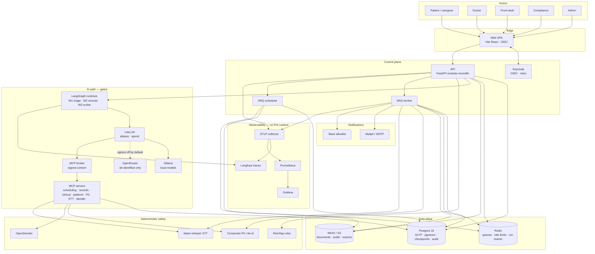
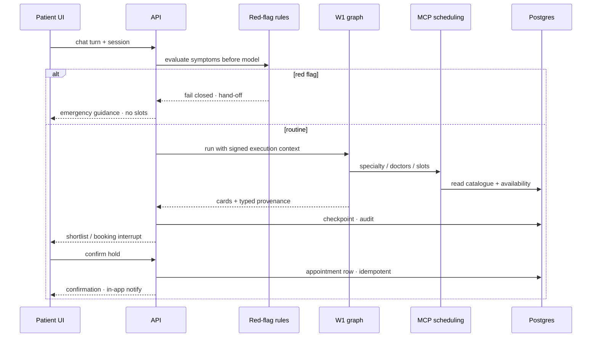
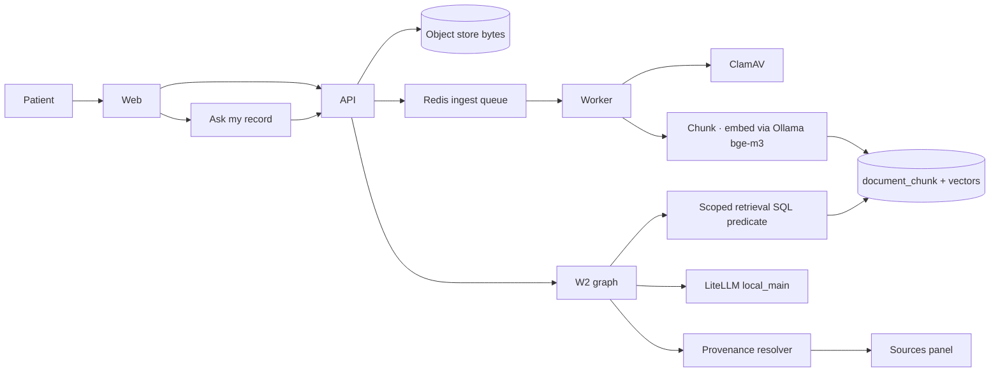
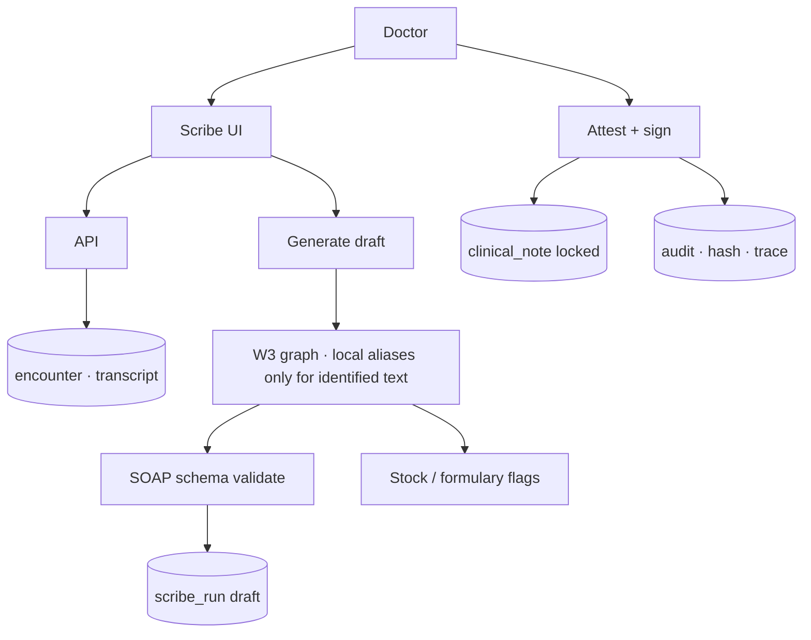

# Data flow — Sahyog Care Companion

| Field | Value |
|---|---|
| Purpose | End-to-end data movement for the six workflows and platform services |
| Normative source | [architecture.md](../architecture.md) · [spec.md](../spec.md) |
| Related | [11-technical-architecture.md](./11-technical-architecture.md) · [12-deployment-architecture.md](./12-deployment-architecture.md) |

## 1. System data flow (C4-style)

## 2. Workflow data paths

### W1 — Find doctor / book

### W2 — Records ingest and ask

### W3 — Scribe draft and sign

## 3. Data classification and stores

| Class | Examples | Store | Leaves boundary? |
|---|---|---|---|
| Identity | subjects, roles | Keycloak + app user map | No |
| Clinical content | notes, transcripts, chat bodies | Postgres | No (W3 local) |
| Document bytes | PDFs, audio | S3-compatible | No |
| Vectors | chunk embeddings | Postgres pgvector | No |
| Checkpoints | LangGraph state | Postgres | No |
| Queues / run events | jobs, SSE tips | Redis | No |
| Spend / metrics | tokens, latency | LiteLLM + Prometheus | Aggregates only |
| Traces | spans, tool names | Langfuse via OTLP | De-identified metadata only |
| Notifications | email/SMS/Slack | providers | Neutral templates; no clinical body |

## 4. Cross-cutting flows

| Flow | Path |
|---|---|
| AuthN/Z | Browser → Keycloak → SPA → API JWT → role scopes |
| Tool calls | Graph → LiteLLM MCP → broker verifies signed `_context` → MCP server → DB |
| Egress | PII scrub → policy gate → OpenRouter only if `EXTERNAL_EGRESS_ENABLED` |
| Audit | Every patient-data read/write → append-only audit with actor, purpose, trace |
| FinOps | LiteLLM spend → reconciliation job → analytics FinOps tiles / export |
| Retention | Scheduler deletes audio ≤24h; chat/checkpoint per policy; audit retained |
