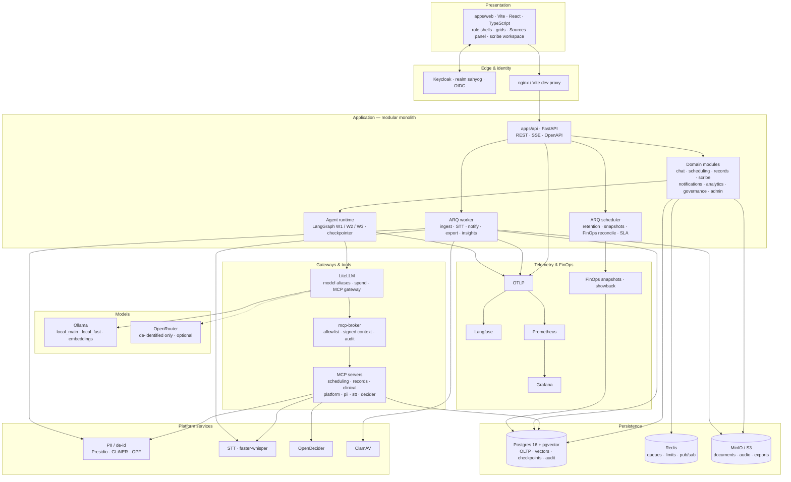
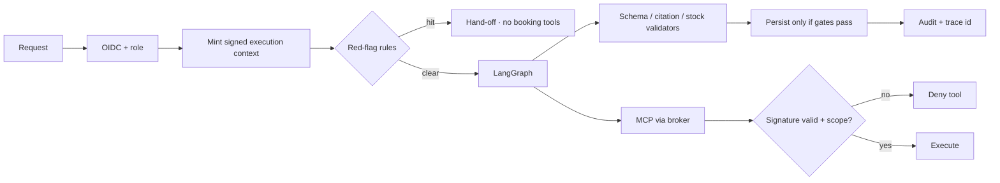

# Technical architecture — Sahyog Care Companion

| Field | Value |
|---|---|
| Purpose | Runtime technical view: modules, AI path, safety, observability |
| Normative source | [architecture.md](../architecture.md) containers §3 · ADRs under [../adr/](../adr/) |
| Related | [10-data-flow.md](./10-data-flow.md) · [12-deployment-architecture.md](./12-deployment-architecture.md) · [02-container-3-1-container-diagram.md](./02-container-3-1-container-diagram.md) |

## 1. Layered technical view

## 2. Module map (API)

| Module | Owns | Outbound |
|---|---|---|
| Auth / RBAC | JWT validation, role guards | Keycloak JWKS |
| Chat | sessions, interrupts, provenance UI feed | W1/W2 graphs, MCP |
| Scheduling | appointments, holds, waitlist | MCP scheduling, notifications |
| Records | upload, ingest status, scoped ask | worker, pgvector, W2 |
| Scribe | encounters, transcripts, runs, sign | W3 local path, clinical notes |
| Notifications | in-app + channel dispatch | Mailpit/SMTP, Slack |
| Analytics / FinOps | tiles, compliance, evals, cost | snapshot tables, LiteLLM reconcile |
| Governance / audit | append-only query UI | audit store |
| Admin / ops | health, flags, effective config | readiness probes |

## 3. Safety and control planes

## 4. Technology choices (ADR-backed)

| Concern | Choice | ADR / note |
|---|---|---|
| UI | Vite React TypeScript | stack ADRs |
| API | FastAPI modular monolith | delivery constraint D-07 |
| Agents | LangGraph + Postgres checkpointer | workflow ADRs |
| Models | LiteLLM aliases · Ollama local | FR-GW |
| Tools | MCP broker only | MC-14 |
| Identity | Keycloak OIDC | — |
| DB | Postgres 16 + pgvector | — |
| Objects | S3-compatible MinIO | — |
| Queues | Redis + ARQ | — |
| Telemetry | OTLP · Langfuse · Prometheus · Grafana | FR-OBS |
| Hosting | Compose reference · K8s-ready | ADR-16b |

## 5. Non-functional targets (summary)

| Area | Target (spec) | Evidence locus |
|---|---|---|
| Triage p95 | < 4 s server | load + traces |
| Record-answer p95 | < 8 s | load + traces |
| Note draft p95 | < 20 s after transcript | eval / role-play |
| Peak load | 1,400 req/h · 4× burst | load reports |
| Privacy | identified W3 local; egress de-id only | config + gates |
| Availability | fail closed on safety; degrade on convenience | architecture QA table |
