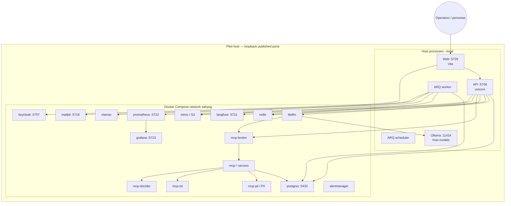
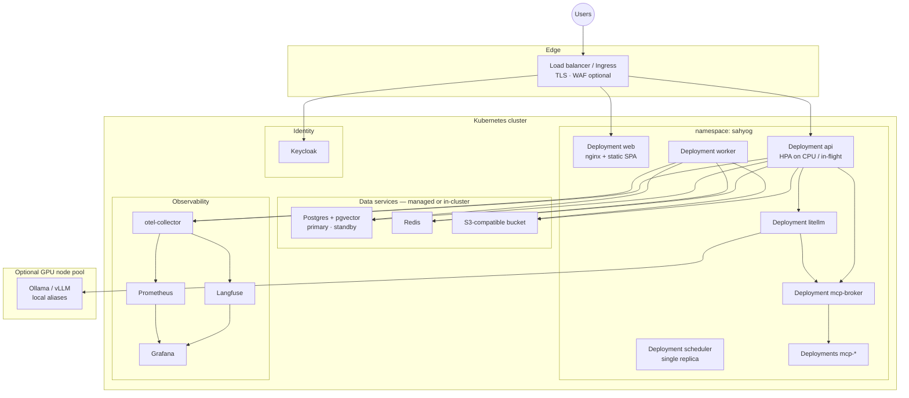

# Deployment architecture — Sahyog Care Companion

| Field | Value |
|---|---|
| Purpose | How the stack is deployed for pilot (Compose) and production-ready (Kubernetes) |
| Normative source | [ADR-16b](../adr/ADR-16b-deployment-hosting.md) · [architecture.md](../architecture.md) §14 · [setup.md](../setup.md) · [infra.md](../infra.md) |
| Related | [11-technical-architecture.md](./11-technical-architecture.md) · [bill-of-materials.md](../bill-of-materials.md) |

## 1. Reference pilot — Docker Compose (`full` profile, local app)

**Start:** `./scripts/start.sh --profile full --local`  
**Invariant:** `EXTERNAL_EGRESS_ENABLED=false` for acceptance demos unless a reviewed de-id path is intentionally shown.

## 2. Production-oriented — Kubernetes

Manifests: `deploy/k8s/` (Kubernetes-ready; Compose remains the reference acceptance path per ADR-16b).

## 3. Environment matrix

| Concern | P laptop pilot | S acceptance | M hosted pilot | L production |
|---|---|---|---|---|
| Orchestration | Compose + host app | Compose on VM | Compose or K8s | Kubernetes |
| DB | Compose Postgres | Compose / managed | Managed preferred | Primary + standby |
| Models | Host Ollama | Ollama ± GPU | 48 GB GPU class | 2× GPU / HA |
| Observability | Langfuse + Prom + Grafana | same | same + retention | same + alerting |
| HA claim | none | none | N+1 app | Multi-AZ |
| Secrets | `.env` local | `.env` / sealed | secret manager | secret manager |

## 4. Network and trust boundaries

| Boundary | Rule |
|---|---|
| Browser → SPA/API | HTTPS in deployed envs; OIDC via Keycloak |
| API → model egress | Denied unless de-identified + flag on |
| MCP tools | Only through broker with signed short-lived context |
| Object store | Private bucket; app credentials; no public ACLs |
| Observability | Loopback or private network; no clinical content in spans |
| Admin UIs | Grafana/Langfuse not exposed publicly without SSO |

## 5. Release unit

| Artefact | Role |
|---|---|
| `apps/web` image / static | UI |
| `apps/api` image | API + worker entrypoints |
| MCP / LiteLLM / sidecars | Compose or K8s deployments |
| Migration job | Alembic against Postgres |
| Config | env + `config/*.yaml` mounts |
| Evidence | gates, eval report, demo reel, BoM |
