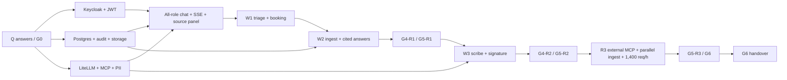

# Care Companion — Delivery, Assurance and Handover Plan

| Field | Value |
|---|---|
| Product | Sahyog Care Companion |
| Document | `docs/plan.md` — how R1, R2 and R3 are built, evidenced and handed over |
| Version | 1.1 — implementation baseline plus post-build deviation log |
| Date | 2026-10-27 |
| Status | Approved for implementation. All Q-01–Q-32 are answered; all R1–R3 features are committed (`D-20`). The eight-week re-baseline is recorded as PD-01. |
| Owner | engineering lead (rotating weekly) |
| Related documents | [spec.md](./spec.md) · [design.md](./design.md) · [architecture.md](./architecture.md) · [roadmap.md](./roadmap.md) · [setup.md](./setup.md) · [infra.md](./infra.md) · [gaps.md](./gaps.md) · [changelog.md](./changelog.md) |
| Source calendar | Baseline brief pp. 43–47 (discovery calendar, change request, pre-mortem); the day-10 steering milestone is retained |

**Implementation status (this build).** This is the delivery baseline, not a claim that every committed item is already delivered. The repository implements the main R1–R3 application slices, but deviations are recorded in [gaps.md](./gaps.md) — including the read-only FHIR adapter (G-08), X-01 (G-13), external MCP (G-14), mem0 preference memory (G-24), alert-to-runbook automation and recorded drills (G-25), human judge calibration (G-16), K8s runtime validation (G-11), composite PII (G-28), OpenDecider/Whisper (G-29), supply-chain controls (G-27), row-level security/field encryption/break-glass (G-10), reviewed hi/mr clinical copy (G-01/G-02), the public-source data estate (G-35), WCAG/cross-browser conformance (G-36), the remaining CI/release stages (G-37) and the remaining catalogued API families (G-38). Langfuse trace export/agent spans (G-23), browser E2E (G-26), scheduled analytics/insights/anchor jobs (G-30), LiteLLM reconciliation (G-31), upload malware scanning (G-32), the consent/care-circle lifecycle (G-33) and patient export/deletion with document download (G-34) are implemented; their evidence is linked from the register. Gate evidence is only valid when linked; this plan does not create it.

## 1. Plan purpose and commitments

This plan converts [spec.md](./spec.md) into a sequenced build with owners, evidence and gates. The product owner has committed **all R1, R2 and R3 features** (`D-20`, ADR-32); none is a stretch goal. The plan therefore sizes the whole programme, not a Core-tier demo with optional follow-ons.

The original two-week calendar is retained as a steering milestone, not as the acceptance date. The platform baseline — Keycloak, Postgres/pgvector, S3, four-role-plus consoles, role-scoped chat, provenance, real notification adapters, i18n, analytics/FinOps, RAGAS/DeepEval, real-user-safe load testing, feature flags and K8s manifests — cannot be accepted honestly in ten working days. The plan keeps the day-10 R1 release candidate and client steering review, then completes R1, R2 and R3 under their own gates.

### 1.1 The six commitments

| # | Commitment | What it means in practice | Evidence |
|---|---|---|---|
| C-01 | **Safety before demo** | No workflow is callable by a user until its G3 controls pass: red-flag rules, patient scope, consent/audit, PII egress, tool allowlisting and provenance. | G3 records; MC-05, MC-07, MC-08, MC-10, MC-12, MC-14 |
| C-02 | **Eval-first** | The 30-case W1/W2 set exists before graph code; the 40-case W3 set exists before the scribe graph; every prompt change carries an eval diff. | Eval manifest with git timestamps; MC-02 |
| C-03 | **One reproducible path** | A clean checkout, a filled `.env` and one documented command are the only acceptance path. Laptop-only state is not evidence. | G1/G5/G6 clean-machine run; MC-26 |
| C-04 | **Evidence, not adjectives** | Every gate links to a run, report or artefact. A green status without an artefact is treated as red. | Gate records; §8 |
| C-05 | **All releases, no stretch goals** | R1, R2 and R3 are planned, staffed and accepted in order. R3 does not inherit R2's green status. | §3.2, §6; ADR-32 |
| C-06 | **Honest capability** | What is not built — ABDM certification, clinical validation, HA, real patient data — is named with its consequence and follow-on. | §3.4, §12.6, [gaps.md](./gaps.md) |

### 1.2 Delivery decision

| Decision | Baseline | Why |
|---|---|---|
| Release target | **R1, then R2, then R3**; all committed | `D-20`; ADR-32 |
| Planning horizon | **Eight working weeks / 40 working days**; 180 gross person-days, 153 planned, 144 estimated | The all-release scope includes 18 work packages across platform, clinical workflows, analytics/FinOps, evals, R3 externalisation and assurance |
| Team | **Four engineers plus a 0.5 FTE analytics/data engineer**; engineering lead rotates weekly | E4 owns integrations/AI platform so R1 real adapters and R3 external MCP do not starve the core build; analytics is a product capability, not a dashboard at the end |
| Day 10 | **R1 release candidate plus a scripted W3 slice**, followed by the client steering review within 48 hours | Preserves the original steering moment without claiming R1/R2 acceptance |
| R1 acceptance | End of week 3 (day 15) | All R1 MUSTs and SHOULDs, G4-R1 and applicable MCs evidenced |
| R2 acceptance | End of week 4 (day 20) | W3, OCR, 80-case W1/W2 and 40-case W3 suites, routing/fallback, R3 preparation |
| R3 acceptance | End of week 6 (day 30) | External MCP server, parallel ingest, 1,400 req/h with 4× burst, hybrid deployment ADR, and the bounded X-01 nursing-summary slice |
| Assurance | End of week 7 (day 35); G6 on day 38 | Full security, load, restore, i18n/a11y, K8s and BoM evidence before handover |
| Handover | Day 40; G7 observation window starts | Acceptance package, clean-machine run and memo |
| Pilot host | **Mac M4 Pro, 26 GB unified memory**, `full` profile reduced to fit; production-grade host later | `D-19`, `Q-28`; local models are selected per purpose and must fit the host |
| Database | **Postgres 16+ / pgvector only**; no SQLite path | `D-02`, `Q-09`; ADR-02 |
| Identity | **Keycloak in every profile**; no dev-auth bypass | `D-01`, `Q-17`; ADR-12, ADR-21 |
| Integrations | **Real SMS, SMTP/Gmail and Slack adapters**; test doubles only in tests. The FHIR read adapter is committed but not implemented (G-08) | `D-21`, `Q-11`; ADR-37 |
| Languages | **English, Hindi and Marathi from R1**, including mixed-language input | `D-10`, `Q-14`; ADR-33 |
| Deployment | **Docker Compose acceptance**, **K8s manifests delivered and validated**, not an HA claim | `D-27`, `Q-12`; ADR-16 |
| Evals | **RAGAS for RAG, DeepEval for non-RAG**, one `EvalRunner`, deterministic safety gate | `D-15`, `Q-20`; ADR-26 |
| Telemetry | **OTLP** from app, agents and MCP; Langfuse self-hosted on Postgres, de-identified | `D-22`, `D-23`; ADR-15, ADR-40 |

**Plan deviation PD-01 — eight-week re-baseline.** The original two-week plan assumed the Core/Pro tier. With all R1–R3 features committed, ten working days could only produce a demo, not an accepted platform. This plan retains day 10 as the R1 candidate and steering review, accepts R1 on day 15, R2 on day 20, R3 on day 30 and hands over on day 40. The old compressed fallback is no longer offered as an acceptance path; a shorter date requires the product owner to remove committed scope in writing.

**Plan deviation PD-02 — a fourth engineer.** E4 (Integrations/AI platform) owns real FHIR/SMS/SMTP/Slack adapters, LiteLLM/Ollama/OpenRouter configuration, MCP servers, external MCP in R3, the load harness and K8s overlays. Without E4, those items would consume E2's platform capacity and push R1 past day 15. If E4 is not available, the plan needs product-owner approval to move the date or trade an equal-sized committed feature; safety checks are not traded.

**Plan deviation PD-03 — analytics capacity for the full programme.** The 0.5 FTE analytics/data engineer works all eight weeks (20 pd), owns the metric registry, snapshot integrity, reconciliation, FinOps attribution and insight evidence. If the role is not funded, R1 analytics ships only as read-only definitions with explicit `unknown`/stale states and a written variance; the plan does not fabricate completeness.

**Plan deviation PD-04 — all releases committed.** R3 is not an option and is not priced separately in [roadmap.md](./roadmap.md). It is planned in weeks 5–7 and accepted at G4-R3 on day 30. The roadmap describes post-handover extensions, not the R3 scope already committed here.

### 1.3 What this plan does not authorise

- It does not authorise real patient data, real credentials in the repository, or a production deployment.
- It does not claim ABDM/ABHA certification, FHIR write-back, clinical validation or medical-device status.
- It does not claim high availability, multi-region operation or a production incident-response service.
- It does not authorise enabling the external MCP server for a partner without the ADR-19 threat model update and the kill-switch test.
- It does not replace the acceptance criteria, mandatory checks or thresholds in [spec.md](./spec.md) §7–§8. Where this plan and the specification differ, the specification wins.

G0 is recorded as cleared for this documentation baseline on 2026-10-25. Implementation starts against this plan; a material change to the approved docs reopens G0 only for the changed area.

---

## 2. Planning basis, assumptions and constraints

### 2.1 Inputs used

| Input | Use in this plan |
|---|---|
| [spec.md](./spec.md) | Requirements, release tags, acceptance criteria, gates G0–G7, MC-01–MC-33, product-owner answers Q-01–Q-32 and decisions D-01–D-28 |
| [design.md](./design.md) | Routes, role-scoped assistants, screens, grid catalogue, chat/source-panel contract, i18n, notifications and responsive scope |
| [architecture.md](./architecture.md) | Module boundaries, data model, gateway/MCP design, adapter boundaries, deployment profiles, runbooks, risks R-01–R-25, ADR-01–ADR-40 |
| [infra.md](./infra.md) | Parameterized sizing, Mac pilot profile, S/M/L profiles, capex/opex, TCO and what-if model |
| [roadmap.md](./roadmap.md) | The X-01 bounded slice selected for R3 and the post-handover extension options |
| [gaps.md](./gaps.md) | Known i18n/clinical/operational gaps and mitigations; feeds the known-limitations register |
| Baseline brief pp. 43–47 | Discovery calendar, sealed change request, two-hour re-plan, pre-mortem, steering format |
| Baseline brief p. 52 | Five roadmap extensions and their proof value |
| Product-owner answers | All 32 answers dated 2026-10-25; the answer column in spec §11 is authoritative |

### 2.2 Planning assumptions

| ID | Assumption | If false | Owner |
|---|---|---|---|
| PA-01 | Four engineers are available for 40 working days at roughly 7.5 focused hours per day, with no more than one day of shared leave. | Recalculate capacity; trade a committed SHOULD or move the date with product-owner approval; never remove a safety check. | engineering lead |
| PA-02 | No open question blocks G0. New questions get an owner, a default and a date; safety questions block until answered. | Record the default in D3/ADR; proceed only if the safety reviewer agrees. | Product owner |
| PA-03 | The five public sources are downloadable by day 3 (actual Kaggle/OpenML files with recorded hashes/licences/row counts), the seed/sample profile works offline, and tagged data can be reset idempotently. | Keep developing on seed/sample only; record a G2 variance naming each blocked public source, reason and closure date; **never invent public row counts or substitute seed rows for a public source**; close before G4-R1. | Data owner |
| PA-04 | A Mac M4 Pro with 26 GB unified memory is available as the pilot/development host; purpose-specific local models fit its memory budget. | Reduce the `full` profile, use a hosted GPU for STT/eval, or run only de-identified external models; record the variance. | Platform owner |
| PA-05 | Keycloak, Postgres/pgvector, MinIO, Redis, LiteLLM and MCP run under Docker Compose on the host. | Acceptance moves to a documented hosted environment; `minimal` is never acceptance. | Platform owner |
| PA-06 | Identified data stays in-boundary; only de-identified text reaches OpenRouter or another external provider. | No external call for that path; local alias only; new DPDP/security review required. | Security owner |
| PA-07 | Real credentials (SMS gateway, SMTP/Gmail, Slack bot, FHIR read endpoint) are supplied through `.env` or a vault before their gate. | The adapter reports `unconfigured`; the capability is visibly degraded and the acceptance criterion is withheld or varied. No runtime mock is substituted. | Product owner + platform |
| PA-08 | The R3 binding scale target is 1,400 requests/hour with 4× burst; R1/R2 evidence uses the 400–500 req/h profile. | Re-run sizing; R3 acceptance cannot be claimed without the load evidence. | engineering lead |
| PA-09 | The clinical reviewer is available on days 7, 17, 19 and 30 for red-flag, grounding, sign-off and role-play review. | W3 clinical thresholds remain provisional and R2/R3 clinical acceptance is withheld. | Clinical reviewer |
| PA-10 | CI runners can start Postgres 16/pgvector, run Playwright, build containers and validate Kustomize manifests; a kind cluster is available for a smoke test. | Run the K8s smoke locally and attach the log; the Compose acceptance path is unaffected. | Platform owner |
| PA-11 | Separate staff and patient Slack test workspaces exist; patient Slack identities are captured and verified at onboarding. | Patient Slack stays disabled; staff Slack uses the configured workspace; record a variance and keep in-app/email as the fallback. | Platform owner |
| PA-12 | Analytics source events, usage/cost rows and reconciliation inputs are complete enough to define all six tabs by day 12. | Publish explicit `unknown`/`stale` states and a variance; do not invent a baseline or a zero. | Analytics lead |
| PA-13 | A 0.5 FTE analytics/data engineer is available for all eight weeks. | Reduce analytics to read-only definitions and showback basics; record a written variance; no false completeness claim. | engineering lead |
| PA-14 | Hindi/Marathi UI strings and clinical copy have a named reviewer; machine translation alone is not accepted for safety text. | Ship the reviewed subset with a `gaps.md` entry; do not silently fall back to English. | Clinical + design |
| PA-15 | OpenRouter and local Ollama are reachable; model aliases and prices are configured per purpose. | Use the local alias; disable the external alias with an `unconfigured` health state; record the cost/quality variance. | E4 |
| PA-16 | Load tests use a dedicated Keycloak test cohort and tagged synthetic data; no real users are generated or modified. | Do not run the test; fix the cohort/reset path first. | E2 + analytics |

### 2.3 Constraints that are not negotiable

- Identified health data never leaves the hospital boundary; only de-identified text may reach an external provider (`D-05`, `Q-02`).
- The model never controls patient identity; context is server-derived and signed for tools (`Q-05`, ADR-04).
- Red-flag rules execute before any model call and fail closed.
- No clinical note persists before a named doctor signs; no auto-sign; no diagnosis, dose or medicine recommendation in patient chat.
- Audit is append-only and covers every patient-linked read/write.
- No PHI or secret in logs, traces, analytics snapshots, cost records, notifications, fixtures, prompts, screenshots or the repository.
- Every generative, embedding, STT and OCR call goes through LiteLLM; every agent tool call goes through the MCP broker/gateway (`D-03`, `Q-06`).
- Postgres 16+ with pgvector is the only database; no SQLite code path (`D-02`, `Q-09`).
- Keycloak is present in every profile; there is no dev-auth bypass in any environment.
- Real adapters only at runtime; test doubles live under `tests/doubles/` and are selected only by the test harness (`D-21`).
- English, Hindi and Marathi UI plus mixed-language input are first-class from R1 (`D-10`).
- Every agent output carries typed source information; a message cannot render without a source status.
- In-app is the notification source of truth; SMS, email and Slack never carry clinical detail or roll back a domain action.
- Safety flags cannot be disabled by a runtime admin toggle; feature flags validate at startup (`D-17`).
- Load tests authenticate through Keycloak, call public APIs, use a tagged test cohort, coexist with real users and abort on a real-user SLO/budget breach (`D-13`).
- No real patient data in development, test, demo, pilot or eval.

### 2.4 Delivery conventions

- **Day 0** is the first working day after G0 sign-off. Calendar dates are fixed at kickoff; this plan uses relative days so it remains valid if review slips.
- **Week** means five working days. **Person-day (pd)** means one engineer for one focused day, including tests and review, excluding ceremonies.
- **Slice** means a vertical, demonstrable increment across UI, API, data and tests. A layer without a user-visible outcome is not a slice.
- **Done** means the story satisfies the Definition of Done in §11.4 and the relevant mandatory checks; code merged is not done.
- Estimates are ±20%. The 15 pd contingency in §5.3 is explicit, not hidden inside optimistic estimates.
- "Accepted" means the gate record is signed with evidence; a demo that works once is not acceptance.

---

## 3. Delivery strategy and scope

### 3.1 Release slices

| Slice | Outcome | Release | Primary requirements | Gate |
|---|---|---|---|---|
| S0 — Foundations | Repo, config, CI, Compose profiles, health, Postgres, storage, Keycloak realm, audit skeleton, K8s skeleton, scripts, flags | R1 | `FR-OPS`, `FR-AUTH`, `FR-DATA`, `FR-PLT` | G1/G2 |
| S1 — Shell, roles and chat | Sign-in, role-aware shell, left nav, themes, en/hi/mr, chat sessions, SSE, memory preferences, all-role assistants | R1 | `FR-UI`, `FR-CHAT`, `FR-I18N`, `FR-AUTH` | G3 |
| S2 — W1 triage and booking | Red-flag stop, specialty match, three candidates, interrupt, booking, front-desk override, notifications | R1 | `FR-W1`, `E1`, `E2` | G3/G4 |
| S3 — W2 records and cited answers | Upload, async ingest, hybrid retrieval, scope guard, citations, refusal, source panel | R1 | `FR-W2`, `E3`, `E4` | G3/G4 |
| S4 — Platform completion | All grids, admin/compliance, consent, audit export, retention/reset, notifications, review queue, analytics/FinOps, observability/cost | R1 | `FR-ADM`, `FR-ANL`, `FR-FIN`, `FR-OBS`, `FR-COST`, `FR-UI` | G4-R1 |
| S5 — W3 scribe | Encounter, local STT/transcript, SOAP draft, stock flags, doctor interrupt, signature/versioning, source map | R2 | `FR-W3`, `E5` | G3/G4-R2 |
| S6 — R2 hardening | OCR, 80-case W1/W2 + 40-case W3, calibrated judge, DeepEval non-RAG, routing/fallback, dashboards, audio deletion, role-play review | R2 | `FR-W2-04`, `FR-W3`, `FR-GW`, `FR-OBS-08` | G4-R2/G5-R2 |
| S7 — R3 scale and integration | External MCP server, parallel `Send` ingest, 1,400 req/h with 4× burst, hybrid deployment ADR, bounded X-01 nursing-summary slice | R3 | `NFR-SCALE-01`; spec §4 R3; ADR-19; roadmap §2.2 | G3/G4-R3 |
| S8 — Assurance | Security, PII replay, i18n/a11y, K8s validation, DR/restore, load, reconciliation, engineering quality, BoM validation | All | MC-01–MC-33; `NFR-MAINT` | G5-R1/R2/R3 |
| S9 — Handover | Clean-machine run, memo, demo, runbooks, limitations, release notes, acceptance sign-off | All | G6/G7 | G6 |

### 3.2 Scope line by release

**R1 — committed.** All R1 MUST and SHOULD requirements in [spec.md](./spec.md) §5, the R1 acceptance criteria in §7, G0–G4-R1 and every applicable mandatory check. This includes the patient shell, all-role chat, W1, W2, all core grids, admin/compliance/pharmacy/front-desk consoles, consent, audit, review queue, real notifications, i18n en/hi/mr, Postgres-only data, S3 storage, LiteLLM/MCP, OpenRouter/Ollama, mem0/pgvector, PII stack, OpenDecider, OTLP/Langfuse telemetry, cost attribution, analytics/FinOps, RAGAS/DeepEval, 30-case eval, real-user-safe load, feature flags, engineering gates, K8s manifests and the test-data reset.

**R2 — committed.** W3 end-to-end with local identified processing; signed and immutable notes; stock-aware review; per-line source map; OCR fallback; async ingest hardening; model routing/fallback/circuit breaker proven; 80-case W1/W2 and 40-case W3 suites; calibrated judge; DeepEval non-RAG suite; dashboards; cost per consultation; audio deletion evidence; role-play review time. Acceptance requires the six-minute demo to include a signed note.

**R3 — committed.** External MCP tool server for approved agents (off by default, mTLS/allowlist/signed context/audit/kill switch); parallel ingest with LangGraph `Send` and a bounded pool; 1,400 req/h load test with 4× burst and p95s on screen; hybrid deployment ADR with the egress boundary implemented; and the bounded **X-01 nursing-summary slice** with eval cases, as defined in [roadmap.md](./roadmap.md) §2.2. The full X-01 ward/inpatient productisation remains post-handover. All R3 items are accepted by day 30.

No release is "optional" and no MUST or SHOULD is pre-deferred. A SHOULD that slips needs a written variance with the measured impact; a MUST cannot be varied without product-owner and reviewer sign-off, and safety MUSTs cannot be varied at all.

### 3.3 Milestones

| Milestone | Date | What is true | What is not claimed |
|---|---|---|---|
| M1 — R1 candidate | End of week 2 (day 10) | Patient and staff sign-in; all-role chat sessions; red-flag stop; routine booking with channel status; upload and a cited answer; source panel; core grids; W1 red-flag recall 100% on the 30-case set; traces and costs; W3 scripted demo slice | Full admin/compliance, complete retention, backup/restore, R1 load evidence and R2 acceptance are not complete |
| M2 — Client steering review | Day 10 + 48 hours | Six-minute demo, technical defence, ADR/change-request walkthrough, honest variance list | Steering review, not final acceptance; the PR is a release candidate |
| M3 — R1 acceptance | End of week 3 (day 15) | G4-R1 passes; R1 MUSTs/SHOULDs and applicable MCs have evidence; known limitations filed; G5-R1 closes by day 18 | R2 scribe and R3 scale are not accepted |
| M4 — R2 acceptance | End of week 4 (day 20) | G4-R2 passes; 80-case W1/W2 and 40-case W3 meet thresholds or have an approved variance; G5-R2 closes by day 22 | R3 is not accepted; R3 scale tests are not yet claimed |
| M5 — R3 acceptance | End of week 6 (day 30) | G4-R3 passes; external MCP conformance/negative tests, parallel ingest, 1,400 req/h with 4× burst, hybrid ADR and the X-01 bounded slice evidence exist; external MCP remains off by default | Full X-01 inpatient productisation, production HA and partner enablement are not claimed |
| M6 — Assurance complete | End of week 7 (day 35) | G5-R3 and the full assurance pack are complete; release candidate tagged | Handover is not signed |
| M7 — Handover | Day 40 (G6 day 38) | G6 package, clean-machine run, cost sheet, FinOps pack, memo, demo recording, AI log and runbooks complete; G7 observation starts | Production readiness or clinical validation |

### 3.4 Explicit non-scope

These items are outside the committed programme. They are not hidden trades and they do not reduce a mandatory check.

| Not in scope | Consequence | Revisit |
|---|---|---|
| ABDM/ABHA certification, linking and FHIR write-back | Read-only FHIR adapter and contract tests only; no ABDM claim | Client programme / roadmap |
| Clinical validation on real patients | Demonstration system with synthetic/public data; no diagnostic claim | Clinical validation programme |
| High availability, multi-region, production SLOs | K8s manifests and HPA/PDB/NetworkPolicy are delivered and validated, but acceptance is single-host Compose | Production hardening phase |
| Real patient data in the pilot | Pilot uses synthetic/public data under supervision | After DPDP/clinical sign-off |
| Break-glass access | Normal role/consent path only | Roadmap |
| RLS and full clinical-text encryption | Repository predicates and SQL scope filters only; direct identifiers are **not** field-encrypted; residual risk documented (G-10) | Post-pilot ADR-18 review |
| Autonomous clinical action, auto-sign, prescribing or dose calculation | Explicitly prohibited by design | Not planned |
| Native iOS/Android apps | Responsive web/PWA-ready | Roadmap |
| Billing, insurance, telemedicine video, wearables | Not built | Roadmap |
| Multi-tenant SaaS across hospital networks | Single Sahyog tenant with clinic scope | Roadmap |

### 3.5 Scope control rule

All R1–R3 features are committed, so "defer it to a later release" is not available inside the programme. A new request is classified before it is estimated:

1. **Safety or legal defect** — stop the line, fix it, record the incident. It is never traded for scope or date.
2. **Clarification of a committed requirement** — absorb only if it fits the current slice; otherwise trade an equal-size committed SHOULD or move the date with product-owner approval. Record the decision in an ADR and a client note.
3. **New feature or post-handover roadmap item** — log it, price it, and do not start it without a signed change order; it goes to [roadmap.md](./roadmap.md), not into R1–R3.
4. **R3 scope increase** — R3 is already fixed. A larger external-MCP, higher-load or extra-extension request is a new change, not an R3 clarification.

No change is accepted without an ADR or recorded product decision, an updated estimate, and an updated eval set where behaviour changes. A mandatory check is never removed to protect a date.

---

## 4. Team, roles and capacity

### 4.1 Pod composition

| Role | Primary accountability | Secondary hats | Rotation |
|---|---|---|---|
| **E1 — Agent/Product engineer** | LangGraph graphs, prompts, tool schemas, memory policy, W1/W2/W3 behaviour, role assistants, eval harness | Clinical-safety liaison, demo narration | engineering lead week 1, week 5 |
| **E2 — Platform/Data engineer** | FastAPI modules, Postgres/pgvector, migrations, Keycloak, S3, Redis/ARQ, audit, retention/reset, analytics platform | Security and cost controls | engineering lead week 2, week 6 |
| **E3 — Frontend/Experience engineer** | Vite/React shell, design system, themes, responsive layouts, all grids, chat SSE client, source panel, i18n UI, accessibility, Playwright | Design QA, demo recording | engineering lead week 3, week 7 |
| **E4 — Integrations/AI platform engineer** | Real FHIR/SMS/SMTP/Slack adapters, LiteLLM/Ollama/OpenRouter, MCP servers/broker, external MCP, load harness, K8s overlays | Cost/egress engineering, release engineering | engineering lead week 4, week 8 |
| **Analytics/data engineer (0.5 FTE, weeks 1–8)** | Metric registry and snapshots, FinOps attribution/reconciliation, analytics privacy, insight evidence, sizing-model inputs, growth/what-if validation | Data quality, showback export, G5 evidence | Not a lead; works with E2 and E3 |
| **engineering lead (rotating)** | Gate records, client note, scope/change control, risk log, decision log, unblocking | Not the sole decision-maker; any member may be questioned at review | Rotates weekly among E1–E4 |
| **Product owner** | Priority calls, acceptance of variance, client voice | — | Weekly review + on call |
| **Clinical safety reviewer** | Emergency copy, red-flag rules, W3 grounding, role-play review, hi/mr clinical copy | Sign-off on MC-10/MC-11 evidence | G0, days 7, 17, 19, 30 |
| **Security/compliance reviewer** | Threat model, access matrix, PII egress, audit, DPDP position, external MCP | Sign-off on MC-07/08/09/12/24 | G0, days 9, 22, 32 |
| **Delivery office** | Holds the sealed day-8 change request; scores the re-plan | — | Day 8 |

### 4.2 Capacity model

| Line | Calculation | Person-days |
|---|---|---:|
| Gross engineering capacity | 4 engineers × 40 working days | 160 |
| Analytics/data capacity | 0.5 FTE × 8 weeks = 20 days | +20 |
| **Total gross** | | **180** |
| Ceremonies, reviews, client communication | ~7% | −12 |
| Contingency and change reserve | Explicit, held by engineering lead | −15 |
| **Planned delivery capacity** | | **153** |
| Estimated work packages (§5.1) | All R1–R3 features, including SHOULDs | 144 |
| **Unallocated buffer** | | **9** |

The 15 pd contingency is about 10% of the work-package estimate and funds the known risks in §5.3. The 9 pd buffer is not a second scope budget; it absorbs normal estimation variance. A committed SHOULD consumes contingency only with product-owner approval and a recorded trade; unspent contingency is returned, not used for new features.

If velocity is below plan by more than 20% at the end of week 2, the engineering lead re-plans within 24 hours: first reduce grid polish and non-safety UI depth, then trade the lowest-value committed SHOULD for an equal-size item, then move the date with product-owner approval. Safety checks, the eval sets, PII/audit/consent and the R3 load evidence are never the trade.

### 4.3 RACI

| Artefact / decision | E1 | E2 | E3 | E4 | Analytics | engineering lead | Product owner | Clinical | Security |
|---|---|---|---|---|---|---|---|---|---|
| Spec approval and change control | C | C | C | C | C | R | A | C | C |
| D1 automation ladder | R | C | C | C | — | A | C | C | — |
| D2 discovery questions | C | C | C | C | — | R/A | C | — | — |
| D3 assumptions register | C | R | C | C | C | A | C | — | — |
| D4 data contracts | C | R | — | C | C | A | — | — | C |
| D5 sizing | C | R | — | C | R | A | — | — | — |
| D6 deployment ADR | C | R | — | R | — | A | C | — | C |
| D7 threat model | C | R | — | R | — | A | — | — | C |
| Architecture pack | R | R | C | R | C | A | C | — | C |
| Eval sets and report | R | C | — | C | C | A | — | C | — |
| UI/design implementation | — | C | R | C | C | A | C | — | — |
| Analytics/FinOps definitions | C | C | C | — | R | A | C | — | C |
| Cost sheet and BoM | C | R | — | C | R | A | C | — | — |
| Executive memo | C | C | C | C | C | R/A | C | — | — |
| Demo recording | C | C | R | C | — | A | C | C | — |
| Gate record | C | C | C | C | C | R | A | C | C |
| AI-collaboration log | R | R | R | R | R | A | — | — | — |

R = responsible, A = accountable, C = consulted. The engineering lead owns the gate record even when the work is delegated. The clinical reviewer is accountable for clinical thresholds; the product owner accepts scope variance but cannot waive a safety check.

### 4.4 Weekly lead rotation

| Week | engineering lead | Focus of the rotation | Handover artefact |
|---|---|---|---|
| 1 | E1 | Discovery, architecture, eval-first, W1 rules, G0/G1/G2 | Week-one status note; G0/G1/G2 records |
| 2 | E2 | R1 vertical slice, chat/W1/W2, day-8 change | R1 candidate note; change ADR; M2 pack |
| 3 | E3 | R1 completeness, grids, i18n/a11y, G4-R1 | G4-R1 record; UX variance list |
| 4 | E4 | R2 clinical, W3 grounding/signature, evals | G4-R2 record; clinical variance list |
| 5 | E1 | R2 assurance, G5-R2, R3 kickoff | G5-R2 evidence index; R3 plan |
| 6 | E2 | R3 external MCP, parallel ingest, load | G4-R3 record; scale report |
| 7 | E3 | Full assurance, K8s/DR, i18n/a11y, BoM | G5-R3 record; assurance pack |
| 8 | E4 | Handover, clean machine, release tag | G6 package; acceptance sign-off |

The rotation is a leadership responsibility, not a knowledge silo. Every engineer reads every PR diff and can answer questions about any gate.

---

## 5. Work breakdown and estimates

### 5.1 Work packages

| WP | Scope | Requirements | Primary owner | Estimate (pd) | Exit evidence |
|---|---|---|---|---:|---|
| WP-01 | Discovery, D1–D3, repo scaffold, CI skeleton, AI log, decision log, pre-mortem, G0 package | G0; MC-01/02/27 | engineering lead + all | 4 | D1–D3 filed; repo builds; G0 record |
| WP-02 | Config, redaction/logging, errors, health/readiness, Compose `minimal`/`core`/`full`, K8s skeleton, scripts skeleton, non-root images, typed feature-flag registry, notification adapters (SMS/SMTP/Slack) | `FR-OPS-01..08`, `FR-PLT-08/15/18`, `FR-ADM-09/11`, `NFR-COST-02` | E2 + E4 | 9 | `start.sh --profile full` healthy; G1; adapter smoke; flag validation |
| WP-03 | Keycloak realm/clients/roles (all roles), JWT validation, policy functions, clinic scope, caregiver context predicate, active-consent enforcement, audit skeleton. Consent CRUD, care-circle UI, explicit context selection and revocation are delivered (G-33); session binding and a consent-history view remain open | `FR-AUTH-01..12`, `FR-PLT-01..06`, `FR-CHAT-09/10` | E2 | 7 | Auth matrix tests; active-consent predicate and expiry; audit rows including `consent_id`; consent grant/revoke/expiry and cross-patient tests |
| WP-04 | Postgres 16/pgvector, migrations, entity model, seeds, S3/MinIO buckets, presigned upload, document download/delete, retention/reset jobs, synthetic-data tagging | `FR-DATA-01..08`, `FR-OPS-09..12`, `FR-W2-18`, `FR-PLT-07`, `FR-W2-13` | E2 | 8 | Migrations from empty; presigned download; document delete with derived-artifact counts; five-source load still open (G-35); reset idempotent; G2 |
| WP-05 | Design tokens, shell, left nav, responsive drawer, themes, icon tooltips, locale framework en/hi/mr, empty/error states, a11y baseline | `FR-UI-01..03/07`, `FR-I18N-01..07`, `NFR-A11Y` | E3 | 8 | UI-AC-01/02/03/07; axe baseline; locale switch |
| WP-06 | Chat session CRUD, message history, SSE, stop/retry, memory preferences, role-scoped assistants, session grid, source-information panel, shared grid client | `FR-CHAT-01..14`, `FR-UI-04/08`, `FR-I18N-04/06` | E3 + E1 | 9 | CHAT-AC-01..08; source-panel contract; role-chat tests |
| WP-07 | LiteLLM aliases per purpose, OpenRouter/Ollama, fallback/circuit breaker, egress scrub, MCP broker/servers, signed context, OpenDecider, PII composite, language-capable routing | `FR-GW-01..12`, `FR-PII-01..08`, `FR-COST-01` | E4 + E1 | 10 | GW-AC-01..04; MC-12/13/14; signed-context spike |
| WP-08 | Red-flag rules, specialty catalogue, shortlist, slot search, interrupt, booking, idempotency, front-desk grid/hand-off, multi-channel status | `FR-W1-01..22` | E1 + E2 | 6 | E1/E2 AC; MC-10/19; 100% red-flag recall |
| WP-09 | Upload, ingest worker, extraction/chunking, embeddings via LiteLLM, hybrid retrieval, scope guard, citations, refusal, OCR preparation | `FR-W2-01..19` | E1 + E2 | 7 | E3/E4 AC; MC-07/12; 30-case eval |
| WP-10 | Encounter, transcript/local STT, SOAP schema, stock flags, doctor interrupt/edit, signature/versioning, audio deletion, per-line source map | `FR-W3-01..22` | E1 + E2 + E4 | 10 | E5 AC; MC-11/22; 40-case eval |
| WP-11 | OTel OTLP, Langfuse (Postgres), product events, usage/cost records, price catalogue, budgets, operational dashboards, FinOps rollups and reconciliation data | `FR-OBS-01..07`, `FR-COST-01..06`, `FR-FIN-01/02/06` | E2 + E4 + analytics | 10 | OBS-AC-01/02; COST-AC-01/02; MC-16/17/31 |
| WP-12 | All remaining core grids, admin/compliance/pharmacy/front-desk consoles, notification preferences/status, review queue, consent UI, retention UI, feature-flag admin, audit export | `FR-UI-05/06/09`, `FR-ADM-01..12`, `FR-PLT-07..18`, `FR-DATA-07/08` | E3 + E2 | 8 | UI-AC-04/05/08; ADM-AC; grid contract; MC-15 |
| WP-13 | Analytics metric registry, six tabs, snapshots, compliance posture, AI insight workflow, FinOps what-if/growth/profitability/showback/recommendations | `FR-ANL-01..14`, `FR-FIN-03..10` | Analytics + E3 | 12 | ANL-AC-01..05; FIN-AC-01..04; MC-31 |
| WP-14 | RAGAS/DeepEval `EvalRunner`, 30/80/40-case suites, judge calibration, i18n eval cases, red-team and source-coverage harness, immutable reports | `FR-OBS-08`, `FR-W2-14`, `FR-W3-05/15`, MC-25/30 | E1 + analytics | 9 | Eval manifest; run provenance; calibrated judge |
| WP-15 | Security/privacy suite, IDOR matrix, PII replay, red-team replay, notification cross-audience tests, real-user-safe load (R1/R2/R3), axe, restore/DR, degradation tests | MC-03..33; `NFR-SCALE-01` | All | 5 | G5 evidence packs; load reports; restore log |
| WP-16 | R3 external MCP server, parallel `Send` ingest, 1,400 req/h with 4× burst, hybrid deployment ADR and egress boundary, bounded X-01 nursing-summary slice | Spec §4 R3; `NFR-SCALE-01`; ADR-19; ADR-16; [roadmap.md](./roadmap.md#22-the-r3-extension-selection) | E4 + E2 + E1 | 10 | Conformance/negative tests; load report; ADR; X-01 demo and 20-case eval |
| WP-17 | K8s manifests/HPA/PDB/NetworkPolicy, kind/schema validation, D6/D7, backup/restore, runbooks, engineering-quality gates, infra sizing/BoM validation | `FR-OPS-13`, MC-21/24/26/32/33, `NFR-MAINT`, `NFR-COST-02` | E2 + E4 + engineering lead | 7 | K8s smoke; restore < 4 h; BoM report; MAINT-AC-01 |
| WP-18 | Handover package, executive memo, six-minute demo, AI log completion, clean-machine run, release notes, known-limitations register | G5/G6; MC-26/27 | engineering lead + all | 5 | G6 acceptance package |
| **Total** | | | | **144** | |

### 5.2 Slice allocation by phase

| Phase | Weeks | Work packages | Planned pd allocated | Exit |
|---|---|---|---|---|
| P0 — Discovery and foundations | Week 1 | WP-01, WP-02 start, WP-03 start, WP-04 start, WP-05 start, sizing inputs | 16 | G0/G1/G2; D1–D3 |
| P1 — R1 vertical slice | Week 2 | WP-02–WP-09 partial, WP-11 start, WP-13 start, source panel | 22 | M1/M2; G3-W1/W2 |
| P2 — R1 completion | Week 3 | WP-03–WP-09 remainder, WP-11/12/13, WP-14, WP-15 start | 20 | G4-R1; G5-R1 by day 18 |
| P3 — R2 clinical | Week 4 | WP-10, WP-07 routing/fallback, WP-11/13/14, WP-15 | 20 | G4-R2 |
| P4 — R2 assurance and R3 start | Week 5 | WP-12/13/14/15, WP-16 start, WP-17 start | 20 | G5-R2 by day 22; R3 plan |
| P5 — R3 scale and integration | Week 6 | WP-16, WP-17, WP-15 | 20 | G4-R3 |
| P6 — R3 assurance | Week 7 | WP-15/16/17 | 18 | G5-R3; M6 |
| P7 — Handover | Week 8 | WP-18, WP-17 close, contingency close | 17 | G6; M7 |
| **Total** | | | **153** | |

Phase allocations include ceremonies and the contingency held by the engineering lead. The work-package estimate is 144 pd; 15 pd is contingency and 9 pd is unallocated buffer.

### 5.3 Contingency and trade table

| Trigger | Use first | Use second | Do not trade |
|---|---|---|---|
| Signed-context spike fails | 2 pd for broker-resolved run registry | Reduce non-essential tool breadth; keep scope guard | Never pass patient identity through tool arguments |
| Local STT too slow or inaccurate on 26 GB | 2 pd; transcript-upload fallback for W3 | Reduce W3 demo audio; keep signature and grounding | Never send identified audio to a cloud API without review |
| Mac host saturated by models + full profile | Move eval/STT to a hosted GPU; run acceptance `full` without local large models | Reduce concurrent local aliases; record the variance | Never lower PII, red-flag, audit or grounding checks |
| Eval judge not calibrated by day 19 | Deterministic checks + human-graded sample | Keep W3 F1 provisional with a written variance | Never present a judge-only result as the safety gate |
| Keycloak setup drift | 1 pd recovery with realm import + smoke | Use the staging realm snapshot | Never enable dev auth in acceptance |
| Grid scope overruns | Ship role-critical columns first | Trade a cosmetic column or filter for an equal-size item | Never move filtering to the client |
| Analytics source data incomplete | Explicit `unknown`/stale states and a variance | Reduce insight breadth, keep metric definitions | Never fabricate a baseline or a zero |
| Slack workspace or patient identity unavailable | Keep the patient channel disabled; use in-app/email/SMS | Staff Slack uses the test workspace; record a variance | Never send clinical detail through any fallback channel |
| FHIR/SMS/SMTP credential missing | Adapter reports `unconfigured`; health names the gap | Acceptance criterion withheld or varied; follow-on date | Never substitute a runtime mock or claim live integration |
| Sizing inputs or measured load missing | Use S/M/L ranges and label them planning estimates | Validate at G5 with measured utilization | Never present a planning range as a vendor quote |
| Change request larger than 3 pd | Trade an equal-size committed SHOULD | Extend by up to a week with product-owner approval | Never silently cut a mandatory check or a safety control |
| 1,400 req/h fails on the pilot host | Optimise, then run the R3 load on a production-grade host | Record the host profile and re-run; do not claim a pass | Never lower the load target or disable the abort guard |
| External MCP security test fails | Keep the server off by default; fix and re-test | Delay R3 acceptance; do not expose a partial server | Never enable without mTLS/allowlist/signed context/kill switch |
| hi/mr clinical copy review late | Ship the reviewed subset with `gaps.md` entry | Hold the affected safety copy in English and record the gap | Never machine-translate emergency copy without clinical review |

---

## 6. Calendar and milestones

### 6.1 Week 1 — discovery, foundations, data and eval-first

| Day | E1 — agent/product | E2 — platform/data | E3 — frontend | E4 — integrations/AI platform | Analytics | Gate / evidence |
|---|---|---|---|---|---|---|
| 1 | Kickoff; D1–D3; architecture review; eval-case format | Repo scaffold; config validation; CI skeleton; Compose `minimal`; secret/PHI scan; flag registry seed | Design tokens; shell wireframe; route map; test harness; locale scaffold | Integration inventory; vault/env schema; FHIR/SMS/SMTP/Slack port contracts; LiteLLM/MCP topology | Metric inventory; FinOps input list | **G0** at end of day: docs approved, Q answered, D1–D3, templates |
| 2 | Data inventory; D4/D5; W1 red-flag rules; eval format | Postgres/pgvector migrations; Keycloak realm; MinIO; health/readiness | Shell/nav/theme/tooltips; empty states; en/hi/mr files | LiteLLM aliases; MCP broker/server skeleton; PII composite; adapter ports | Metric registry draft | Data inventory; migrations; flag registry validates |
| 3 | Sample data load; W1 graph skeleton; eval harness | JWT/policies; audit skeleton; presign; seed users | Chat shell; session list; grid contract client | OpenRouter/Ollama config; scheduling/stock/records MCP; notification adapters | Event schema; usage/cost schema | Auth smoke; five-source sample checks |
| 4 | 30 W1/W2 cases frozen; RAGAS run-record schema; W1 graph | LiteLLM fallback/spend; cost schema; Langfuse/OTel; flag validation | Chat SSE client; booking shell; source-panel contract; i18n pass | Signed-context spike; real adapter smoke (SMTP sink, SMS test endpoint, Slack test workspace, FHIR sandbox) | Snapshot stub; metric contract examples | **Evals exist before graph code** (MC-02); signed-context spike result |
| 5 | Pre-mortem; ADR review; W1 tests; W2 eval cases | Health/readiness; scripts; non-root images; K8s manifests; backup skeleton | Responsive/mobile pass; axe baseline; theme contrast; locale review | PII egress corpus; red-team harness; notification template review; K8s kind smoke | D4/D5 inputs; FinOps assumptions | **G1**; **G2**; architecture pack v1 |

### 6.2 Week 2 — R1 vertical slice, sealed change, candidate demo

| Day | E1 — agent/product | E2 — platform/data | E3 — frontend | E4 — integrations/AI platform | Analytics | Gate / evidence |
|---|---|---|---|---|---|---|
| 6 | Chat graph/checkpointer; memory preferences; W1 specialty match | Chat API/SSE/run manager; Postgres checkpointer; usage rows | Chat create/rename/delete; streaming/stop/retry; source panel | Role-scoped tools; OpenDecider; PII egress | Session/message events | Chat isolation tests |
| 7 | W1 shortlist/interrupt/booking; red-flag fault injection | Scheduling transactions/idempotency; delivery records | Booking cards/slot picker; front-desk grid; channel status | Real SMS/email/Slack test sends; FHIR demographics; stock CSV/API | Booking metrics | **G3-W1**; red-flag recall 100% |
| 8 | **Sealed change request**: restate, impact, three options, ADR-41, re-plan | Schema/config impact; migration plan | UI/grid impact; copy | Integration impact; credential plan | Metric/definition impact | Change ADR + same-day client note; 2-hour timebox |
| 9 | W2 ingest/retrieval/ask; citations; scope guard; refusal; role chat | Worker queue; embeddings; hybrid SQL; provenance resolver; PII tags | Upload/status; ask UI; citation validation; six-type source panel; document grid | OCR prep; PDF sandbox; records MCP; adapter failure states | Citation/refusal metrics | **G3-W2**; zero foreign content |
| 10 | W1/W2 eval dry run; R1 demo; W3 scripted slice | Trace/usage/cost verification; backup smoke; health summary | Demo recording; Playwright; a11y pass | Integration health/credential report; delivery evidence | Analytics snapshot | **M1**; **M2 within 48 h** |

### 6.3 Week 3 — R1 completion and acceptance

| Day | Focus | Exit evidence |
|---|---|---|
| 11 | All core grids: patients, appointments, documents, stock, notes, consents, audit, review, users, models, costs, clinics, jobs, sessions, flags; server-side search/sort/filter/pagination | Grid contract tests; UI-AC-04; p95 < 500 ms at documented volume |
| 12 | Admin/compliance/pharmacy/front-desk shells; consent lifecycle delivered (G-33 closed; session binding and history remain open); audit export (script only; G-38); retention/reset dry-run; notification preferences/status; review queue; feature-flag admin; analytics six tabs baseline | AUTH-AC-03/05; E6-AC-01/02; PLT-AC-04/05; ADM-AC-06; audit immutability |
| 13 | i18n and accessibility remediation; hi/mr UI and mixed-language chat; keyboard-only booking/ask/source panel; 360 px; theme contrast; tooltip/focus audit | MC-23/29; axe zero critical/serious; locale review notes |
| 14 | Security suite: IDOR, cross-clinic, 1,000-booking abuse, secret/dependency scans, Slack audience tests, PII replay; R1 load with test cohort and abort guard | MC-03/05/12/19; OPS-AC-03; R1 load report |
| 15 | Backup/restore drill; migration repeat; engineering-quality report draft; infra BoM draft; R1 regression; **G4-R1** | Restore < 4 h; MC-21/24/26/32; G4-R1 record |

### 6.4 Week 4 — R2 clinical companion

| Day | Focus | Exit evidence |
|---|---|---|
| 16 | Encounter/transcript schema; local STT/transcript upload; W3 graph skeleton; 40-case W3 set frozen before graph code; source-coverage cases | Eval manifest; STT smoke; source cases registered |
| 17 | SOAP drafting; transcript grounding; `[doctor to specify]`; medicine extraction; formulary/stock lookup and staleness | MC-11 negative tests; zero invented molecules |
| 18 | Doctor review UI; interrupt/edit/reject; signature; immutable versions; correction flow; audio 24 h deletion; per-line source map | E5-AC-01..06/08; signature audit; audio deletion test |
| 19 | OCR fallback; per-purpose routing/fallback/circuit breaker; 80-case W1/W2 and 40-case W3 runs; RAGAS + DeepEval; judge calibration; W3 role-play | GW-AC-03; E5-AC-07; eval provenance; κ report |
| 20 | R2 regression; dashboards; analytics/FinOps R2 evidence; cost per consultation; **G4-R2** | Eval report; cost/FinOps report; G4-R2 record |

### 6.5 Week 5 — R2 assurance and R3 kickoff

| Day | Focus | Exit evidence |
|---|---|---|
| 21 | Full R2 eval, red-team replay, PII egress replay, failure injection, alert tests, AI-insight review log | MC-07/12/17/25/30/31 |
| 22 | Real-user-safe load at R2 profile; checkpoint restart; queue/backpressure; backup restore repeat; **G5-R2** | MC-18/19/24; load + restore reports |
| 23 | D6/D7 final; runbooks; retention/deletion evidence; engineering-quality report; analytics reconciliation | D6/D7 filed; MC-32/33; runbook index |
| 24 | R3 kickoff: external MCP threat model, hybrid ADR, parallel ingest design, load plan; X-01 bounded-slice scope and eval cases frozen | R3 plan; ADR-19 update; X-01 eval cases |
| 25 | External MCP server skeleton; parallel ingest skeleton; scale harness; K8s overlay validation | R3 technical spike report |

### 6.6 Week 6 — R3 scale and integration

| Day | Focus | Exit evidence |
|---|---|---|
| 26 | External MCP server: mTLS/allowlist/signed context/audit/kill switch; conformance and negative tests | ADR-19 evidence; security review |
| 27 | Parallel ingest with LangGraph `Send`, bounded pool, idempotent chunks, backpressure | No duplicate vectors; queue metrics |
| 28 | 1,400 req/h with 4× burst; p95s on screen; bottleneck fixes; restart/statelessness | MC-18 R3 load report |
| 29 | X-01 bounded slice end-to-end with citations, clinician accept/edit and demo; hybrid deployment ADR with egress boundary; R3 a11y/i18n | X-01 evidence; D6 update; ADR |
| 30 | R3 regression; **G4-R3** | G4-R3 record; external MCP remains off by default |

### 6.7 Week 7 — full assurance

| Day | Focus | Exit evidence |
|---|---|---|
| 31 | Security: IDOR, prompt injection, cross-audience Slack, egress replay, secret/dependency/container scans, K8s NetworkPolicy | MC-03/05/07/12/14/22/24 |
| 32 | 1,400 req/h repeat with real-user guard; restore into empty environment; failure/degradation suite; **G5-R3** | MC-18/24/30; G5-R3 record |
| 33 | Full accessibility and i18n audit; role matrix; notification privacy; analytics small-cell suppression and export audit | MC-23/28/29/31 |
| 34 | Cost sheet; FinOps reconciliation; infra BoM validation against measured utilization; known-limitations register | MC-16/31/33; BoM report |
| 35 | Engineering-quality report; runbooks; release candidate tag; **M6 assurance complete** | MC-32/33; release candidate |

### 6.8 Week 8 — handover

| Day | Focus | Exit evidence |
|---|---|---|
| 36 | Executive memo; six-minute demo recording; AI-collaboration log completion; repository hygiene; release notes | G6 artefact pack |
| 37 | Clean-machine run from checkout + `.env`; `scripts/smoke.sh`; role, source-panel, channel and flag checks | Clean-machine log |
| 38 | G6 review; fix findings; final gate record; **G6** | Signed G6 record |
| 39 | Release tag; final regression; package index; known-limitations sign-off | Release notes; tag |
| 40 | Handover and acceptance sign-off; **M7**; G7 observation starts | Acceptance record; G7 window |

### 6.9 Gate timeline

| Gate | Planned day | Owner | Decision |
|---|---:|---|---|
| G0 — Review and discovery | 1 | Product owner + engineering lead | Approve docs/Q answers; authorise implementation |
| G1 — Foundations | 5 | Platform lead | Stack starts, health truthful, CI/images pass, no SQLite/dev auth |
| G2 — Data estate | 5 | Data owner | Five sources loaded, checks pass, contracts/sizing filed |
| G3 — W1 safety core | 7 | Clinical + security | W1 callable by a patient |
| G3 — W2 safety core | 9 | Security | W2 callable by a patient |
| G3 — W3 safety core | 17 | Clinical + security | W3 callable by a doctor |
| G4-R1 | 15 | engineering lead | R1 MUST/SHOULD and applicable MCs pass |
| G4-R2 | 20 | engineering lead + clinical | R2 MUST/SHOULD and clinical thresholds pass |
| G4-R3 | 30 | engineering lead + security | External MCP, parallel ingest, load, hybrid ADR and X-01 bounded slice pass |
| G5-R1 | 18 | engineering lead + security + analytics | Full R1 assurance evidence |
| G5-R2 | 22 | engineering lead + security + analytics | Full R2 assurance evidence |
| G5-R3 | 32 | engineering lead + security + analytics | Full R3 assurance evidence |
| G6 — Handover | 38 | Product owner | Package complete and reproducible |
| G7 — Observation | 40 + 48 h | Ops owner | No scope leak, PII event, missed red flag or audit gap |

G2 is evidenced on the full five-source load of **actual** public files (`scripts/load_public_sources.py`, contracts under `docs/data-contracts/`). If a source is blocked (PA-03), the gate record names the source, reason and closure date; the variance must close before G4-R1. The seed/sample profile and the tagged generated layer are not G2 evidence and must not be reported as the public estate.

---

## 7. Critical path and dependencies

### 7.1 Critical path



The path is **identity/data/gateway → chat → W1 → W2 → R1 → W3 → R2 → R3 → assurance → handover**. The two long-lead items are the 30/80/40-case eval sets and the R3 load environment; both start before the code they test. Any slip in signed context, Keycloak, local STT, the Mac host or external MCP security moves the end date unless scope is traded with approval.

### 7.2 Dependency table

| Dependency | Needed by | Blocks | Mitigation if late |
|---|---|---|---|
| Q answers and approved docs | Day 1 | Everything | All answered; G0 records the baseline |
| Keycloak realm + test users | Day 3 | Auth, chat, all role consoles | Realm import + smoke; test realm snapshot |
| Postgres/pgvector + migrations | Day 2 | Chat, W1/W2/W3, audit, analytics | Migration job from empty; no fallback engine |
| Five-source data estate | Day 5 | G2, evals, demo | Generated sample; G2 variance with closure date |
| 30 W1/W2 eval cases | Day 4 | W1/W2 code | Freeze before graph; no merge without eval |
| LiteLLM aliases + MCP broker | Day 4 | All agent calls | Local alias; health `unconfigured`; no direct SDK |
| Signed-context spike | Day 4 | Tool identity/scope | Broker run registry; keep scope guard |
| Real adapter credentials | Day 7/16 | Notification/FHIR evidence | Adapter `unconfigured`; variance; no mock |
| Local Ollama/models on 26 GB | Day 5 | W1/W2 quality, W3 STT | Purpose-specific small models; hosted GPU fallback |
| 40 W3 eval cases | Day 16 | W3 graph code | Freeze before graph; clinical sign-off |
| Clinical reviewer availability | Day 17 | W3 grounding/sign-off | Provisional thresholds; withhold R2/R3 clinical acceptance |
| R3 load environment/host | Day 28 | G4-R3 | Production-grade host; re-run; no claim without evidence |
| External MCP threat model | Day 24 | R3 server | Keep off by default; delay R3 acceptance |

### 7.3 Parallelisation rules

- E1 owns graphs/prompts/evals; E2 owns platform/data/analytics plumbing; E3 owns UI/grids/i18n; E4 owns integrations/gateway/scale/K8s. Shared work is split by vertical slice, not by layer.
- A slice is not "handed off" from backend to frontend; the API contract and UI state are designed together on day 1 of the slice.
- Every PR has one accountable author and one reviewer from a different discipline; safety/security changes need a second reviewer.
- The engineering lead protects the critical path: if a dependency is late, the lead re-plans the day, not the gate.
- Friday afternoons are reserved for evidence and gate prep, not new feature work.
- R3 work does not start before G4-R2 has passed; it may be designed from day 24.

---

## 8. Gates, mandatory checks and evidence

### 8.1 Gate evidence plan

| Gate | Evidence required | Produced by | Reviewers |
|---|---|---|---|
| G0 | Approved docs; Q answers; D1–D3; data inventory; eval format; threat-model/ADR/AI-log templates; sizing parameters and draft capex/opex envelope | engineering lead + all | Product owner, clinical, security |
| G1 | Keycloak realm/clients; config validation; Postgres-only migrations; S3/MinIO; health/readiness; scripts; CI with dependency/flag checks; real notification adapters (or explicit `unconfigured`); non-root images; K8s manifests | E2 + E4 | engineering lead, security |
| G2 | Five sources loaded; transform checks; synthetic labels; D4/D5; embedding dimension; offline sample | E2 + E1 | engineering lead, data reviewer |
| G3-W1 | Red-flag eval 100%; rules before model; fail-closed; booking integrity; scope/consent/audit; tool allowlist; notification status | E1 + E2 | Clinical, security |
| G3-W2 | Patient filter in SQL before ranking; citation resolution; red-team PDF; PII egress; outside-record refusal | E1 + E2 | Security |
| G3-W3 | Grounding/bracket checks; no unsigned note; signature/immutability; stock flags; audio lifecycle; per-line source map | E1 + E2 + E4 | Clinical, security |
| G4-R1 | E1–E6 R1 criteria; chat/session, source panel, grids, UI/a11y/i18n, gateway, channel status, analytics/FinOps, flag safeguards; no critical/high defect | All | engineering lead |
| G4-R2 | E5 criteria; W3 source map; 80-case W1/W2 + 40-case W3; RAGAS/DeepEval; routing/fallback; dashboards; role-play review time | All | engineering lead, clinical |
| G4-R3 | External MCP conformance/negative tests; parallel ingest; 1,400 req/h with 4× burst; hybrid ADR; X-01 bounded slice; off-by-default proof | All | engineering lead, security |
| G5-R1 | Eval thresholds; real-user-safe R1 load; security; a11y; i18n; analytics/FinOps integrity; DB migration; restore; telemetry/cost; engineering quality | All | engineering lead, security, analytics |
| G5-R2 | R2 eval/clinical thresholds; R2 load; audio deletion; OCR; DeepEval non-RAG; restore repeat | All | engineering lead, clinical, security |
| G5-R3 | R3 load; external MCP security; K8s validation; DR; full i18n/a11y; FinOps reconciliation; BoM validation; engineering quality | All | engineering lead, security, analytics |
| G6 | Docs; D1–D7; eval report; cost sheet; FinOps pack; infra BoM; engineering-quality report; flag registry; memo; demo; AI log; clean repo; runbooks; one-command start | engineering lead | Product owner |
| G7 | 48 h observation: no scope leak, PII event, missed red flag or audit gap; p95/cost within budget or incident | Ops owner | engineering lead, security |

### 8.2 Mandatory checks by phase

All 33 checks apply. The plan groups them so none is orphaned:

| Phase | Mandatory checks that must have evidence before the phase closes |
|---|---|
| Discovery (G0) | MC-01, MC-02, MC-27, MC-33 (inputs) |
| Foundations (G1/G2) | MC-03, MC-04, MC-13 (baseline), MC-14 (baseline), MC-20, MC-21, MC-26, MC-32 (baseline) |
| Chat and roles (G3) | MC-05, MC-06, MC-09, MC-15, MC-23, MC-29 |
| W1 (G3/G4-R1) | MC-05, MC-09, MC-10, MC-13, MC-14, MC-16, MC-17, MC-19, MC-25, MC-28, MC-30 |
| W2 (G3/G4-R1) | MC-05, MC-07, MC-09, MC-12, MC-13, MC-14, MC-17, MC-22, MC-25, MC-28, MC-29, MC-31 |
| R1 platform/analytics (G4-R1) | MC-08, MC-15, MC-16, MC-18, MC-19, MC-23, MC-24, MC-26, MC-29, MC-31, MC-32 |
| W3 (G3/G4-R2) | MC-05, MC-09, MC-11, MC-13, MC-14, MC-17, MC-22, MC-25, MC-30 |
| R2 (G4-R2/G5-R2) | MC-11, MC-12, MC-18, MC-22, MC-25, MC-30, MC-31 |
| R3 (G4-R3/G5-R3) | MC-05, MC-12, MC-13, MC-14, MC-18, MC-24, MC-30, MC-31, MC-32 |
| Assurance (G5) | All MC-01–MC-33, with release-specific evidence for each gate |
| Handover (G6) | MC-01, MC-25, MC-26, MC-27, MC-32, MC-33 plus the evidence index |
| Observation (G7) | MC-30, MC-31; incident-free window; alert evidence |

### 8.3 Evidence rules

1. Every gate record names the release, commit SHA, environment, date, owner and evidence links.
2. A test that has not run on the release commit is not evidence. Nightly results are not a substitute for a release run.
3. Screenshots illustrate; they do not replace a report or a test.
4. Eval reports include run ID, model aliases, prompt versions, judge version, dataset hash and the measured figure per metric.
5. A variance is a written row with the measured number, target, reason, residual risk, owner and expiry. "Known issue" without these fields is not a variance.
6. No exception is allowed for MC-07, MC-10, MC-11, MC-12 or MC-27. A failed one of these stops the release.
7. The gate record is signed by the engineering lead and the relevant reviewer. The product owner accepts scope variance; they do not waive a safety check.
8. A release cannot inherit another release's gate status. R3 re-runs the applicable safety, load and security checks.

### 8.4 Exception and stop-the-line protocol

- **Stop the line** for a confirmed scope leak, missed red flag, invented molecule/dose, PII egress, unsigned note visibility, audit write failure, cross-audience Slack leak or secret in the repo.
- Freeze the release branch; preserve evidence; open an incident; notify the product owner and security/clinical reviewer within the hour.
- Fix, add a regression case to the eval set, re-run the affected gate and record the incident in the memo as a finding, not a footnote.
- A stop-the-line event does not automatically move the date; the engineering lead re-plans within 24 hours and states what moves.

### 8.5 CI gates

CI is the minimum bar, not the release gate.

| Stage | Blocks merge | Blocks release |
|---|---|---|
| Ruff/mypy strict, ESLint/tsc strict, formatting | Yes | Yes |
| Import-linter/dependency-cruiser boundaries; provider/SMTP/Slack SDK ban | Yes | Yes |
| Unit/integration on Postgres 16 + pgvector (Testcontainers) | Yes | Yes |
| Contract tests (OpenAPI, grid, SSE, source panel, notification, analytics/FinOps) | Yes | Yes |
| Migrations from empty; repeat idempotently; no SQLite path | Yes | Yes |
| i18n string scan, Unicode/Hinglish fixtures, locale rendering | Yes | Yes |
| K8s Kustomize/schema validation; kind smoke where available | Yes | Yes |
| gitleaks, PHI fixture scan, Semgrep direct-SDK/direct-tool rules | Yes | Yes |
| Dependency/container/license scans | High/critical only | Zero critical/high |
| Feature-flag registry validation and safety-lock mutation test | Yes | Yes |
| Bundle, API, image and queue performance budgets | Yes | Yes |
| Playwright critical paths (roles, source panel, Slack status, flags, i18n) | Yes | Yes |
| axe critical/serious | Yes | Yes |
| Deterministic eval checks + RAGAS/DeepEval smoke | Yes | Yes |
| Full 30/80/40-case eval with RAGAS/DeepEval provenance | Nightly | Yes |
| Real-user-safe load/restore/security suite | No | Yes |
| K8s deploy smoke and external MCP conformance | No | Yes (R3) |

---

## 9. Quality, test and evaluation plan

### 9.1 Test layers and ownership

| Layer | What it proves | Owner | Cadence |
|---|---|---|---|
| Unit | Pure rules, policy functions, parsers, cost formula, i18n helpers | Author | Every PR |
| Integration | API + real Postgres/pgvector + Redis + object store; auth/consent/audit; adapters against test endpoints | E2/E4 | Every PR |
| Contract | OpenAPI, grid query/response, SSE event schema, source-panel schema, notification status, analytics metric definition, MCP tool schemas | E2 + E3 + E4 | Every PR |
| E2E | Sign-in for every role; red-flag stop; booking with channel status; upload/ask with source panel; session create/delete; doctor sign with source map; hi/mr/mixed language; flags | E3 | Every PR / nightly |
| Eval | W1/W2/W3 quality; RAGAS/DeepEval provenance; source coverage; red-team; refusal; citation; grounding | E1 | PR deterministic; nightly/full on release |
| Security | IDOR matrix, PII egress, prompt injection, booking abuse, dependency/container, flag mutation, Slack audiences, external MCP | E2 + E4 + security | Weekly + release |
| Performance | p95 per workflow; real-user-safe load; burst; restart; bundle/API budgets | E2 + E4 | Weekly + release |
| Accessibility | axe, keyboard, 360 px, themes, tooltips, Devanagari rendering | E3 | Every UI PR + release |
| Restore/DR | Postgres, object store, Keycloak realm and config restore into an empty environment | E2 | Week 5/7 + release |
| Operational | Health, readiness, alerts, retention, queue backlog, backup age | E2 | Weekly + release |
| K8s | Kustomize/schema, kind deploy smoke, NetworkPolicy/HPA/PDB presence | E4 | Weekly + release |

### 9.2 Eval-first schedule

| Eval set | Frozen by | Count | Must exist before | Owner |
|---|---|---|---|---|
| W1/W2 R1 set | Day 4 | 30 | W1/W2 graph code | E1 |
| W3 R2 set | Day 16 | 40 | W3 graph code | E1 + clinical |
| R2 expanded set | Day 19 | 120 total (80 W1/W2 + 40 W3) | R2 release candidate | E1 |
| X-01 R3 slice set | Day 24 | 20 cases | X-01 slice code | E1 + clinical |
| Red-team corpus | Day 4 | At least 10 payloads + red-team PDF | W2 ingestion/ask | Security |
| PII egress corpus | Day 4 | Identified synthetic payloads across every external path | LiteLLM egress | Security |
| Source-coverage cases | Day 4 (W1/W2) and day 16 (W3) | Document, tool, memory, conversation, rule and general sources | W2/W3 source resolution | E1 |
| i18n/mixed-language cases | Day 4 (seed) and day 13 (full) | en/hi/mr/Hinglish per workflow | Release eval | E1 + clinical |
| Judge calibration | Day 19 | 20+ human-graded samples | Trusting the judge | E1 + clinical |

The eval manifest is versioned and hash-addressed. A prompt change without an eval run is rejected by CI. The red-flag set is never reduced to make a date. RAGAS is the reference runner for W2 generation metrics; DeepEval covers non-RAG metrics through the same `EvalRunner`; deterministic in-app checks remain the safety gate.

### 9.3 Test data and reset rules

- Only seed/sample, tagged generated-layer, public Kaggle/OpenML, or eval fixtures. No real patient data, real identifiers or production exports.
- **Public estate ≠ seed.** The five FR-DATA-01 sources are actual downloads with measured row counts and SHA-256 (`scripts/load_public_sources.py`). Seed/sample (`--sample`) is offline demo only. Do not invent counts or present seed rows as public-source evidence.
- **Evidence is measured.** Eval/load/WER/recall reports committed under `docs/evidence/` must come from actual runs (or explicitly status=`incomplete`/`missing`). Authored hypotheses and fake metrics are not closure evidence.
- Every generated-layer row is labelled `synthetic=true` with prompt/seed versions; D4 records provenance and licences.
- `scripts/reset-test-data.sh` is idempotent, scoped to tagged synthetic/load-test data, audited, and refuses to run outside `APP_ENV=dev|test|staging` without an explicit protected flag.
- The reset removes test appointments, documents, chunks, vectors, sessions, messages, notes, consents, notification records and test Keycloak users; it preserves schema, price catalogue, feature registry and audit anchors.
- The red-team PDF is isolated, labelled and never used outside the eval environment.
- Test users are seeded with synthetic roles/clinics and documented in [setup.md](./setup.md).
- Every fixture passes the PHI scan before commit.
- Load tests use a dedicated Keycloak cohort and never create or modify real users.

### 9.4 Performance and load

| Release | Profile | Evidence |
|---|---|---|
| R1 candidate | 100–200 req/h smoke; workflow p95 observed | Trace aggregation; no claim beyond the profile |
| R1 acceptance | Documented demo profile 400–500 req/h; p95 < 4 s W1, < 8 s W2, grids < 500 ms; Keycloak test cohort; real-user guard armed | Python/httpx load report; test/real split; error rate < 1% |
| R2 acceptance | Same profile plus W3 draft p95 < 20 s; review time < 90 s median | Load + role-play report |
| R3 acceptance | 1,400 req/h with 4× burst; p95s on screen; error rate < 1%; restart/statelessness | R3 load report; abort-guard evidence |

The load test authenticates dedicated test users through Keycloak and calls the same public APIs as real users. It never uses a dev-auth bypass, direct database seeding, a disabled rate limit/PII/audit path or the production provider key. When it runs alongside real users, `LOAD_TEST_ALLOW_REAL_USERS` needs explicit approval, notification sinks are test-only, traffic is tagged `traffic_class=synthetic` and reported separately, and the real-user SLO and budget guard abort the run on breach.

### 9.5 Security and privacy test plan

- Access matrix test for every role/resource combination, including cross-user, cross-clinic and staff/patient separation.
- IDOR suite for sessions, messages, documents, chunks, appointments, notes, consents and grids.
- Red-team PDF with embedded instructions, plus prompt-injection payloads in chat and tool arguments.
- PII egress replay through every external path: LiteLLM/OpenRouter, logs, traces, analytics, SMS, email, Slack, cost records and eval reports.
- 1,000-booking abuse test; no more than 20 accepted.
- Secret scan, PHI scan, dependency audit, container scan, license check, SBOM.
- Audit immutability: app role cannot update/delete; DB trigger rejects; chain verification.
- Consent expiry/revocation on the next request; caregiver context switch.
- Upload type sniffing, size cap, presigned URL scope/expiry, PDF sandbox; malware scanning is wired for documents and completed audio in the `full` profile, with fail-closed behaviour when the scanner is required (G-32).
- Audio deletion within 24 h; failure alerts and retries.
- Slack mapping/allowlist negative tests; no channel-wide fallback; separate staff/patient workspaces; no clinical detail in body.
- Notification failure must not roll back booking or signature; every attempt visible.
- Feature-flag mutation tests: safety flags cannot be disabled; unknown/expired flags fail startup; env precedence and audit verified.
- External MCP: mTLS, allowlist, signed context, kill switch, audit; server off by default.
- K8s NetworkPolicy and secret handling; no service exposed publicly except web/ingress.
- Analytics small-cell suppression, no free-text/PHI in snapshots or exports, insight accept/reject audit.

### 9.6 Accessibility, i18n and responsive verification

- axe scan on core routes; zero critical/serious.
- Keyboard-only booking, record-question, role chat and source-panel journeys; focus visible; no trap.
- Screen-reader names on every icon-only button; tooltip on hover and focus; Escape dismiss.
- 360 px viewport: drawer navigation, usable composer, no page-level horizontal scroll.
- Light/dark/system themes applied before first paint; contrast checks in both.
- Reduced motion respected for streaming and transitions.
- Devanagari and Latin scripts render without clipping at 200% zoom; fonts and line height reviewed.
- Language switch preserves the current route and session; mixed-language input is not coerced to English.
- Emergency copy is reviewed in en/hi/mr; untranslated strings fail a visual review, not a silent fallback.
- Analytics charts have accessible table alternatives and no colour-only meaning.

### 9.7 Evaluation report shape

The report in `evals/reports/latest.md` contains one row per target:

| Field | Example |
|---|---|
| Metric | W1 red-flag recall |
| Target | 100% |
| Measured | 100% (30/30) |
| Run ID / commit | `eval-2026-11-05-01` / `abc1234` |
| Framework / version | RAGAS 0.x or DeepEval adapter version |
| Dataset hash | `sha256:…` |
| Prompt versions | `w1-triage@v3`, `judge-prompt@v2` |
| Model aliases | `intent=…`, `answer=…`, `judge=…` |
| Judge version / calibration | `judge-v1`, κ = 0.68 on 20 samples |
| Source-coverage result | 30/30 cases with a valid source status |
| Result | Pass |
| Variance (if any) | None |
| Owner | E1 |

A target without a measured number or a written variance is not reported as met. Safety metrics are never averaged into a green score.

---

## 10. Risk, change and decision management

### 10.1 Plan-level risks

| ID | Risk | Likelihood / impact | Trigger | Mitigation | Owner |
|---|---|---|---|---|---|
| P-01 | All-release scope exceeds 144 pd | High / High | Week-2 velocity below plan by >20% | Trade committed SHOULD; reduce grid polish; move date with approval; never cut safety checks | engineering lead |
| P-02 | Signed context fails or is bypassed | Medium / High | Spike negative or any tool accepts model-supplied identity | Broker run registry; keep scope guard; re-open gateway design | E2/E4 |
| P-03 | Local STT quality/latency on 26 GB | Medium / High | WER/latency above threshold on day 17 | Transcript-upload fallback; hosted GPU; reduce demo audio | E1 |
| P-04 | Data load or licences late | Medium / High | No sample by day 3 | Generated sample; G2 variance; no invented counts | E2 |
| P-05 | Keycloak/Compose setup drift | Medium / Medium | Clean-machine run fails | Realm import; scripts; smoke; staging realm snapshot | E2 |
| P-06 | Eval judge disagreement | Medium / Medium | κ < 0.6 on calibration | Human-graded sample; deterministic checks; variance | E1 |
| P-07 | Clinical reviewer unavailable | Medium / High | No review by day 17 | Provisional W3 thresholds; withhold R2/R3 clinical acceptance | engineering lead |
| P-08 | Sealed change larger than reserve | Medium / Medium | Impact > 3 pd | Trade equal scope; ADR-41; same-day client note | engineering lead |
| P-09 | Cross-user/cross-audience leak found late | Low / High | Any foreign citation, IDOR or Slack leak | Stop the line; fix; regression case; incident | Security |
| P-10 | Cost/eval spend overruns | Medium / Medium | Budget 80% alert | Purpose-specific models; local fallback; hard stops | E4 + analytics |
| P-11 | Team illness/leave | Medium / Medium | >1 day lost | Pair/rotate; trade SHOULD; protect gates | engineering lead |
| P-12 | Demo depends on network/model provider | Medium / High | Provider outage during demo | Local fallback alias; recorded demo; pre-warm models | E1/E4 |
| P-13 | Analytics/FinOps data incomplete or inconsistent | High / Medium | Metric definition or reconciliation cannot be signed off by day 12 | Read-only tabs with explicit unknown/stale states; variance | Analytics lead |
| P-14 | Slack workspace or patient identity unavailable | Medium / Medium | No test post by week 2 | Adapter `unconfigured`; in-app/email/SMS fallback; variance | E4 |
| P-15 | Mac host saturation | High / High | Swap/memory pressure or p95 collapse | Purpose-specific models; `core` for development; hosted GPU for eval/STT; full profile only for acceptance | E4 |
| P-16 | External MCP security exposure | Medium / High | Conformance/negative test failure | Keep off by default; mTLS/allowlist/kill switch; delay R3 acceptance | E4 + security |
| P-17 | i18n/clinical copy quality | Medium / Medium | Reviewer finds unsafe or missing hi/mr copy | Reviewed subset; `gaps.md`; no silent English fallback | E3 + clinical |
| P-18 | Real credentials unavailable | High / Medium | Adapter `unconfigured` at gate | Record variance, withhold capability claim; no mock | Product owner |

### 10.2 Pre-mortem

Metric completeness: every row must map to a **test, dashboard tile, or eval gate**. Zero-tolerance safety rows are never averaged into a green score ([spec.md](./spec.md) `FR-ANL-04`, observability requirements).

| Failure | Early signal | Detection we build | Response |
|---|---|---|---|
| A patient sees another patient's chunk | Citation `doc_id` not in caller's record | Foreign-ID check on every answer; red-team PDF in eval set; SQL scope guard (not prompt) | Block answer; incident; review retrieval filter |
| A scope leak / cross-patient ask succeeds | Question about another patient or outside the record returns content | W2 golden set: scope leaks **= 0**; red-team ask cases; IDOR suite | Stop release; add regression case; fix predicate |
| A citation is unfaithful or unresolved | Answer cites missing/`doc_id` not in retrieved set | Deterministic citation resolve on every answer; faithfulness / citation precision on eval | Block or strip claim; incident; widen retrieve-or-refuse |
| A medicine is invented in a draft | Molecule in plan absent from transcript | Transcript-grounding check on every medicine line; invented molecules **= 0** | Reject draft / `[doctor to specify]`; log case; add eval |
| A red flag is missed | Emergency presentation routed to a routine slot | Red-flag recall on every eval run; target **100%**; fault injection | Stop release; add case; widen rules; fail closed |
| Dose / diagnosis asked of the assistant | Patient asks for a calculated dose or a definitive diagnosis | W2 safety check → hand off to doctor; refusal eval cases | Refuse; open handoff; never invent a dose |
| A slot is double-booked | Two appointment rows with one `slot_id` | Unique partial index; idempotency test under retries | Front-desk override; incident; fix constraint path |
| A patient receives clinical detail over Slack | Free-text note content in a notification body | Template allowlist + body scan + cross-audience test | Disable channel; incident; fix template; re-test |
| Identified text leaves the boundary | External alias receives raw PHI/PII | Egress off / PII gate fail-closed; local W3; red-team corpus | Block egress; incident; keep local route |
| A note is locked without a human signature | Draft becomes "signed" without attestation | Signature attestation required; audit on sign; e2e sign path | Quarantine note; revoke visibility; fix state machine |
| Audit write fails but the API succeeds | Patient-linked read/write with no audit row | Fail-closed on audit insert; alert on audit gap | 503 + alert; never silently drop |
| Cost runs away | Tokens per triage turn climbing week on week | Cost meter per run; daily budget alert; FinOps showback | Route to small/local alias; cap turns/session |
| Latency / review SLOs break | p95 triage > 4s, ask > 8s, draft > 20s, or review per note > 90s | Ops/Grafana tiles from traces + review queue | Incident; capacity or prompt fix; variance if accepted |
| The Mac cannot run the full stack and models | Swap pressure, OOM, p95 collapse | Host memory/CPU dashboards; load pre-check | Use `core` for dev; hosted GPU for eval/STT; record profile |
| The external MCP server becomes an unguarded back door | A tool call without signed context or allowlist | Conformance/negative tests; kill switch | Keep off; fix; delay R3 acceptance |
| Doctors ignore drafts | Review time rising; edits touch every field | Edit distance and review time on the dashboard | Shadow five consultations; fix template before model |

Related deliverables: [cost-sheet.md](./cost-sheet.md) · architecture access matrix §9.3 · [threat-model.md](./threat-model.md) · analytics Quality & safety view.

### 10.3 Sealed change request

The delivery office holds one scoped change, released on day 8, touching data, regulation or integration. The team does not know it in advance. The two-hour re-plan is binding:

| Minutes | Action | Output |
|---:|---|---|
| 10 | Read twice; restate to the client in one sentence; client confirms | Shared statement of the change |
| 30 | Impact across scope, data model, architecture, eval set, i18n and integrations | Written impact list, not a feeling |
| 30 | Three options with costs: absorb, trade, defer to post-handover | Options table |
| 20 | Decide in ADR-41; tell the client what moves the same day | ADR + client message |
| 30 | Re-plan the remaining days; add the change's eval cases before code | Updated board + eval manifest |

The steering review scores the ADR, what was cut and why, and whether the client heard it the same day — not whether the change was fully built. The change cannot remove a mandatory check.

### 10.4 Decision log baseline

| Decision | ADR / record | Status | Owner |
|---|---|---|---|
| Modular monolith + worker | ADR-01 | Accepted | E2 |
| Postgres-only, no SQLite | ADR-02 (supersedes ADR-17) | Accepted | E2 |
| LiteLLM sole model/tool gateway | ADR-03 | Proposed → accepted at G1 | E4 |
| Signed `_context` via broker | ADR-04 | Accepted; spike proof due day 4 | E2/E4 |
| LangGraph in API + Postgres checkpoints | ADR-05 | Proposed → accepted at G1 | E1 |
| mem0 preference-only | ADR-06 | Proposed → accepted at G1 | E1 |
| Hybrid retrieval | ADR-07 | Proposed → accepted at G1 | E1 |
| Composite PII + tokenisation | ADR-08 | Accepted; corpus evidence | E2 |
| OpenDecider as MCP | ADR-09 | Accepted | E1 |
| W3 local-only default | ADR-10 | Proposed → accepted at G3-W3 | E1 |
| SSE over WebSocket | ADR-11 | Proposed → accepted at G1 | E3 |
| Keycloak OIDC PKCE | ADR-12 | Proposed → accepted at G1 | E2 |
| S3/MinIO storage | ADR-13 | Proposed → accepted at G1 | E2 |
| Hash-chained audit | ADR-14 | Proposed → accepted at G1 | E2 |
| Langfuse Postgres + OTLP | ADR-15, ADR-40 | Accepted | E2/E4 |
| Compose + K8s manifests | ADR-16 | Accepted | E4 |
| Repository predicates / RLS deferred | ADR-18 | Accepted with documented risk | E2 |
| External MCP in R3, off by default | ADR-19 | Accepted | E4 |
| ARQ + Redis + outbox | ADR-20 | Proposed → accepted at G1 | E2 |
| Every profile Postgres + Keycloak | ADR-21 | Accepted | E2 |
| Typed provenance | ADR-22 | Proposed → accepted at G1 | E1 |
| Notifications: in-app truth, real channels | ADR-23 | Accepted | E4 |
| Versioned metric registry + snapshots | ADR-24 | Proposed → accepted at G4-R1 | Analytics |
| FinOps as a product surface | ADR-25 | Accepted | Analytics |
| RAGAS + DeepEval via `EvalRunner` | ADR-26 | Accepted | E1 |
| Real-user-safe load | ADR-27 | Proposed → accepted at G5-R1 | E2 |
| Advisory AI insights | ADR-28 | Proposed → accepted at G4-R1 | Analytics |
| Engineering standards in CI | ADR-29 | Proposed → accepted at G1 | E2 |
| Parameterized sizing/BoM | ADR-30 | Proposed → accepted at G5 | E4 + engineering lead |
| Typed feature flags | ADR-31 | Accepted | E2 |
| All R1–R3 in scope | ADR-32 | Accepted | Product owner |
| en/hi/mr from R1 | ADR-33 | Accepted | E3 |
| All-role chat/consoles | ADR-34 | Accepted | E1 |
| Slack staff + opt-in patients | ADR-35 | Accepted | E4 |
| Per-purpose model routing | ADR-36 | Accepted | E4 |
| Real adapters, test doubles only in tests | ADR-37 | Accepted | E4 |
| Tagged synthetic data + reset | ADR-38 | Accepted | E2 |
| FinOps what-if/profitability shared model | ADR-39 | Accepted | Analytics |
| Day-8 change decision | ADR-41 (new) | Created when the change lands | engineering lead |

### 10.5 Open questions

There are no unanswered product questions. Q-01–Q-32 were answered on 2026-10-25 and the answers supersede the earlier defaults (spec §11.1, D-01–D-28). The previously blocking items are resolved:

| Former blocker | Answer incorporated | Consequence for this plan |
|---|---|---|
| Release target (Q-01) | All R1–R3 committed | Eight-week programme; R3 accepted day 30 (PD-04) |
| External egress / W3 locality (Q-02/Q-03) | De-identified external only; local PII/PHI stack; W3 local by default | Egress corpus, local aliases, PII composite, no identified external calls |
| Signed context (Q-05) | Internal IDs for tracing/aggregation; no identifiable logs/traces; OTLP | Broker spike day 4; pseudonymous telemetry; trace/audit link |
| Database (Q-09) | Postgres only | No SQLite job, adapter or fallback (ADR-02) |
| Models/hardware (Q-10/Q-28) | Mac M4 Pro 26 GB; purpose-specific models | Model-routing config and memory budget; hosted GPU fallback |
| Integrations (Q-11) | Real adapters, credentials via env/vault | Adapter `unconfigured` state; no runtime mocks |
| i18n (Q-14) | en/hi/mr and mixed-language from R1 | WP-05/06/14 and MC-29; `gaps.md` |
| Slack (Q-24/Q-31) | Staff + opt-in patients; separate test workspaces | Dual-audience adapters and cross-audience tests |
| Analytics/FinOps (Q-23/Q-26/Q-27/Q-29) | Configurable budgets/prices; what-if/growth/profitability; cloud/colo/on-prem | WP-13 and infra model; R1 analytics |
| K8s (Q-12) | Compose + K8s-ready manifests/docs | WP-17; acceptance remains Compose |

If a new question arises, it gets an owner, a default and a date in the decision log. A safety or residency question blocks the affected work until the clinical/security reviewer answers; it is never resolved silently by the team.

---

## 11. Ways of working

### 11.1 Operating cadence

| Ceremony | When | Duration | Output |
|---|---|---|---|
| Daily stand-up | 09:30 IST | 15 min | Yesterday/today/blockers; gate risk; no status theatre |
| Slice kickoff | Start of each slice | 45 min | API/UI contract, test list, eval cases, owner |
| Design/ADR review | As needed, at least twice weekly | 30 min | Decision or written follow-up |
| Client note | End of each week | 1 page | What works, what is measured, what moved, what is next |
| Demo | End of weeks 1, 2, 4, 6 | 10 min internal / 6 min external | Working software, not slides |
| Retro | End of weeks 2, 4, 6, 8 | 45 min | Two changes for the next week |
| Gate review | Per §6.9 | 30–60 min | Signed gate record or a written red |

### 11.2 Branching and review

- Trunk-based development; short-lived branches (≤2 days); feature flags for incomplete vertical slices.
- One accountable author, one reviewer from a different discipline, and a second reviewer for safety/security-sensitive changes.
- Every PR states requirement IDs, acceptance test/eval, risk, rollback, AI-collaboration entry and screenshots for UI changes.
- No direct pushes to the release branch; no `--no-verify`; no secrets in history.
- Migrations are forward-only and reviewed by E2; destructive changes require a backup and expand/contract.
- Prompt/schema/eval changes are reviewed like code and include an eval diff.
- A PR that breaks the dependency rule, bypasses LiteLLM/MCP, or adds a provider SDK fails CI and is not merged.

### 11.3 AI-assisted development rules

These ten house rules are binding:

1. Spec and eval set before the first prompt.
2. Prompts, schemas and eval sets live in the repository and change only through PRs.
3. Every PR carries an AI-collaboration note: what the agent proposed, what was rejected, and why.
4. A coding agent never sees real identified data; use the generated layer only.
5. Deterministic first; use the model for the fuzzy step.
6. Every model call has a schema, timeout, fallback and trace ID.
7. Read the trace before changing the prompt.
8. Every clinical or financial effect waits for a named human.
9. Keep an ADR log; the steering review walks the decisions, not the code.
10. When the model surprises the team, the case enters the eval set the same day.

**AI-collaboration entry template**

```markdown
### PR <id> — <title>
- Agent/tool used:
- What the agent proposed:
- What was accepted:
- What was rejected and why:
- Human checks performed (diff read, test/eval, PHI scan):
- New eval case added (if behaviour changed):
```

A repository missing this log is not scored, regardless of code quality (MC-27).

### 11.4 Definition of ready and done

**Story ready**

- Requirement ID and acceptance criterion identified.
- API/UI contract and error states agreed.
- Test/eval cases listed before code.
- Data classification, audit, provenance and telemetry impact stated.
- Rollback or feature-flag path known.
- Language/mixed-input and accessibility impact considered.

**Story done**

- Acceptance criteria and relevant mandatory checks pass.
- Happy path, authorization failure, validation failure and degradation are tested.
- Audit, telemetry, cost and source metadata emitted where applicable.
- No secret/PHI; no direct SDK/tool bypass; no unhandled clinical claim.
- Docs/ADR/config updated; AI-collaboration entry present.
- Feature flag/migration reversible.
- en/hi/mr strings externalized; no hard-coded English where the surface is localized.

**Release done**

- All applicable gates and MCs pass; eval report, cost sheet, setup run and demo reproducible from a clean checkout.
- Known limitations listed with consequence and owner.
- No critical/high security finding; release owner signs the record.
- The release does not inherit a prior release's evidence.

### 11.5 Handling defects

| Severity | Definition | Response |
|---|---|---|
| S0 — safety/security | Scope leak, missed red flag, invented molecule, PII egress, unsigned note, audit failure, secret exposure, cross-audience notification leak | Stop the line; incident; fix and regression case before any release |
| S1 — blocking | Core flow impossible, data loss, auth bypass, booking integrity, external MCP exposure | Fix within 1 working day; gate blocked |
| S2 — major | Workflow degraded, accessibility blocker, cost/reconciliation gap, i18n break | Fix in the current week; document if deferred |
| S3 — minor | Cosmetic, copy, non-blocking edge case | Backlog; may ship with product-owner acceptance |

An S0 is never traded against scope or date. It is recorded in the memo as a finding.

### 11.6 Communication and client voice

- The engineering lead writes the weekly note in the client's language: outcome, evidence, decision needed, risk.
- Bad news is sent the same day: missed gate, slipped date, discovered safety issue, scope trade.
- The day-8 change response is sent within the two-hour window; the client confirms the restatement before work changes.
- The steering review is not a surprise: the memo, demo and variance list are shared at least 24 hours before.
- No claim of live integration, clinical accuracy, HA or production readiness is made without the corresponding evidence.

---

## 12. Handover and acceptance

The release is accepted only when the package below exists, is reproducible and is signed. Acceptance is against [spec.md](./spec.md) §7–§8 and the gates in this plan; a demo that works once is not acceptance.

### 12.1 Acceptance package

| # | Artefact | Acceptance line | Owner | Path / evidence |
|---|---|---|---|---|
| A-01 | Working repository | Clean checkout + filled `.env` + one command starts `full`; smoke passes | E2/E4 | `README.md`, `scripts/start.sh`, clean-machine log |
| A-02 | Requirements and design | Spec, design, architecture, plan, roadmap, setup, infra and gaps approved | engineering lead | `docs/` |
| A-03 | D1 automation ladder | 12 client + ≥6 team-found tasks, rung and four answers for each | E1 | `docs/d1-automation-ladder.md` |
| A-04 | D2 discovery questions | Ten questions posted/answered/logged; answered and logged | engineering lead | `docs/d2-discovery.md` |
| A-05 | D3 assumptions register | ≥8 rows with owner, validation, fallback | E2 | `docs/d3-assumptions.md` |
| A-06 | D4 data contracts | 14 contracts with owner/schema/freshness/sensitivity/checks/consumers | E2 | `docs/data-contracts/` |
| A-07 | D5 sizing | Inventory with the three "enough data" checks | E2 | `docs/d5-sizing.md` |
| A-08 | D6 deployment ADR | Scored cloud/colo/on-prem options, chosen deployment, hybrid egress boundary, revisit trigger | E4 | `docs/adr/` + architecture §14 |
| A-09 | D7 threat model | STRIDE coverage, controls, proofs, external MCP and dual Slack audiences | E2/E4 | `docs/threat-model.md` + architecture §9.8 |
| A-10 | Eval report | Every §8.3 target with measured figure or written variance | E1 | `evals/reports/latest.md` |
| A-11 | Cost sheet | Formula, measured usage, price date, per workflow/consultation | E4 + analytics | `docs/cost-sheet.md` |
| A-12 | Architecture pack | Context, containers, entity model, graphs, sequences, corrected from the baseline brief | E2 | [architecture.md](./architecture.md) |
| A-13 | Executive memo | One page, business result first, one honest agent-misleading line | engineering lead | `memo/executive-memo.md` |
| A-14 | Demo | Six minutes: booking, cited answer, signed note; no narration over the demo | E3 | Recorded link + script |
| A-15 | AI-collaboration log | One entry per PR; complete and honest | All | `AI-COLLABORATION.md` |
| A-16 | Gate records | G0–G7 signed with evidence links | engineering lead | `docs/gates/` |
| A-17 | Runbooks | 15+ runbooks with symptom, impact, first 5 minutes, mitigation, evidence | E2/E4 | `docs/runbooks/` |
| A-18 | Load/security/restore evidence | Reports linked from gate records | All | `docs/evidence/` |
| A-19 | Known-limitations register | Every gap with consequence, owner and follow-on | engineering lead | `docs/known-limitations.md` |
| A-20 | Release notes | Commit SHA, migration/config/flag changes, rollback, tier statement | E2 | `RELEASE.md` |
| A-21 | Analytics and FinOps pack | Versioned metric definitions, snapshot freshness, reconciliation, showback, insight review log, what-if model | Analytics lead | `docs/analytics-finops.md` |
| A-22 | Infrastructure sizing and BoM | Parameters, selected Mac pilot profile, capex/opex, TCO, FX/tariff date, measured-load validation | E4 + engineering lead | [infra.md](./infra.md) + sizing output |
| A-23 | Engineering-quality report | Dependency boundaries, strict types, coverage, security scans, performance budgets, flag mutation | E2 | CI artefact + `docs/engineering-quality.md` |
| A-24 | Feature-flag registry and effective config | Owner/expiry/safety class, env precedence, locked flags, audit evidence | E2 | `config/features.yaml` + `/meta` evidence |
| A-25 | K8s package | Manifests, HPA/PDB/NetworkPolicy, migration/seed Job, kustomize/schema/kind evidence | E4 | `deploy/k8s/` + validation log |
| A-26 | R3 package | External MCP conformance/runbook/kill switch, parallel ingest evidence, 1,400 req/h report, hybrid ADR, X-01 bounded-slice demo | E4 | `docs/r3/` + gate record |
| A-27 | i18n and accessibility pack | en/hi/mr coverage, mixed-language eval, axe/keyboard/360 px evidence, gaps | E3 | `docs/i18n-a11y.md` + [gaps.md](./gaps.md) |
| A-28 | Test-data reset evidence | Idempotent reset log, scoped/tagged deletion, refusal outside allowed envs | E2 | `scripts/reset-test-data.sh` + log |

### 12.2 Clean-machine acceptance run

The engineering lead performs this on a machine that has never run the project, with a fresh checkout and a filled `.env`:

1. Verify prerequisites from [setup.md](./setup.md) §2.
2. Run `scripts/start.sh --profile full` (or the documented Mac-reduced `full` profile).
3. Confirm `/readyz` is truthful and all required services healthy; confirm no SQLite or dev-auth path exists.
4. Run `scripts/migrate.sh` and confirm migrations at head on Postgres 16 + pgvector.
5. Run `scripts/seed-users.sh` and `scripts/load-data.sh --sample`; run `scripts/reset-test-data.sh` and reload to prove repeatability.
6. Run `scripts/smoke.sh` and the Playwright critical paths, including hi/mr/mixed-language cases.
7. Sign in as patient, caregiver, doctor, front desk, pharmacist, compliance and admin; confirm role boundaries and role-scoped chat.
8. Book a routine appointment; confirm in-app plus the configured SMS/email/Slack test sink; stop a red-flag case; upload a PDF and ask a cited question with a complete source panel; sign a synthetic note with a source map.
9. Open Langfuse, the cost view, the audit trail and all six analytics/FinOps tabs for the runs just made; confirm metric definitions, freshness, suppression and reconciliation.
10. Open the feature-flag registry and `/meta`; confirm source/owner/locks and that a safety flag cannot be changed.
11. Run `scripts/retention.sh --dry-run` and `scripts/backup.sh`; restore into an empty environment.
12. Start the K8s overlay on kind (where available) and confirm the app reaches readiness.
13. Start the external MCP server with the feature off; confirm it is unreachable; enable it in a test profile and run the conformance/kill-switch check.
14. Run `scripts/load-test.sh --profile r1` with the test cohort and abort guard; confirm test/real separation.
15. Record the run log, screenshots and any deviation in the G6 record.

No manual database edit, undocumented environment change or "works on my machine" step is allowed. The clean-machine log is a G6 artefact.

### 12.3 Steering review format

| Minutes | Segment | Content |
|---:|---|---|
| 6 | Demo | Patient books, asks a cited record question, doctor signs a synthetic note; no narration over the recording |
| 5 | Technical defence | Reviewer chooses one node, one decision and one failure from the repository; any team member answers |
| 9 | ADRs and change request | Why the architecture, what the day-8 change cost, what was cut, what the client heard |

Review questions, including the original eight architect questions, are in [architecture.md](./architecture.md#173-architecture-review-questions), which extends the set to twenty-four. The engineering lead must not answer for another member.

### 12.4 Acceptance checklist (sign-off)

| Area | Check | Result | Evidence |
|---|---|---|---|
| Safety | No scope leak; red-flag recall 100%; no invented molecule; no unsigned note visible; no PII egress | Pass / Fail | MC-07/10/11/12 |
| Identity | OIDC PKCE; role/clinic/consent matrix; no dev bypass in any profile | Pass / Fail | MC-04/05/08 |
| Audit | Every patient-linked read/write; immutable; exportable; trace link | Pass / Fail | MC-09 |
| Gateway/tools | All model calls via LiteLLM; all agent tools via MCP; signed context; external MCP off by default | Pass / Fail | MC-13/14 |
| Data | Counts/licences; checks; synthetic labels; Postgres-only migrations; reset idempotent | Pass / Fail | MC-20/21 |
| UI | 360 px, themes, tooltips, keyboard, axe; all grids server-side | Pass / Fail | MC-15/23 |
| i18n | en/hi/mr UI, mixed-language chat, Unicode storage/retrieval/traces, no silent English fallback | Pass / Fail | MC-29; A-27 |
| Chat | Sessions owner-scoped; all roles; create/rename/delete/purge; streaming/stop/retry | Pass / Fail | CHAT-AC-01..08; MC-06 |
| Configuration | Feature registry validates; env precedence applies; safety flags locked; runtime changes audited; `/meta` matches | Pass / Fail | ADM-AC-06; MC-32 |
| Provenance | Every agent output has typed sources; six labels; foreign/missing source blocks | Pass / Fail | CHAT/E1/E4/E5 source criteria; MC-31 |
| Notifications | In-app source of truth; SMS/email/Slack status/attempts; staff/patient audiences; no clinical detail; no rollback | Pass / Fail | PLT-AC-04/05; MC-19 |
| W1/W2 | Booking integrity, idempotency, citations/refusal, ingest lifecycle | Pass / Fail | E1–E4 AC; MC-19/22 |
| W3 | Grounding, signature/immutability, stock flags, source map, audio deletion, review time | Pass / Fail | E5 AC; MC-11/22 |
| Analytics/FinOps | Definitions, freshness, small-cell suppression, advisory insights, budgets, unit economics, reconciliation, showback, what-if | Pass / Fail | ANL/FIN AC; MC-31 |
| Cost/telemetry | Usage/cost per run; formula/date; dashboards; alerts; OTLP portability | Pass / Fail | MC-16/17 |
| Engineering | Dependency/type/security gates, performance budgets, flag mutation, no provider SDK leaks | Pass / Fail | MC-32 |
| Infrastructure | Sizing model reproduces the Mac pilot and selected profiles; capex/opex/BoM/TCO; measured-load validation | Pass / Fail | MC-33 |
| Reliability | Real-user-safe load at each release profile; restart/resume; degraded mode; restore < 4 h | Pass / Fail | MC-18/24/30 |
| R3 | External MCP conformance/kill switch; parallel ingest; 1,400 req/h with 4× burst; hybrid ADR; X-01 bounded slice | Pass / Fail | G4-R3/G5-R3 |
| Handover | Docs/artefacts; clean machine; demo; memo; AI log; runbooks; K8s | Pass / Fail | G6 package |
| Honesty | Known limitations and variances written with consequence/owner | Pass / Fail | `docs/known-limitations.md` + [gaps.md](./gaps.md) |

A single Fail on a safety row blocks acceptance. A Fail elsewhere requires a written variance accepted by the product owner and, for security/clinical rows, the relevant reviewer.

### 12.5 Gate record template

```markdown
## Gate <Gx> — <name>
- Release / commit:
- Environment / profile:
- Date / owner:
- Result: PASS | PASS WITH VARIANCE | FAIL
- Evidence links:
  - <test/report/run id>
- Mandatory checks covered:
- Variances (measured number, target, reason, residual risk, owner, expiry):
- Incidents since last gate:
- Decision / next gate:
- Signed: engineering lead / clinical / security / product owner
```

### 12.6 Known-limitations and variance register

The register is part of handover, not an excuse. Each row states:

| Field | Requirement |
|---|---|
| ID / title | Stable identifier |
| What is limited | A user-visible or operator-visible consequence |
| Why | The constraint or trade-off |
| Residual risk | Safety, security, cost or quality impact |
| Mitigation | What is in place now |
| Owner / expiry | Who owns the follow-on and by when |
| Acceptance | Product owner + relevant reviewer signature |

At minimum it covers: single-host availability; Mac memory ceiling; no RLS/full clinical-text encryption; ABDM/ABHA not certified; no FHIR write-back; OCR quality; judge calibration; local STT dependency; hi/mr clinical copy coverage; external MCP off by default; any eval metric with a variance; and any real adapter left `unconfigured` for lack of credentials.

### 12.7 Post-handover responsibilities

| Window | Responsibility | Evidence |
|---|---|---|
| First 48 h (G7) | Observe pilot: no scope leak, PII event, missed red flag or audit gap; p95/cost within budget or incident | Observation note; alerts |
| Week 1 after | Triage feedback; convert surprises into eval cases; fix S0/S1 only | Updated eval manifest; patch release |
| Week 2 after | Production-host hardening plan; clinical-validation plan; ABDM/roadmap decision | Roadmap decision record |
| Ongoing | Model/price monitoring; retention jobs; backup/restore drill; dependency patching; metric reconciliation | Runbook cadence |

### 12.8 What acceptance does not mean

- It does not mean the product is a validated medical device.
- It does not mean production HA, multi-region readiness or a production SLO.
- It does not mean ABDM/ABHA certification, FHIR write-back or DPDP certification.
- It does not mean real patient data has been processed.
- It does not mean the external MCP server is enabled for partners; the baseline is not implemented in this build (G-14), and the feature flag defaults off.
- It does not mean a metric without a run is met, or a limitation without a register row is forgotten.

---

## 13. Post-handover path

### 13.1 Production hardening

| Item | Entry condition | Evidence |
|---|---|---|
| Production host sizing | G6 accepted; measured pilot utilization available | Updated [infra.md](./infra.md) model; BoM |
| K8s production deployment | Client cluster and managed Postgres/S3/Keycloak available | Deployment runbook; HPA/PDB/NetworkPolicy validation; DR drill |
| HA/multi-region | Client SLO and budget agreed | Architecture ADR; failover test |
| Real integrations | Client supplies credentials and endpoint certification | Adapter conformance; contract tests; egress review |
| DPDP/clinical validation | Client legal/clinical programme | DPIA, clinical protocol, validation report |

### 13.2 ABDM and FHIR write-back

ABDM/ABHA certification, linking and FHIR write-back are a separate programme. The **target** read-only FHIR adapter and data contracts are the starting point, but the read adapter is not implemented in this build (G-08). No claim of ABDM readiness is made beyond schema structure and mapping.

### 13.3 Roadmap extensions

R3 includes the bounded X-01 nursing-summary slice defined in [roadmap.md](./roadmap.md) §2.2: one patient, one shift window, uploaded synthetic notes, line-level citations, clinician accept/edit and a 20-case eval. It is scoped by day 24 and accepted at G4-R3. The full X-01 inpatient productisation and the other four baseline extensions are post-handover candidates, not committed scope.

### 13.4 Operational cadence after handover

- Weekly cost and quality review from the FinOps/analytics pack.
- Monthly model/price catalogue review and routing check.
- Quarterly restore/DR drill and access review.
- Every production surprise becomes an eval case; every eval case has an owner.
- Retention/deletion jobs and audit-chain verification run on schedule; failures alert.

---

## 14. Appendices

### Appendix A — Story map (epic → slice)

| Epic | Slice | Core stories | Release |
|---|---|---|---|
| E1 — Find my doctor | S2 | Intake, red-flag stop, specialty, three candidates, clarification, no-slot hand-off | R1 |
| E2 — Book and manage | S2 | Slot choice, interrupt, booking, idempotency, confirmation, cancel/reschedule, front-desk override | R1 |
| E3 — My records | S3 | Upload, status, list, delete, caregiver consent, duplicate detection | R1 |
| E4 — Ask my record | S3 | Ask, retrieval, citation, refusal, red-team, feedback, source panel | R1 |
| E5 — Scribe | S5/S6 | Encounter, transcript, SOAP, stock, review, sign, version, audio deletion, source map | R2 |
| E6 — Platform safety | S0/S1/S4 | Auth, consent, audit, review, notifications, retention, admin/compliance, analytics/FinOps | R1 |
| Platform extensions | S0/S1/S4 | Chat sessions, role assistants, grids, themes, i18n, telemetry, cost, OpenRouter/Ollama, MCP, PII, decider, flags, K8s | R1 |
| Scale and extend | S7 | External MCP, parallel ingest, 1,400 req/h, hybrid ADR, X-01 bounded slice | R3 |
| Assurance and handover | S8/S9 | Security, load, restore, a11y, BoM, clean machine, memo, demo | All |

### Appendix B — Estimate basis

- Estimates include implementation, unit/integration tests, PR review and the evidence needed for the slice gate; they exclude ceremonies and leave.
- A frontend grid story includes the server contract, URL state, empty/error/loading states, i18n and accessibility; it is not a table component alone.
- An agent story includes schemas, timeouts, fallback, trace/cost metadata, provenance and at least one eval case.
- An integration story includes a real-adapter contract test, an `unconfigured` failure path and no runtime mock.
- An R3 story includes conformance/negative tests and the load/security evidence, not only the feature.
- The estimate includes all R1–R3 MUST and SHOULD work. It does not include production HA, clinical validation, ABDM certification or post-handover roadmap extensions.
- The 15 pd contingency is not a second scope budget; it funds risk and change. Unspent contingency is returned.

### Appendix C — Plan change log

| Version | Date | Change | Reason |
|---|---|---|---|
| 0.1 | 2026-10-25 | Initial five-week R1+R2 plan | Product-owner scope and baseline constraints reconciled |
| 1.0 | 2026-10-25 | Eight-week R1–R3 baseline; fourth engineer; Postgres-only; real adapters; i18n; analytics/FinOps; K8s; 144 pd WPs; gates to day 40 | Q-01–Q-32 answered; D-20 all releases committed |
| 1.1 | 2026-10-27 | Post-build deviation log added ([changelog.md](./changelog.md)); register re-audited and extended with G-33–G-38; WP-03 and week-12 consent claims corrected | As-built review against spec §5–§8 found undocumented gaps and target-vs-as-built drift |

### Appendix D — Source notes

- Baseline: two-week plan, sealed change, two-hour re-plan, pre-mortem.
- Baseline: steering format and eight architect questions.
- Baseline: five roadmap extensions.
- [spec.md](./spec.md): requirements, acceptance, gates, mandatory checks, product-owner answers and decisions.
- [architecture.md](./architecture.md): deployment profiles, scripts, risk register R-01–R-25, ADR-01–ADR-40, deferred items.
- [design.md](./design.md): routes, role-scoped assistants, grids, chat/source panel, i18n, accessibility and responsive scope.
- [infra.md](./infra.md): sizing model, Mac pilot, capex/opex and what-if.
- [gaps.md](./gaps.md): i18n/clinical/operational gaps and mitigations.
