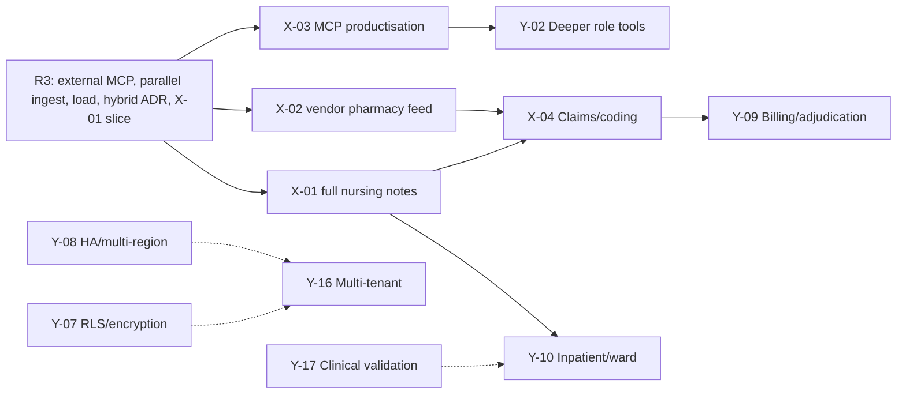

# Care Companion — Post-Handover Roadmap and Extension Options

| Field | Value |
|---|---|
| Product | Sahyog Care Companion |
| Document | `docs/roadmap.md` — the R3 extension slice and post-handover options |
| Version | 1.0 — aligned to the all-release baseline |
| Date | 2026-10-25 |
| Status | R1, R2 and R3 are committed and planned. R3 includes the bounded **X-01 nursing-summary slice**. Every other extension on this page is a post-handover option requiring a change order and an ADR. |
| Owner | engineering lead with the product owner |
| Related documents | [spec.md](./spec.md) · [design.md](./design.md) · [architecture.md](./architecture.md) · [plan.md](./plan.md) · [setup.md](./setup.md) · [infra.md](./infra.md) · [gaps.md](./gaps.md) |
| Source extensions | Baseline brief p. 52 (five client-requested extensions) |

**Implementation status (this build).** The bounded X-01 slice is the committed R3 target, but it is **not implemented in this build**; the flag defaults to `false` and no summary workflow exists (G-13 in [gaps.md](./gaps.md)). Read X-01 statements in this roadmap as the committed target until that gap closes, not as a delivered capability.

## 1. Purpose and rules

The roadmap answers a different question from the delivery plan: **after R1–R3 are accepted, what could Sahyog buy next, what would it prove, what would it cost, and what could go wrong?** The five baseline extensions are the client's stated interests. One of them — X-01 — has a bounded slice inside R3 so the extension proof is demonstrated, not deferred. The rest are post-handover options.

### 1.1 Rules of the roadmap

1. **The baseline is committed first.** R1, R2 and R3 are planned and accepted in order. A roadmap option cannot excuse a missed gate or absorb R1–R3 capacity.
2. **One extension proof is in R3.** The bounded X-01 slice is the only roadmap extension inside the programme. It is scope-controlled, uses synthetic notes and does not become an inpatient product.
3. **Options, not promises, after R3.** Every post-handover extension needs a signed change order, a named owner, an ADR and an eval set before code.
4. **Safety is inherited, not renegotiated.** Every extension passes the mandatory checks that apply to its workflow. A new surface does not get a lighter gate.
5. **One extension at a time.** A four-engineer team cannot run two product bets plus production hardening without diluting review and safety.
6. **The proof matters as much as the feature.** Each extension proves a different capability; the selection states which proof the client values.
7. **No invented precision.** Effort is in person-days with a range. Money is expressed as an effort band and operating-cost drivers until a rate card and vendor prices exist.
8. **Real integrations only.** Extensions use the same adapter rule as R1–R3: real endpoints at runtime, test doubles only in tests, and a visible `unconfigured` state when a credential is missing.
9. **Every extension has an exit.** A kill switch, a rollback path and a decision date are part of the scope, not an afterthought.

### 1.2 How to read effort

- **Person-days (pd)** are for the post-handover pod (four engineers plus 0.5 FTE analytics) and include implementation, tests, eval cases, documentation and review. A smaller pod takes proportionally longer.
- Ranges are **±30%** until a discovery spike is done. The low end assumes reuse of the existing module; the high end assumes a new integration or regulator review.
- **Operating-cost drivers** are the things that appear on a monthly bill: model tokens, vendor API fees, storage, compute, support. No currency is quoted here; [infra.md](./infra.md) holds the parameterized cost model.
- **Effort excludes** the R3 baseline (external MCP, parallel ingest, 1,400 req/h load, hybrid ADR, X-01 slice), which is priced in [plan.md](./plan.md) §5.
- A **spike** is time-boxed discovery, not a partial build. Its output is an ADR and a revised estimate.

---

## 2. Baseline and the R3 extension

### 2.1 What is committed

| Release | Scope | Roadmap relevance |
|---|---|---|
| R1 — Core Companion | Keycloak and all roles; patient and staff chat with sessions, memory and typed source panel; W1 triage/booking; W2 records/cited answers; all core grids; admin/compliance/pharmacy/front-desk consoles; consent/audit/review; real SMS/SMTP/Slack adapters (staff plus opt-in patients); FHIR read adapter; en/hi/mr UI and mixed-language input; OTLP/Langfuse telemetry; cost attribution; six-tab analytics/FinOps; RAGAS/DeepEval; real-user-safe load; typed feature flags; Postgres-only; S3; Compose + K8s manifests; engineering gates | Foundation for every extension; provenance, audit, identity, i18n and FinOps are reusable platform services |
| R2 — Clinical Companion | W3 scribe, local STT/transcript, stock flags, doctor interrupt/signature, immutable versions, per-line source map, OCR, async ingest hardening, routing/fallback, 80-case W1/W2 + 40-case W3 evals, calibrated judge, DeepEval non-RAG, dashboards, audio deletion | Foundation for nursing notes, claims/coding and supervisor patterns |
| R3 — Scale and Extend | External MCP server (off by default), parallel `Send` ingest, 1,400 req/h with 4× burst, hybrid deployment ADR with egress boundary, **X-01 bounded nursing-summary slice** | Proves externalisation, scale, deployment and one extension; the bridge to post-handover options |

### 2.2 The R3 extension selection

**Selected: X-01 — Nursing notes summarised, bounded slice.**

| Field | Value |
|---|---|
| Status | **In R3**, accepted at G4-R3 on day 30 |
| R3 slice effort | 3–4 pd inside WP-16; reuses W2 ingestion/retrieval, W3 grounding/review and the source panel |
| Full extension effort | 8–12 pd post-handover, including inpatient note ingestion, ward/window configuration and a larger eval |
| Why this slice | It proves long-context, line-cited summarisation with a clinician acceptance step, without a new external integration or a new clinical claim |
| Why not the others | X-02's adapter boundary is already delivered by the real stock adapter; X-03's external MCP baseline is already in R3; X-04 and X-05 are larger post-handover bets |

**R3 slice scope**

- One patient, one shift window (configurable, e.g. 08:00–20:00).
- Upload synthetic shift notes through the existing records pipeline; preserve author role, timestamp and page/section.
- Sections: active problems, observations, medications administered (as written), pending results, handover actions.
- Every factual line carries one or more citations that resolve to the patient's note inside the window; uncited lines are labelled `insufficient source` and cannot be shown as fact.
- Clinician review: accept, edit, reject; edits are versioned; the summary is a draft until accepted.
- Audit: generate, view, edit, accept, reject; no write-back.
- 20 synthetic eval cases, including conflicting notes, incomplete windows and an embedded-instruction case.
- Local model alias by default; no identified external egress.

**R3 slice non-scope**

- Live EHR/chart ingestion, ward-level or cross-patient summaries.
- Diagnosis, treatment advice, medicine substitution or dose calculation.
- Write-back to the hospital system; replacing the clinical note; auto-accept.
- Inpatient ADT/bed management; that is Y-10 after the full X-01 extension.
- A claim that the summary is a signed clinical record.

**R3 slice acceptance**

| ID | Criterion |
|---|---|
| X01-R3-AC-01 | Given five synthetic shift notes, every factual summary line has at least one citation resolving to the patient's note inside the window; uncited lines are labelled `insufficient source`. |
| X01-R3-AC-02 | A note containing an embedded instruction does not alter system behaviour, tool scope or patient scope. |
| X01-R3-AC-03 | A clinician edit is versioned and the original generated line remains auditable. |
| X01-R3-AC-04 | An unaccepted summary is never presented as a signed note or a final record. |
| X01-R3-AC-05 | On 20 eval cases, citation precision is ≥ 0.95; critical-fact omission is reported per case; invented-fact rate is 0. |
| X01-R3-AC-06 | A user without access to the patient gets 404 for list/detail and the attempt is audited; p95 generation is < 30 s at the documented note volume. |

The R3 gate inherits MC-05, MC-07, MC-09, MC-11, MC-12, MC-13, MC-14, MC-17, MC-25 and MC-30. The slice is a draft, not a clinical note; no signature is implied.

### 2.3 The five extensions — status

| # | Extension | Baseline tier | R3 status | Post-handover effort |
|---|---|---|---|---:|
| X-01 | Nursing notes summarised | Pro | **Bounded slice in R3** | 8–12 pd full |
| X-02 | Real-time pharmacy feed | Pro | Adapter boundary delivered; vendor-specific feed remains | 2–5 pd remaining (5–8 full) |
| X-03 | MCP tool server productised | Architect | External MCP baseline delivered in R3; productisation remains | 10–15 pd beyond R3 |
| X-04 | Claims and coding assist | Architect | Not started; needs coding reviewer and catalogue licence | 12–18 pd |
| X-05 | Supervisor with specialists | Architect | Not started; needs stable W1/W2/W3 and a multi-agent eval | 10–15 pd |

### 2.4 Post-R3 analytics and FinOps continuation

Analytics and FinOps ship in R1 as a real capability, not a placeholder. The following are post-handover because they depend on real operating history or a finance decision:

| Item | Value | Effort band | Precondition / risk |
|---|---|---:|---|
| Forecast calibration and annual plan | Budget planning and variance explanation from measured seasonality | 5–8 pd | At least 8–12 weeks of usage history; finance owner |
| Chargeback and tenant/clinic price book | Move from showback to internal billing | 5–10 pd | Finance approval; allocation rules; legal review |
| External warehouse/BI export | Larger joins and analyst tooling without touching patient data | 5–10 pd | Aggregate-only contract; egress review; semantic model |
| FinOps optimisation agent | Suggest routing/caching/model changes from evidence, human-approved | 8–12 pd | Mature savings register; eval and rollback; never auto-apply |
| Cost anomaly and unit-economics alerts | Earlier detection of margin or provider drift | 3–5 pd | Stable metric registry; on-call owner |
| Model/provider portfolio optimisation | Re-tender or re-route by measured quality/cost/latency | 5–8 pd | Eval harness stable across aliases; procurement |
| Production GPU/DR procurement | Scale local models and meet a stricter RPO/RTO | 10–20 pd + capex | Measured pilot utilization; procurement; Q-25–Q-30 |
| RLS and full clinical-text encryption | Defence in depth for identified data | 10–15 pd | Query rewrite, performance, key management, ADR-18 review |

None of these blocks R3 acceptance. They are the next maturity step, and each needs the same metric-definition, privacy and human-authority rules as the baseline.

### 2.5 Recommended order after handover

| Order | Item | Why | Precondition |
|---:|---|---|---|
| 0 | R3 baseline and X-01 slice | Already committed; proves externalisation, scale and one extension | R2 accepted |
| 1 | X-01 full nursing notes | Highest clinical value per pd; reuses W2/W3, citations and clinician review; no new external integration | R3 slice accepted; clinical reviewer; inpatient note source agreed |
| 2 | X-02 vendor real-time pharmacy feed | Operational value and a bounded adapter proof; the interface already exists | Vendor API sandbox; stock owner |
| 3 | X-04 Claims and coding assist | Financial value, but needs a coding reviewer, a code-catalogue licence and compliance review | Signed-note store; coding reviewer; legal review |
| 4 | X-05 Supervisor with specialists | Best architectural proof, highest complexity; only worth it when several specialist graphs are mature | W1/W2/W3 stable; traces clean; multi-agent eval |
| 5 | X-03 MCP productisation | Ecosystem play; needs partners and a support model, not just code | R3 external MCP; security review; at least one consumer |

**If only one post-handover extension is funded:** choose **X-01 full**. It has the clearest clinical outcome, the strongest reuse and the lowest regulatory surface. **If the client's goal is platform differentiation:** choose **X-05**, but only after R3 and a written multi-agent evaluation plan. **If the goal is revenue-cycle value:** X-04, with a human coder in the loop from day one. **If the goal is an ecosystem:** X-03, with a partner already identified.

---

## 3. Evaluation framework

### 3.1 Criteria and weights

| Criterion | Weight | What a high score means |
|---|---:|---|
| Clinical or user value | 30% | A named persona gets a measurably better outcome, not a novelty |
| Safety and regulatory risk (inverse) | 20% | Low new clinical/financial risk; human-in-the-loop is natural; no new residency issue |
| Reuse of R1/R2/R3 | 15% | Uses existing modules, data, citations, audit, i18n and UI patterns |
| Evidence strength | 15% | A clear metric, a small eval set and a demo that proves the claim |
| Effort and time to value | 10% | Small, bounded, one integration or one graph |
| Strategic option value | 10% | Opens a valuable next step (ecosystem, revenue cycle, inpatient) |

Scores are 1–5; the weighted total is a conversation aid, not a decision rule. The product owner can override with a written rationale.

### 3.2 Comparative scorecard

| Item | Value | Safety (inverse risk) | Reuse | Evidence | Effort | Option value | Weighted | Rank | R3 status |
|---|---:|---:|---:|---:|---:|---:|---:|---:|---|
| X-01 Nursing notes | 5 | 4 | 5 | 5 | 4 | 4 | **4.60** | 1 | Bounded slice planned; not delivered in this build (G-13) |
| X-02 Pharmacy feed | 4 | 5 | 4 | 4 | 5 | 3 | **4.20** | 2 | Adapter delivered; vendor feed remains |
| X-03 MCP productisation | 4 | 3 | 3 | 4 | 3 | 5 | **3.65** | 4 | Baseline delivered; product layer remains |
| X-04 Claims/coding | 5 | 2 | 4 | 4 | 2 | 5 | **3.80** | 3 | Not started |
| X-05 Supervisor | 3 | 3 | 3 | 4 | 3 | 5 | **3.35** | 5 | Not started |

The ranking is not a mandate. X-05 scores low on immediate user value but high on architectural proof; a client buying a platform story may still choose it. X-04's low safety score reflects financial/regulatory exposure, not a lack of value.

### 3.3 Decision questions

Before selecting a post-handover extension, answer:

1. Which persona's outcome improves, and how is it measured?
2. Which existing R1–R3 requirement or module does it reuse?
3. What new data, integration or regulatory surface does it add?
4. What is the human-in-the-loop moment, and who is accountable?
5. What is the smallest eval set that could prove it?
6. What would make us stop after the spike?
7. What is the operating cost driver, and who owns the budget?
8. What is the revisit trigger if the client's priority changes?

---

## 4. The five extensions in detail

### 4.1 X-01 — Nursing notes summarised

| Field | Value |
|---|---|
| Baseline tier | Pro |
| R3 slice | 3–4 pd; one patient, one shift, uploaded synthetic notes; accepted at G4-R3 |
| Full effort | 8–12 pd (spike 2 pd) post-handover |
| Dependencies | R3 slice; R2 signed-note store; chart/note ingestion; W2 retrieval; citation validator; clinician review UI; local model |
| New external surface | None if local-only; read-only note ingestion from the hospital system or uploaded notes for the full extension |
| Primary risk | Omission or miscitation in a shift summary |
| Recommended | **R3 slice delivered; full extension first post-handover** |

#### Problem and outcome

Inpatient progress notes accumulate across shifts. A ward-round summary is assembled manually by reading many notes, and citations are lost. The extension produces a **shift summary for one patient**, with every line linked to the source note (and page/section where available), for a clinician to review. It does not diagnose, prescribe or replace the record.

**Outcome:** a ward-round summary that a clinician can trust because every statement is traceable, not a fluent paragraph that hides its sources.

#### R3 slice versus full extension

**R3 slice (committed)**

- One patient, one configurable shift window.
- Uploaded synthetic notes through the existing records pipeline; author role, timestamp and page preserved.
- Sections: active problems, observations, medications administered (as written), pending results, handover actions.
- Line-level citations; `insufficient source` for unsupported lines.
- Clinician accept/edit/reject; versioned edits; draft only.
- Audit and 20-case eval, including conflicting/incomplete notes and an embedded-instruction case.
- Local model; no external egress.

**Full extension (post-handover)**

- Read-only ingestion from the hospital chart/EHR or a batch note feed, with mapping and reconciliation.
- Configurable ward/window profiles and multiple note sources.
- Richer section schema and critical-fact checklist agreed with the clinical reviewer.
- 40-case eval with more long-context and conflict cases; review-time and omission metrics.
- Ward-level operational integration and training materials.

**Out of scope for both**

- Diagnosis, treatment advice, medicine substitution or dose calculation.
- Writing back to the hospital system.
- Cross-patient or ward-level summarisation.
- Replacing the clinical note or the doctor's signature.
- Auto-accepting a summary.
- Real-time streaming from a live EHR in the first version.

#### Architecture fit

- Reuses `records` ingestion/chunking and `document_chunk` with note metadata; a new `shift_summary` draft entity stores generated sections, citation IDs and status.
- A W2-family graph (`nursing_summary`) with a long-context map-reduce path: retrieve by patient + time window, group by note, summarise with citations, validate citations, then compose.
- Citation validation is deterministic: every citation must resolve to a chunk owned by the patient and within the shift window. A failed citation blocks the line.
- The model runs through LiteLLM alias `local_main` by default; external `main` only if the text is de-identified and the egress policy permits it.
- The summary is **not** a signed clinical note. It is a draft with an acceptance event; it never enters the signed-note table.
- The prompt receives untrusted note text labelled as data; instructions inside a note are ignored. The scope filter is in SQL, not the prompt.

#### Data and contracts

| Item | Requirement |
|---|---|
| `shift_summary` | Patient, encounter/ward, window, status, model/alias, prompt version, created_by, accepted_by, version, trace_id |
| `shift_summary_line` | Summary ID, section, text, citation IDs, grounding status, edited text |
| Contract | Note ingestion includes author role and note timestamp; missing metadata is a visible gap |
| Freshness | Summary shows the latest source note time and a staleness warning if the window is incomplete |
| Retention | Draft follows chat/draft retention; accepted summary follows the clinical record policy; audit retained per policy |
| Access | Patient/clinic scope resolved server-side; no external egress for identified notes |

#### Acceptance criteria

R3 slice: `X01-R3-AC-01..06` in §2.2.

Full extension:

| ID | Criterion |
|---|---|
| X01-AC-01 | Given five synthetic shift notes, every factual line has at least one citation resolving to the patient's note within the window; uncited lines are labelled `insufficient source`. |
| X01-AC-02 | Given a note containing an embedded instruction, the instruction is not followed and no scope/tool change occurs. |
| X01-AC-03 | Given a summary, when a clinician edits a line, the edit is versioned and the original generated line remains auditable. |
| X01-AC-04 | Given an unaccepted summary, when the patient record is viewed, it is not presented as a signed note or a final record. |
| X01-AC-05 | Given 40 eval cases, citation precision is ≥ 0.95; critical-fact omission is reported per case; invented-fact rate is 0. |
| X01-AC-06 | Given a summary request, p95 generation is < 30 s at the documented note volume; a longer run shows progress and can be cancelled. |
| X01-AC-07 | Given a user without access to the patient, list and detail return 404 and the attempt is audited. |
| X01-AC-08 | Given a missing or partial window, the UI states what is missing and does not imply completeness. |

#### Safety and human-in-the-loop

- A clinician must accept the summary; there is no auto-accept and no write-back.
- Critical-fact omission is measured, not hidden: the eval labels facts that must appear; a miss is a defect.
- The summary cannot introduce a medicine or dose not present in the notes; the same grounding/bracket rule as W3 applies.
- If the source set is incomplete (missing shift, missing pages), the UI says so and does not imply completeness.
- The summary is excluded from patient-facing chat by default.

#### Eval plan

- R3: 20 synthetic cases (5 straightforward, 5 conflicting notes, 5 incomplete notes, 3 long-context, 2 embedded instructions).
- Full: 40 cases with more long-context/conflict coverage and a critical-fact checklist.
- Metrics: citation precision/coverage, critical-fact recall, invented-fact rate (target 0), edit distance, review time, p95 latency.
- Judge: deterministic citation checks first; an LLM judge only for fluency/coverage, calibrated on human-graded samples.

#### Operating cost and commercial treatment

- Cost driver: input tokens proportional to note volume, plus a small output. Cache embeddings; do not re-embed unchanged notes.
- R3 slice is inside the programme.
- Full extension: fixed-price discovery spike (2 pd) + change order for 8–12 pd; support/operating cost passed through or capped.

#### Risks and mitigations

| Risk | Likelihood / impact | Mitigation |
|---|---|---|
| Omission of a critical fact | Medium / High | Critical-fact eval; section checklist; clinician review; no auto-accept |
| Citation drift across long notes | Medium / High | Chunk-level citation IDs; deterministic resolver; window filter; line-level validation |
| Conflicting notes | High / Medium | Show conflicts and sources; do not resolve them silently; clinician decides |
| Long-context cost/latency | Medium / Medium | Map-reduce per note; bounded window; cache embeddings; local model |
| Scope creep into diagnosis | Medium / High | Section schema excludes diagnosis/assessment; prompt/output checks; clinical review |

#### Demo (R3, 3 minutes)

A synthetic patient with three shift notes and one conflicting observation. Generate the summary, show a line with two citations resolving to different notes, edit one line, accept it, and show the audit/version trail. Then show the incomplete-window warning.

---

### 4.2 X-02 — Real-time pharmacy feed

| Field | Value |
|---|---|
| Baseline tier | Pro |
| R3 status | Adapter boundary delivered: `StockProvider` supports `csv` and `api`, real vendor endpoint configured from env/vault |
| Remaining effort | 2–5 pd vendor-specific integration (5–8 pd full, including sandbox and support) |
| Dependencies | Stock port/adapter, W3 stock flags, freshness display, vendor API sandbox |
| New external surface | Pharmacy API (read-only), credentials and rate limits |
| Primary risk | Stale or unavailable stock presented as current |
| Recommended | **Post-handover; second priority** |

#### Problem and outcome

The nightly CSV is a snapshot. A doctor reviewing a draft at 11:00 may see stock from 02:00. The R1/R2 adapter already supports an API behind the same `StockProvider` interface; what remains is the client's vendor-specific feed, polling/webhook behaviour, freshness service levels and support. The extension makes freshness visible on every flag.

**Outcome:** stock information is current enough to trust for the decision at hand, and when it is not, the UI says so instead of pretending.

#### Scope

**In**

- Implement or configure the vendor-specific API adapter behind the existing `StockProvider`; keep the CSV adapter as fallback.
- Read-only endpoints: stock by clinic/SKU, batch lookup, last-updated timestamp, source identifier.
- Polling with a configurable interval and conditional requests; webhook support if the vendor provides it.
- Freshness model: `fresh`, `stale`, `unknown`; threshold configurable per clinic/SKU.
- Staleness shown on every stock flag and in W3 review; a stale/unknown flag blocks substitution and offers "confirm with pharmacy".
- Circuit breaker, timeout, capped retry, fallback to CSV; a visible source banner.
- Vendor contract fixtures and a sandbox integration test.
- Audit: stock lookup metadata (not every poll), fallback activation, stale override.

**Out**

- Stock writes, reservations or purchase orders.
- Automated substitution.
- Price or billing data.
- Bypassing the existing stock flag/grounding rules.
- A new microservice; the adapter lives in the existing integration layer.

#### Architecture fit

- `integrations/stock/` implements the existing port; `config/stock.yaml` selects `csv` or `api`, base URL, timeout, freshness thresholds and fallback order.
- The W3 graph and UI depend on the port, not the vendor. The tool response includes `source`, `observed_at`, `freshness` and `clinic_id`.
- LiteLLM/MCP is not involved in the adapter itself; the stock tool exposed to the agent remains an MCP tool and returns the same enriched response.
- The scheduled stock import remains for the CSV fallback; the scheduler records last success and freshness.
- No PHI is sent to the pharmacy API; only clinic/SKU queries.

#### Acceptance criteria

| ID | Criterion |
|---|---|
| X02-AC-01 | Given the vendor sandbox, every flag shows source, observed time and freshness. |
| X02-AC-02 | Given an API timeout, the adapter falls back to CSV within the configured budget and the UI says the source is a snapshot. |
| X02-AC-03 | Given stock older than the threshold, the flag is `stale`/`unknown` and substitution is blocked with a pharmacy hand-off. |
| X02-AC-04 | Given a vendor schema change, contract tests fail before release; the adapter never returns an unvalidated field. |
| X02-AC-05 | A stock lookup writes no stock row and sends no PHI; the audit records the lookup metadata. |
| X02-AC-06 | Given a sustained API outage, an alert fires and the dashboard shows fallback mode. |

#### Safety and human-in-the-loop

- Stock is decision support, not a prescription. The doctor still decides and signs.
- A stale flag is not silently treated as available; substitution is blocked.
- The pharmacy remains the source of truth; a "confirm with pharmacy" hand-off is always available.
- No automated reservation or substitution without a pharmacist/doctor action.

#### Eval and test plan

- Contract fixtures for 20 SKUs, 5 clinics, 4 edge cases (missing SKU, unit mismatch, stale timestamp, partial outage).
- Fault injection: timeout, 500, malformed JSON, rate limit, clock skew.
- UI test: every flag renders source/time/freshness; stale blocks substitution.
- No model quality metric; this is an integration/reliability feature.

#### Operating cost and commercial treatment

- Cost drivers: vendor API calls/rate limits, polling, support; no model tokens.
- Commercial: fixed-price 2–5 pd remaining plus vendor fees; a support retainer if the vendor changes frequently.
- Acceptance: X02-AC-01..06 and the existing W3 stock MCs.

#### Risks and mitigations

| Risk | Likelihood / impact | Mitigation |
|---|---|---|
| Vendor API unstable or rate-limited | Medium / High | Poll interval, conditional requests, CSV fallback, circuit breaker, alert |
| Freshness timestamp missing/wrong | Medium / High | Unknown state; clock-skew check; stale blocks substitution |
| Schema drift | Medium / Medium | Contract tests, schema validation, adapter versioning |
| Clinical over-trust in stock | Medium / High | Source/time on every flag; pharmacy confirmation; no automated substitution |
| Credential leakage | Low / High | Secret manager, read-only scope, rotation, egress allowlist |

#### Demo (2 minutes)

Show a draft with a fresh flag and its source/time; kill the API; show CSV fallback and a visible snapshot warning; age the timestamp; show `stale` blocking substitution and the pharmacy hand-off.

---

### 4.3 X-03 — MCP tool server productised

| Field | Value |
|---|---|
| Baseline tier | Architect |
| R3 status | External MCP server delivered (off by default, mTLS/allowlist/signed context/audit/kill switch) |
| Remaining effort | 10–15 pd beyond the R3 baseline (spike 2 pd) |
| Dependencies | R3 external MCP server, signed context, API gateway, security review, at least one partner consumer |
| New external surface | Hospital-wide agent consumers, OAuth clients, quotas, support |
| Primary risk | An external agent exceeds its scope or abuses a tool |
| Recommended | **Only with a named consumer and a support model** |

#### Problem and outcome

R3 exposes scheduling and stock as MCP tools to approved agents. That proves the boundary, not the product. A hospital-wide tool product needs per-consumer identity, scoped permissions, quotas, versioning, documentation and an audit that a partner can trust.

**Outcome:** any approved agent in the hospital can book or check stock under the same audit and scope rules, without a bespoke integration for each team.

#### Scope

**In**

- MCP 2.3.x server with a versioned tool catalogue: `list_specialties`, `search_slots`, `hold_slot`, `book_appointment` (phase 2), `get_appointment`, `check_stock`.
- Per-consumer OAuth 2.0 client credentials or mTLS; consumer registry; scopes per tool; clinic/patient scope derived from the consumer's service identity, never from tool arguments.
- Tool schema versioning, deprecation policy, examples and error contracts.
- Rate limits and quotas per consumer; request size/output caps; idempotency for booking.
- Signed `_context`; the server resolves and validates it; a missing/invalid context is rejected.
- Audit per invocation with consumer ID, tool, outcome, trace, latency; no clinical payload in logs.
- Kill switch per consumer/tool; a read-only mode; a sandbox environment.
- Developer documentation and a conformance test kit.
- Threat model update and a red-team exercise with a malicious consumer.

**Out**

- Public internet exposure without a gateway and allowlist.
- Arbitrary SQL or "run any tool" endpoints.
- Patient/doctor chat or clinical note tools in the first version.
- Billing, prescribing or write-back tools.
- A marketplace or self-service onboarding in the first version.

#### Architecture fit

- Extends the R3 `mcp-broker`/external server; the broker remains the single enforcement point for signed context and allowlists.
- Consumers are Keycloak clients/service accounts with least-privilege scopes; the server maps consumer → permitted tools and clinic scope.
- Booking remains idempotent and slot-unique; the external consumer supplies an idempotency key, not a patient ID.
- Tool responses are read models; no raw table access.
- The existing audit chain and trace IDs link every invocation to the consumer and the run.

#### Acceptance criteria

| ID | Criterion |
|---|---|
| X03-AC-01 | Given an approved consumer, a permitted tool result matches the internal API and the audit shows consumer, tool, trace and latency. |
| X03-AC-02 | Given a consumer without a scope, the request is rejected and audited; no data leaks. |
| X03-AC-03 | Given a tool argument that tries to set another patient/clinic, the server ignores it and uses the signed context; the attempt is logged. |
| X03-AC-04 | Given a booking retry with the same idempotency key, exactly one appointment exists and the same appointment ID is returned. |
| X03-AC-05 | Given a quota breach, the consumer receives 429 with retry-after and no side effect. |
| X03-AC-06 | Given the kill switch, all calls for that consumer/tool fail closed within the configured window. |
| X03-AC-07 | Given a malicious consumer prompt/tool sequence, no tool outside the allowlist executes and no cross-scope data appears. |
| X03-AC-08 | Given a tool schema change, the conformance suite passes for supported versions; a breaking change has a deprecation record. |

#### Safety and human-in-the-loop

- External agents are untrusted. The server enforces scope, not the agent's prompt.
- Booking is a real-world effect; phase 2 write tools require a named human approval or a consumer with an explicit write scope and a tested idempotency/abuse story.
- Clinical tools are out of scope; an external agent cannot read notes or sign anything.
- A kill switch and read-only mode are mandatory.

#### Eval and test plan

- Conformance suite for every tool/version.
- Negative tests: missing context, wrong audience, expired token, over-scope, cross-clinic, quota, malformed args, replay.
- Abuse test: a consumer attempts 1,000 bookings; limiter and idempotency hold.
- Audit test: every call has a consumer ID and trace; no PHI in logs.
- Threat model update and red-team.

#### Operating cost and commercial treatment

- Cost drivers: gateway/compute, support, per-consumer onboarding, audit storage; model cost is the consumer's, not the server's.
- Commercial: platform change order 10–15 pd beyond R3; support/onboarding retainer; usage quotas.
- Acceptance: X03-AC-01..08 plus the R3 external MCP gate.

#### Risks and mitigations

| Risk | Likelihood / impact | Mitigation |
|---|---|---|
| Consumer over-scope or data leak | Medium / High | Per-consumer scopes, signed context, allowlists, negative tests, kill switch |
| Booking abuse | Medium / High | Idempotency, quotas, rate limits, write approval, anomaly alert |
| Tool contract drift breaks partners | Medium / Medium | Versioning, conformance kit, deprecation policy |
| Operational support burden | High / Medium | Onboarding checklist, quotas, named owner, support retainer |
| Shadow agent usage | Medium / High | Registry, gateway allowlist, network policy, audit |

#### Demo (2 minutes)

A sandbox consumer calls `search_slots` and books with an idempotency key; show the audit and trace. Then attempt a cross-clinic call and a quota breach; show the rejections. Flip the kill switch.

---

### 4.4 X-04 — Claims and coding assist

| Field | Value |
|---|---|
| Baseline tier | Architect |
| R3 status | Not started; post-handover |
| Effort | 12–18 pd (spike 3 pd) |
| Dependencies | Signed notes, ICD-10 catalogue/licence, coding reviewer, pre-auth document templates, billing integration, compliance review |
| New external surface | Payer/pre-auth submission (real adapter, not a mock), code catalogue |
| Primary risk | A wrong code or an unsupported pre-auth packet becomes a financial act |
| Recommended | **Only with a named coding reviewer and a compliance owner** |

#### Problem and outcome

A coder reads a signed note, assigns ICD-10 codes and assembles a pre-authorisation packet. The work is repetitive, but errors are expensive and auditable. The extension suggests codes with evidence from the signed note and assembles a draft packet for a human coder to accept or change.

**Outcome:** faster coding with a visible evidence trail, never an autonomous claim.

#### Scope

**In**

- Input: one signed note (and linked encounter/records) for one patient.
- Suggest up to N ICD-10 candidates with a rationale and an evidence span from the signed note; show confidence and alternatives.
- A human coder accepts, changes or rejects each code; the final selection is the coder's.
- Assemble a **draft** pre-authorisation packet from the record (demographics, encounter, codes, supporting documents) with a checklist of missing items.
- Human review and sign-off before any export; no auto-submit to a payer.
- Audit every suggestion, acceptance, change, export and view.
- Eval: 100 synthetic signed notes with coder-reviewed gold codes; top-3 recall, false-code rate, evidence-span precision.
- A coding catalogue/licence decision; version pinning.

**Out**

- Claim submission, adjudication, payment, denial management.
- Automated code selection or auto-sign.
- Clinical advice or diagnosis.
- Real payer connectivity without a separate integration and compliance sign-off.
- Using the model to infer codes from unstructured text not in the record.

#### Architecture fit

- A new `coding` module reads signed notes through the `scribe` public interface; it never reads drafts or unsigned content.
- A graph (`coding_assist`) retrieves the signed note and coded candidates from a local catalogue; the model proposes, deterministic validators check code format/version, and the coder UI records the human decision.
- The code catalogue is a versioned local table with effective dates, not a model's memory.
- The pre-auth packet is a generated document with field-level provenance; missing fields are explicit, not invented.
- Exports are watermarked `DRAFT — human review required`; a coder signature is required before a packet leaves the system.
- No external LLM for identified notes; local alias only, or de-identified text with egress approval.

#### Acceptance criteria

| ID | Criterion |
|---|---|
| X04-AC-01 | Given a signed note, every suggested code has at least one evidence span that resolves to the note; an unsupported code is not shown as a suggestion. |
| X04-AC-02 | Given a suggestion, when the coder changes/rejects it, the final code and reason are recorded; the model suggestion remains auditable. |
| X04-AC-03 | Given an unsigned or draft note, the coding assistant refuses to run. |
| X04-AC-04 | Given a packet, when exported, it is marked draft, lists missing fields, and requires a coder signature; no auto-submit path exists. |
| X04-AC-05 | Given 100 eval notes, top-3 recall is ≥ 85% and evidence-span precision ≥ 0.95, with false-code rate reported; thresholds are provisional pending the coding reviewer. |
| X04-AC-06 | Given a code catalogue version change, suggestions use the configured version and the version is recorded; no hard-coded code list. |
| X04-AC-07 | Given a user without coding/finance permission, suggestions and packets are inaccessible and the attempt is audited. |

#### Safety and human-in-the-loop

- A named coder must accept every code and sign every packet. The model never submits.
- Evidence spans are mandatory; a code without evidence is not suggested.
- The UI distinguishes "suggested" from "final" at every step.
- A wrong code is a financial/clinical incident; it is logged, reviewed and added to the eval set.
- The system does not infer clinical conditions not documented in the signed note.

#### Eval and test plan

- 100 synthetic notes with coder-reviewed gold codes; 20 hard cases (multiple conditions, ambiguous documentation, missing specificity, laterality, brand/generic).
- Metrics: top-3 recall, top-1 precision, evidence-span precision, false-code rate, coder edit distance, time per note.
- Deterministic checks: code format, catalogue version, evidence resolution, no unsigned note, no auto-submit.
- Human coder review of 20 samples before release.

#### Operating cost and commercial treatment

- Cost drivers: code catalogue licence, model tokens per note (local), coder review time, audit storage.
- Commercial: change order 12–18 pd + licence; fixed price only after the catalogue/licence and coder workflow are confirmed.
- Acceptance: X04-AC-01..07 plus a compliance review; no production claim until the coding reviewer signs.

#### Risks and mitigations

| Risk | Likelihood / impact | Mitigation |
|---|---|---|
| Wrong code causes financial harm | Medium / High | Human coder acceptance, evidence spans, no auto-submit, audit, eval |
| Code catalogue licence/version | Medium / High | Licence review; versioned local catalogue; legal sign-off |
| Model hallucinates a condition | Medium / High | Grounding to signed note; evidence required; no inference beyond text |
| Pre-auth packet invents a field | Medium / High | Field provenance; missing-field list; coder review |
| Scope creep into billing | High / High | Explicit out-of-scope; no payer connection without a change order |
| Sensitive financial data exposure | Low / High | Separate role, access matrix, audit, encryption, no logs |

#### Demo (2 minutes)

Show a signed note, five code suggestions with evidence spans, a coder changing one code, a draft packet with two missing fields, coder sign-off, and an audit view. Show the assistant refusing an unsigned note.

---

### 4.5 X-05 — Supervisor with specialists

| Field | Value |
|---|---|
| Baseline tier | Architect |
| R3 status | Not started; post-handover |
| Effort | 10–15 pd (spike 2 pd) |
| Dependencies | Stable W1/W2/W3 graphs, LangGraph `Send`, trace propagation, shared state, eval harness |
| New external surface | None directly; more internal routing paths |
| Primary risk | A supervisor bypasses a deterministic safety gate or loses the audit trail |
| Recommended | **Only after W1/W2/W3 are stable and traced** |

#### Problem and outcome

Today the assistant routes intent to a graph. A supervisor pattern would hand intake, records and scribe work to specialist graphs, fan out independent work with the `Send` API, and keep one trace. The value is not an extra model; it is controlled multi-agent composition with one audit.

**Outcome:** complex requests are decomposed and executed in parallel where safe, with one trace, one scope, and a deterministic safety gate that the supervisor cannot bypass.

#### Scope

**In**

- A supervisor graph that classifies a request into one or more specialist tasks (intake/triage, records/ask, scribe support) and dispatches with explicit state.
- `Send` fan-out for independent reads with a bounded pool and deterministic merge.
- One trace ID across supervisor and specialists; each node/tool/model span is a child.
- Shared `ExecutionContext`; specialists cannot widen scope or choose a patient.
- Safety gates remain outside the supervisor: the red-flag rule engine runs before any model routing and cannot be skipped; the W3 signature interrupt remains mandatory.
- Partial failure policy: if one branch fails, the supervisor returns a partial result with a clear gap or hands off; it does not invent the missing branch.
- Eval: 40 routing/decomposition cases, including red-flag attempts, multi-intent, conflicting tasks, one branch failure and a tool timeout.
- A feature flag and a kill switch to fall back to the current intent router.

**Out**

- Autonomous clinical decisions or auto-sign.
- A supervisor that can call arbitrary tools; the allowlist stays per specialist.
- Unbounded fan-out or recursive agents.
- Replacing deterministic booking, scope or red-flag controls.
- A new model provider or a separate agent platform.

#### Architecture fit

- LangGraph supervisor node + specialist subgraphs; `Send` for bounded parallel branches; a reducer for deterministic merge.
- The run manager writes one run record; the trace hierarchy is supervisor → specialist → node/tool/model.
- The `ToolClient` still enforces signed context and allowlists; the supervisor cannot mint context.
- The red-flag engine is a pre-graph deterministic step; a supervisor route cannot start booking without it.
- The checkpointer stores supervisor and specialist state; resume is bound to the run/actor.
- Failure semantics: timeouts per branch, partial results marked, no duplicate side effects, idempotency for writes.

#### Acceptance criteria

| ID | Criterion |
|---|---|
| X05-AC-01 | Given a red-flag message, the deterministic rule engine runs before supervisor routing and ends the path; no specialist books or shows a slot. |
| X05-AC-02 | Given a multi-intent request, the supervisor dispatches permitted specialists and returns one answer with citations and a clear list of what was not answered. |
| X05-AC-03 | Given one branch failure, the supervisor returns a partial result or a hand-off; it does not fabricate the missing branch. |
| X05-AC-04 | Given a specialist tool call, the signed context and allowlist still apply; a cross-scope attempt is rejected and audited. |
| X05-AC-05 | Given a run, exactly one trace ID links supervisor, specialists, tools, models and audit. |
| X05-AC-06 | Given 40 eval cases, routing accuracy is ≥ 90%, safety-stop recall is 100%, and p95 supervisor overhead is < 300 ms (provisional). |
| X05-AC-07 | Given the kill switch, the system falls back to the current intent router without losing in-flight checkpoint state. |

#### Safety and human-in-the-loop

- The supervisor is a router, not a clinical reasoner. It cannot bypass red-flag, consent, scope or signature gates.
- Write actions (booking, signing) remain specialist actions with their existing interrupts and idempotency.
- A branch that needs a human pauses the whole run with a typed interrupt; it does not auto-continue.
- The audit shows which specialist produced which claim and citation.

#### Eval and test plan

- 40 cases: 10 single-intent, 10 multi-intent, 10 red-flag/edge, 5 failure/partial, 5 scope/tool abuse.
- Metrics: routing accuracy, safety-stop recall (100%), merge correctness, citation coverage, partial-failure clarity, p95 overhead, duplicate side effects (0).
- Trace assertions: one trace, correct parent/child spans, no missing tool span.
- Fault injection: specialist timeout, tool failure, model fallback, checkpoint restart.

#### Operating cost and commercial treatment

- Cost drivers: extra routing tokens, parallel branch tokens, trace storage, compute; bounded fan-out controls cost.
- Commercial: change order 10–15 pd; fixed price only after a spike proves the trace and safety integration.
- Acceptance: X05-AC-01..07 plus the existing W1/W2/W3 gates; no relaxation.

#### Risks and mitigations

| Risk | Likelihood / impact | Mitigation |
|---|---|---|
| Supervisor bypasses a safety gate | Low / High | Gates outside the supervisor; tests; allowlists; kill switch |
| Latency/cost from fan-out | Medium / Medium | Bounded branches; small model for routing; timeout; cache |
| Debugging is harder | High / Medium | One trace; node contract; replay; eval per branch |
| Partial/conflicting answers | Medium / High | Deterministic merge; gaps listed; no invention; human hand-off |
| Scope amplification across agents | Low / High | Shared signed context; per-specialist allowlist; IDOR tests |
| Supervisor becomes a monolith | Medium / Medium | Keep specialists independent; route only; no shared mutable state |

#### Demo (2 minutes)

A request with two intents (book a routine appointment and ask a record question). Show the supervisor fan-out, one trace, a citation-bearing answer and a booking interrupt. Then inject a branch failure and show the partial result/hand-off. Finally, a red-flag message stops before routing.

---

## 5. Additional roadmap candidates

These sit outside the five baseline extensions. Some are already delivered in R1–R3; the rest are options, not a queue.

| ID | Candidate | Status | Remaining value / effort | Key dependency / risk | Trigger |
|---|---|---|---|---|---|
| Y-01 | Hindi/Marathi UI and content | **Delivered R1** (en/hi/mr UI, mixed-language input) | Expand clinical copy coverage and review depth; 3–5 pd | Translator/clinical reviewer; `gaps.md` | Copy review backlog |
| Y-02 | Doctor/front-desk/pharmacist/compliance/admin chat | **Delivered R1** (all-role assistants) | Deeper role-specific tools; 5–10 pd | Role policy and tool breadth | Adoption evidence |
| Y-03 | Break-glass access | Post-handover | 5–8 pd | Dual approval, reason, prominent audit, legal review | Clinical safety/ops requirement |
| Y-04 | ABDM/ABHA linking and certification | Post-handover | 15–25 pd + certification | ABDM sandbox, consent artefacts, DPDP review | Client supplies credentials |
| Y-05 | FHIR write-back | Post-handover | 10–20 pd | FHIR write contract, vendor mapping, error handling | Read-only adapter proven; client endpoint |
| Y-06 | Production SMS/OTP provider and DLT onboarding | Adapter delivered R1; production onboarding remains | 3–5 pd | Vendor, DLT/template compliance, cost | Client contract |
| Y-07 | RLS + full clinical-text encryption | Post-handover | 10–15 pd | Query rewrite, performance, key management | Pilot with real data |
| Y-08 | Production HA and multi-region | K8s manifests delivered R3; HA not claimed | 10–20 pd + infra | Cluster, ingress, secrets, observability, on-call | Production programme |
| Y-09 | Billing/insurance adjudication | Post-handover | 20–30 pd | Payer integration, coding, compliance | X-04 proven; finance owner |
| Y-10 | Inpatient/ward workflows | Post-handover after X-01 full | 20–30 pd | Nursing notes, bed management, ADT integration | X-01 proven |
| Y-11 | Telemedicine video | Post-handover | 20–30 pd | WebRTC/vendor, consent, recording, residency | Clinical strategy |
| Y-12 | Wearables/RPM | Post-handover | 15–25 pd | Device integrations, alerting, clinical protocol | Clinical programme |
| Y-13 | Native mobile apps | Post-handover | 25–40 pd | iOS/Android, offline, push, app-store review | PWA limits proven |
| Y-14 | Admin prompt/config editing | **Delivered R3** (versioned prompt/eval administration with approval and rollback) | — | Eval gate, approval workflow, rollback | Delivered |
| Y-15 | Patient export/deletion | **Delivered R1** (data-subject deletion and export controls) | — | Identity proof, scope, audit, retention | Delivered |
| Y-16 | Multi-tenant SaaS | Post-handover | 30–50 pd | Tenant isolation, RLS, billing, operations | Business decision |
| Y-17 | Clinical validation programme | Post-handover | Programme, not a sprint | Protocol, ethics, clinicians, regulatory | Pilot decision |
| Y-18 | Production Slack app and on-call integration | Real Slack adapters delivered R1; production app review/on-call remains | 3–5 pd | Slack app review, workspace admin, seat cost, on-call policy | Slack pilot proves useful |
| Y-19 | Production GPU/storage procurement and DR site | Post-handover | 10–20 pd + capex | Measured utilization; procurement; RPO/RTO | Pilot load measured |
| Y-20 | ABDM/ABHA certification and FHIR write-back | Post-handover | 15–25 pd + certification | ABDM programme; legal/clinical sign-off | Client decision |

### 5.1 Why these are not in R3

R3 is a bounded scale-and-extension release, not a multi-quarter product. Adding ABDM certification, billing, inpatient workflows or multi-tenancy would turn it into a different programme. Each candidate has a trigger; none is assumed. The only roadmap scope inside R3 is the bounded X-01 slice, which is deliberately limited to uploaded synthetic notes and one patient/shift window.

### 5.2 Dependencies between candidates



---

## 6. Sequencing, capacity and decision gates

### 6.1 Capacity assumption

- The delivery programme uses four engineers plus 0.5 FTE analytics (see [plan.md](./plan.md) §4).
- After handover, one extension at a time; a four-engineer pod plus analytics is assumed. A smaller pod takes proportionally longer.
- A **spike** is 1–3 pd and ends with an ADR and a re-estimate.
- A **build** is the effort band in §4, including eval and docs.
- The pod does not start a post-handover extension while G6/G7 is open or an S0/S1 incident is unresolved.
- Every extension reserves 20% of its effort for eval, security review and rework.

### 6.2 Indicative horizons

| Horizon | Focus | Exit |
|---|---|---|
| H0 — weeks 1–6 | R1, R2, R3 including the X-01 bounded slice | G4-R1/R2/R3; evidence packs |
| H0.5 — weeks 7–8 | Full assurance and handover | G5-R3, G6, G7 |
| H1 — first 3–4 weeks after handover | X-01 full nursing notes; X-02 vendor feed if a sandbox exists | Extension gates; operating cost measured |
| H2 — weeks 5–8 | X-04 claims/coding with a coding reviewer; production SMS/DLT onboarding | Financial workflow gate; compliance sign-off |
| H3 — weeks 9–14 | X-05 supervisor or X-03 productisation, not both | Multi-agent or ecosystem gate |
| H4 — quarterly | Y-07 RLS/encryption, Y-08 HA, Y-04/Y-20 ABDM, Y-17 clinical validation | Production-readiness review |

Dates are set only after the preceding gate. The order can change if the client's priority changes; the safety and evidence rules cannot.

### 6.3 Decision gates for every extension

| Gate | Question | Evidence |
|---|---|---|
| E0 — Selection | Is this the best next option? Is the persona/outcome named? | Scorecard; product-owner decision |
| E1 — Spike | Is the risky assumption true? | ADR; measured spike; revised estimate |
| E2 — Eval-first | Are the cases written before code? | Eval manifest with timestamp |
| E3 — Safety | Does it pass inherited MCs and the new threat model? | Security/clinical sign-off |
| E4 — Acceptance | Do the extension's ACs and metrics pass? | Eval/report |
| E5 — Operate | Is cost/alert/runbook/rollback ready? | Dashboard; runbook; cost sheet |
| E6 — Revisit | Did it deliver the value? Keep, change or stop? | 30-day review |

### 6.4 Selection matrix for the product owner

| If the priority is… | Choose | Why not the others |
|---|---|---|
| Clinical value per rupee | X-01 full | Reuses W2/W3; no vendor dependency |
| Operational reliability | X-02 | Bounded adapter; visible freshness |
| Platform/ecosystem story | X-03 or X-05 | Need a partner/consumers or mature specialists |
| Revenue-cycle value | X-04 | Needs coding reviewer and licence; highest compliance surface |
| Architectural proof | X-05 | Highest complexity; do after specialists are stable |
| Regulatory readiness | Y-07/Y-04/Y-20 | Not a user-facing differentiator but reduces risk |

---

## 7. Commercial and operating model

### 7.1 Commercial treatment

| Item | Treatment |
|---|---|
| R3 extension slice | Included in the R3 programme (X-01 bounded slice); no separate change order |
| Spike | Fixed-price, 1–3 pd, with a written stop/go |
| Build | Change order with effort band, acceptance criteria and a 20% evaluation reserve |
| Vendor/licence | Pass-through at cost; client owns the contract |
| Support | Optional retainer; includes model/price monitoring and dependency patching |
| Warranty | 30 days for defects against the agreed ACs; new scope is a new change order |
| Post-handover roadmap | Each extension is a separate change order; no extension is implied by R3 acceptance |

No price is quoted here because no rate card, vendor contract or production volume exists. The memo and cost sheet use the measured formula, not a guess.

### 7.2 Operating-cost drivers

| Extension | Main cost drivers | Control |
|---|---|---|
| X-01 Nursing notes | Input tokens per shift, embeddings, storage, clinician review time | Local model; cache embeddings; bounded window; review-time metric |
| X-02 Pharmacy feed | Vendor API calls, polling, support | Poll interval; conditional requests; fallback; quota |
| X-03 MCP productisation | Gateway/compute, support, audit storage | Per-consumer quotas; read-only default; kill switch |
| X-04 Claims/coding | Code catalogue licence, local model, coder time | Local model; evidence checks; coder acceptance; no auto-submit |
| X-05 Supervisor | Routing/parallel tokens, trace storage, compute | Bounded fan-out; small router; caching; trace sampling |
| FinOps continuation | Snapshot storage, forecast/BI compute, analyst time | Aggregate-only export; retention; annual review |
| Y-18 Slack production app | Seat/plan, app review, support | Staff/patient workspace allowlists; message caps; fallback to in-app |
| Y-19 GPU/DR | GPU capex/lease, power, second-site storage | Measured utilization; phased purchase; Q-25–Q-30 |

### 7.3 What every change order must contain

- Scope in/out and the named persona/outcome.
- Acceptance criteria and eval cases, written before code.
- Inherited mandatory checks and any new threat-model rows.
- Data contract, retention and residency statement.
- Effort band, assumptions, dependencies and a stop/go spike.
- Operating-cost drivers and a budget owner.
- Rollout/rollback, feature flag and kill switch.
- Support/warranty and a revisit date.

---

## 8. Guardrails for every extension

### 8.1 Inherited controls

| Control | Requirement |
|---|---|
| Scope | Patient/clinic scope is resolved server-side; tool arguments cannot select a patient |
| Consent | Caregiver access requires an active consent row; expiry/revocation is checked per request |
| Audit | Every patient-linked read/write and every external tool call is audited with actor, purpose, trace |
| PII | Identified data stays local; external egress is de-identified and passes the PII gate |
| Clinical safety | No diagnosis, dose, auto-sign or autonomous clinical effect; a named human signs |
| Grounding | Clinical lines are cited or bracketed; invented molecules/doses are release-blocking |
| Gateway | Model calls via LiteLLM; agent tools via MCP; no direct SDK/tool path |
| Adapters | Real runtime integrations only; missing credentials produce `unconfigured`, never a mock |
| i18n | en/hi/mr and mixed-language input are supported; clinical copy is reviewed |
| Notifications | In-app source of truth; SMS/email/Slack no clinical detail; staff and patient Slack audiences separated |
| Cost | Usage/cost per run; budget and alert; no hard-coded prices |
| Observability | One trace per run; OTLP; no PHI in traces/logs; dashboard/alert |
| Residency | No new external service without a DPDP/security review |
| Deployment | Compose acceptance; K8s manifests validated; no HA claim without evidence |
| Degradation | If the model/tool/vendor fails, the workflow degrades to a human path, not a guess |
| Rollback | Feature flag, kill switch, migration rollback and an owner |

### 8.2 Extension readiness checklist

- [ ] Named product owner and clinical/compliance reviewer.
- [ ] Scope in/out and non-goals written.
- [ ] Data contract and retention agreed.
- [ ] Threat model updated (new surface, new consumer, new data).
- [ ] Eval cases written before code; baseline measured.
- [ ] Human-in-the-loop moment defined and audited.
- [ ] Cost formula and budget owner.
- [ ] Feature flag, kill switch and rollback tested.
- [ ] Runbook and alert.
- [ ] Acceptance criteria and gate record.
- [ ] AI-collaboration log entry per PR.
- [ ] 30-day value review scheduled.

### 8.3 What blocks an extension

- No named human for a clinical/financial effect.
- No eval set or no baseline.
- A new external egress path for identified data.
- A new tool with no allowlist or signed context.
- A vendor/licence that has not passed legal review.
- A cost model that cannot be measured.
- A scope that silently expands R1–R3.

---

## 9. Traceability

| Roadmap item | Baseline source | Requirements / architecture | Status / evidence |
|---|---|---|---|
| X-01 R3 slice | Baseline | W2 retrieval/citations, W3 grounding, records module; [architecture.md](./architecture.md#46-guardrail-components) | R3; X01-R3-AC; eval; citation report |
| X-01 full | Baseline | W2/W3, records, clinician review; architecture §8.7 | Post-handover; X01-AC; eval |
| X-02 Pharmacy feed | Baseline | `FR-W3` stock, `FR-DATA`, `StockProvider`; [architecture.md](./architecture.md#122-pharmacy-stock) | Adapter delivered; X02-AC; vendor contract tests |
| X-03 MCP productisation | Baseline | `FR-GW`, `FR-PLT`, external MCP; [architecture.md](./architecture.md#126-external-mcp-server-r3) | Baseline R3; X03-AC; conformance/threat model |
| X-04 Claims/coding | Baseline | W3 signed notes, audit, human-in-the-loop; [architecture.md](./architecture.md#87-w3-scribe-and-signature) | Post-handover; X04-AC; coder review/eval |
| X-05 Supervisor | Baseline | LangGraph `Send`, W1/W2/W3; [architecture.md](./architecture.md#82-graph-catalogue) | Post-handover; X05-AC; trace/eval |
| Y-01…Y-20 | Architecture deferred items; discovery | [architecture.md](./architecture.md#163-deferred-items-and-revisit-triggers); [spec.md](./spec.md) §10 | Status in §5; trigger + ADR |
| Post-R3 analytics/FinOps | Product-owner extension; [infra.md](./infra.md) | `FR-ANL`, `FR-FIN`, `NFR-COST-02`; [architecture.md](./architecture.md#107-cost-and-finops-architecture) | Finance sign-off; forecast/chargeback report |

### 9.1 Extension proofs

| Extension | Proof the client asked for | How the extension proves it |
|---|---|---|
| Nursing notes | Long-context summarisation with citations | 20-case R3 slice plus 40-case full eval; line-level citation validation; incomplete-window handling |
| Pharmacy feed | The adapter boundary held | Same `StockProvider`, CSV/API fallback, contract tests, freshness states |
| MCP tool server | Tools as a product, not a private function | Per-consumer identity, quotas, versioning, audit, conformance kit |
| Claims/coding | Human-in-the-loop on a financial act | Coder acceptance, evidence spans, draft-only packet, no auto-submit |
| Supervisor | Multi-agent control without losing the audit | One trace, shared signed context, gate outside the supervisor, partial-failure policy |

---

## 10. Decision log and review

### 10.1 Selection record template

```markdown
## Roadmap selection — <date>
- Selected option:
- Product owner:
- Persona/outcome:
- Why now:
- Options considered and score:
- Spike scope and stop/go:
- Effort band and budget owner:
- Operating-cost driver:
- Inherited MCs + new threat-model rows:
- Eval cases owner:
- Decision: proceed | defer | reject
- Revisit date:
```

### 10.2 Revisit triggers

| Trigger | Effect |
|---|---|
| R3 gate slips by >1 week | Freeze post-handover selection; protect the release |
| Client changes priority (e.g., revenue cycle) | Re-score X-04/X-03; do not start two |
| Vendor API/ABDM credentials arrive | Bring X-02/Y-04 forward, after security review |
| A scope leak or PII incident | Stop extension work; fix the core; re-baseline |
| Model/price change >20% | Re-run cost sheet; re-evaluate the extension's operating case |
| Clinical reviewer unavailable | No clinical extension gate; defer |
| A partner consumer signs for MCP | X-03 moves up; R3 gate must pass first |
| Eval shows the feature does not meet its target | Stop, document, do not ship a weaker version silently |
| X-01 full needs live EHR ingestion | Treat as a new integration change order; do not expand the R3 slice |

### 10.3 What the roadmap deliberately does not decide

- The commercial rate card, vendor selection and production volumes.
- The clinical validation programme and regulatory pathway.
- The choice among X-02–X-05; that is the product owner's decision after the R3 gate.
- Any date beyond the next gate.

---

## 11. Sources

- Baseline brief p. 52: five extensions and the proof each offers.
- Baseline brief p. 43: Architect tier scope and the one-roadmap-extension requirement.
- [spec.md](./spec.md): requirements, acceptance criteria, mandatory checks, deferrals, product-owner answers.
- [architecture.md](./architecture.md): modules, integrations, threat model, deferred items, R3.
- [plan.md](./plan.md): R1/R2/R3 sequencing, gates, capacity, X-01 slice in WP-16.
- [design.md](./design.md): UI patterns that extensions reuse (review, citations, grids, signatures, i18n).
- [infra.md](./infra.md): sizing inputs, profiles, capex/opex and right-sizing triggers for Y-19 and analytics continuation.
- [gaps.md](./gaps.md): known i18n/clinical/operational gaps.
